# Getting Started

DownAudible keeps a copy of your Audible books on your Mac. You can save the audio Audible supplies, convert it for another player, or download just the cover and companion material.

## Set up DownAudible

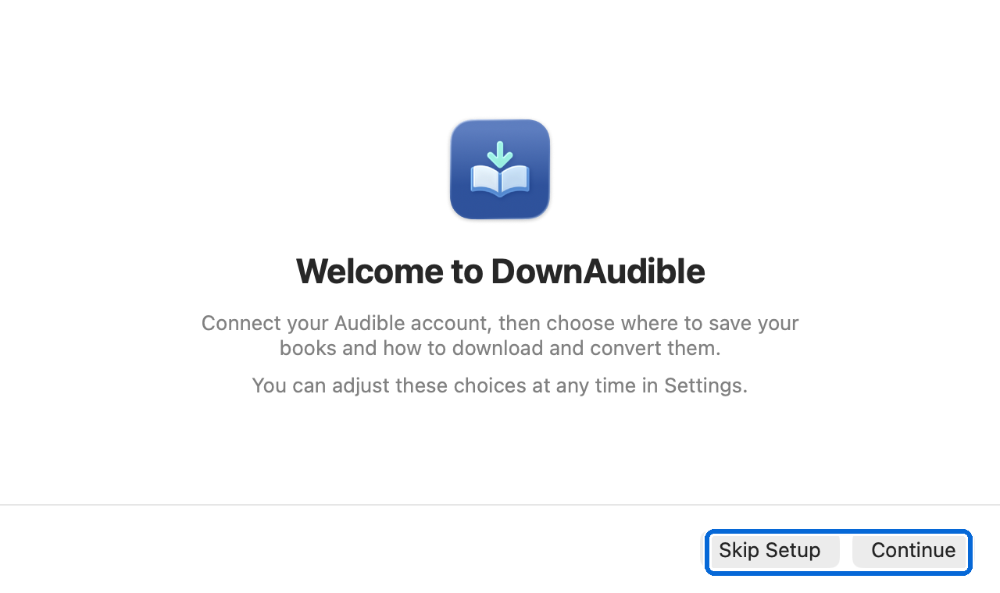

DownAudible opens setup on first launch. Click **Continue** to step through General, Accounts, Library, Downloads, Conversion, Files, Jobs, Notifications, and Audiobookshelf. On the Accounts page, choose **Add Account…**, then choose **Web Browser** or **Enter Credentials** to sign in. Choose **Import Account…** to use a saved profile or authentication file. For local conversion, choose **Continue Without an Account**. For optional Android sign-in, see [Widevine Stereo](help-13-widevine.md).

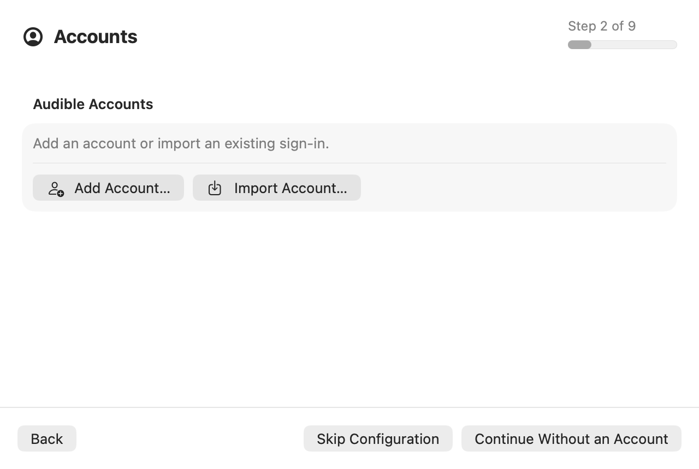

Use **Continue** to move to the next page or **Back** to return to a setting. Setup saves your choices as you edit them. **Skip Setup** on the welcome page and **Skip Configuration** on a settings page take you to the finish with your current settings. At the end, choose **Open DownAudible** to return to the app or **View DownAudible Help** to finish with this guide open.

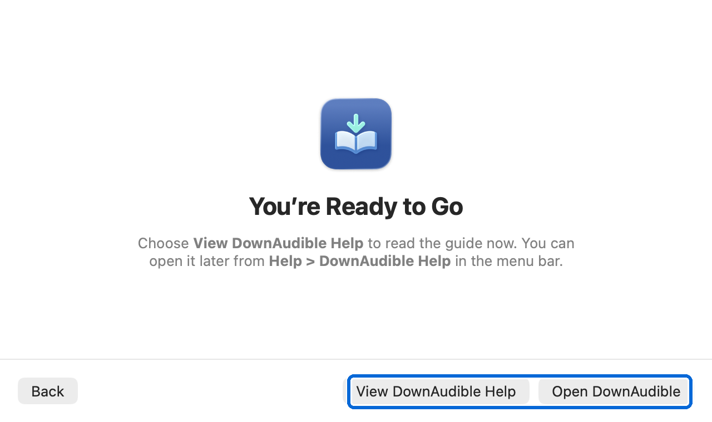

From the menu bar, choose **Help > DownAudible Help** to read this guide any time. The **Help** menu also opens **Widevine Stereo** and **Audiobookshelf** directly. Choose **Help > Set Up DownAudible…** to run setup again with your saved settings.

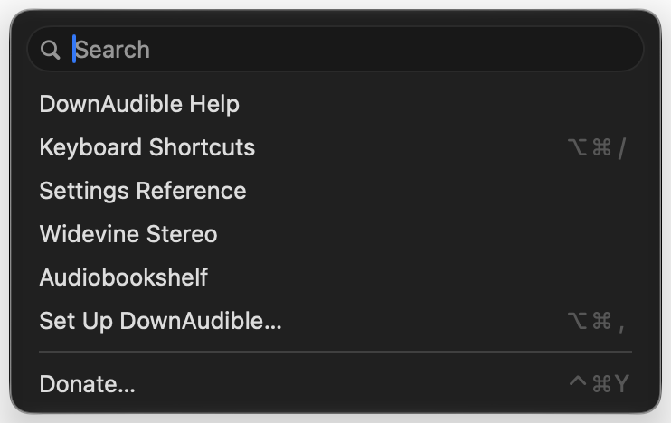

## Software updates

Choose **DownAudible > Check for Updates…** to check GitHub for a new release. The same button is in **Settings > General** and on the General page in setup.

Turn on **Check for updates automatically** in General to let DownAudible check while it’s open. If you haven’t chosen a setting, DownAudible asks the next time you launch it after setup. Turn on **Install updates automatically** to download updates in the background and install them when you quit.

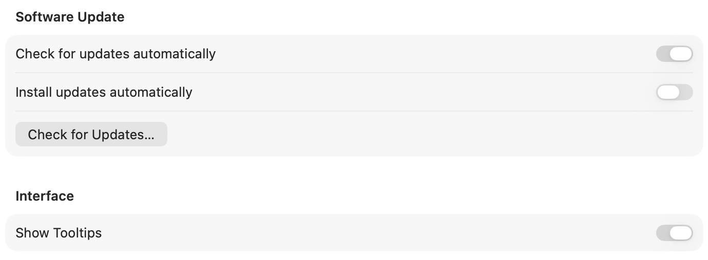

## Your first download

1. Open **Library**. If you need to connect an account, click **Sign In…** and choose the marketplace where you bought your books. You can also choose **Import Account…**.

   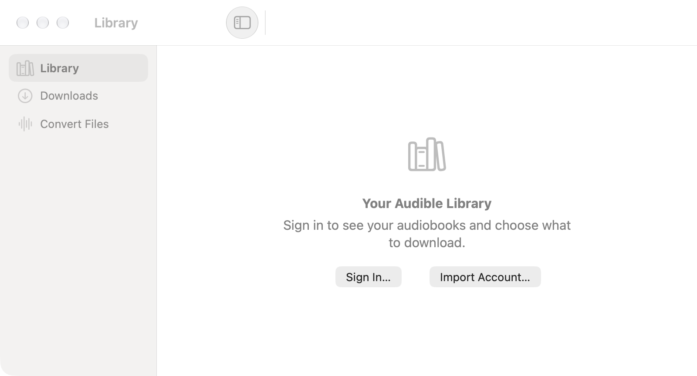

2. Select a book in the table. From the **Download** toolbar menu, choose **Download Selected As…**.

   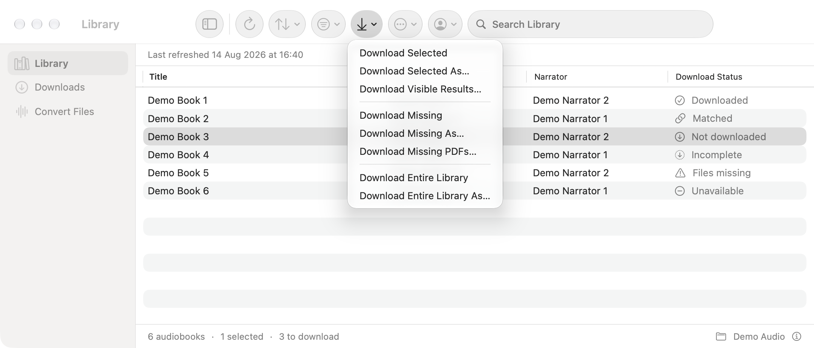

3. Choose a destination folder. Keep **Download audio** on and choose whether to convert it. To save the original and a converted copy, turn on **Keep the original after conversion**.

   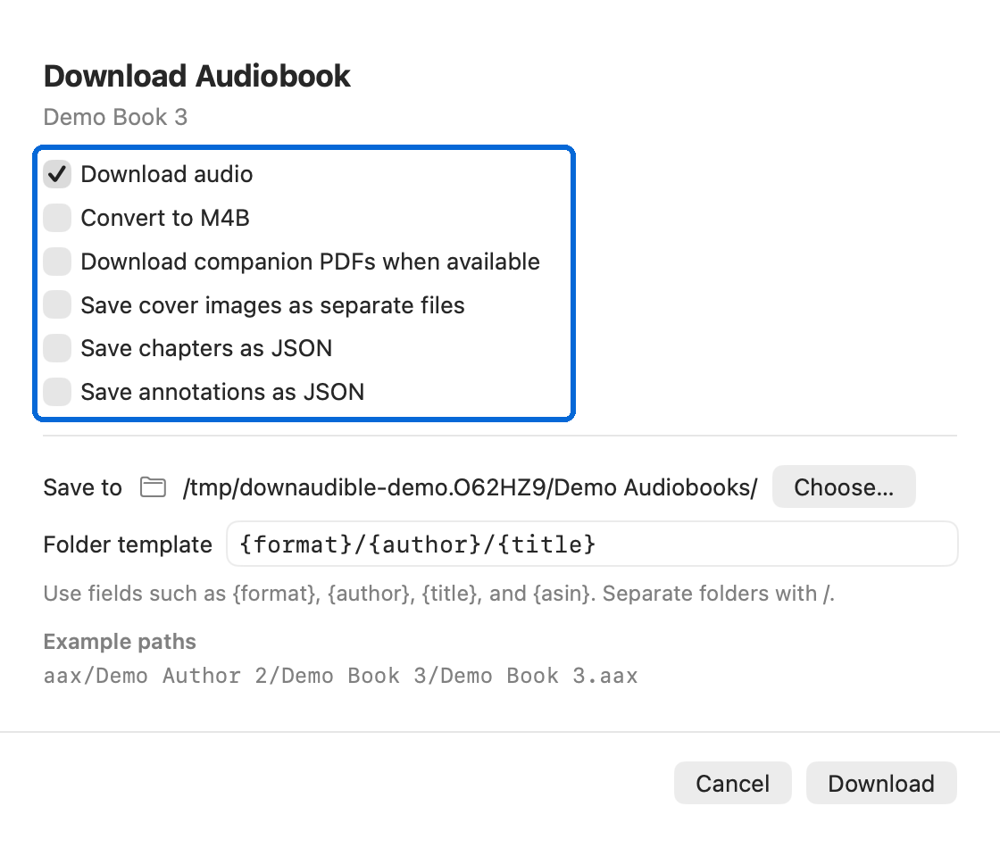

4. Click **Download**. Follow the job in **Downloads**. When it finishes, use **Show Output in Finder** to see the file. Use **Download Selected** for the next book to start with the saved settings.

   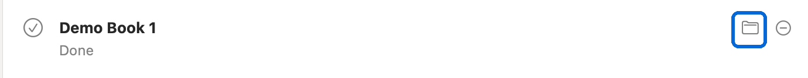

## The sidebar

**Library** shows the current Audible account. **Convert Files** works on files you already have. **Downloads** shows work in progress, results, and errors. The number next to **Downloads** is the number of jobs still running or queued. The **View** menu opens any of these pages even when the sidebar is hidden.

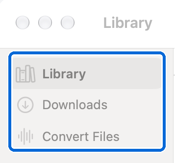

Use **View > Hide Sidebar** or **Show Sidebar** to change the layout. The **View** menu also opens **Library Status** and controls the status bar at the bottom of the library window.

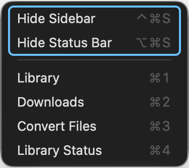

Choose **DownAudible > Settings** to change the app’s defaults.

## Related chapters

[Accounts and Sign-In](help-02-accounts.md)

[Downloading Books](help-04-downloads.md)

[Downloads and Recovery](help-07-transfers.md)

[Credits](help-11-credits.md)

## Keyboard Shortcuts

| Command | Shortcut |
| --- | --- |
| Settings… | Command–Comma |
| Library | Command–1 |
| Downloads | Command–2 |
| Convert Files | Command–3 |
| Download Selected As… | Option–Command–D |
| Set Up DownAudible… | Option–Command–Comma |

[See all keyboard shortcuts](help-10-keyboard-shortcuts.md)

---

## Support DownAudible

If you like DownAudible, a donation is one way to support my work. There’s no pressure or hard sell. DownAudible is and always will be free.

[Make a donation](https://www.paypal.com/donate/?hosted_button_id=WMLX4PLED9PRE)
