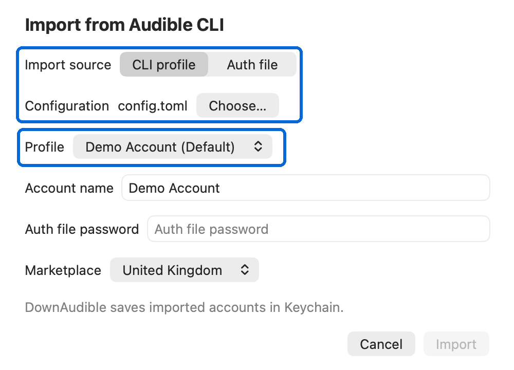
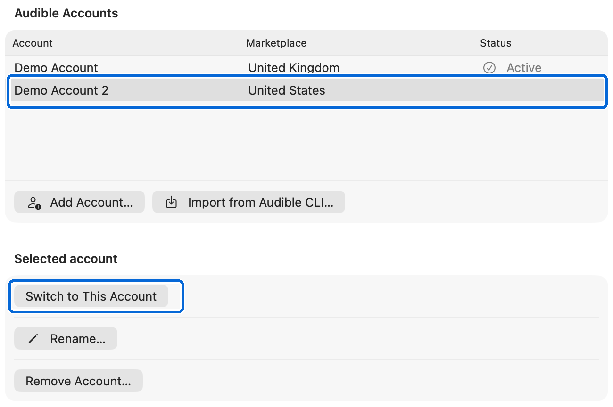
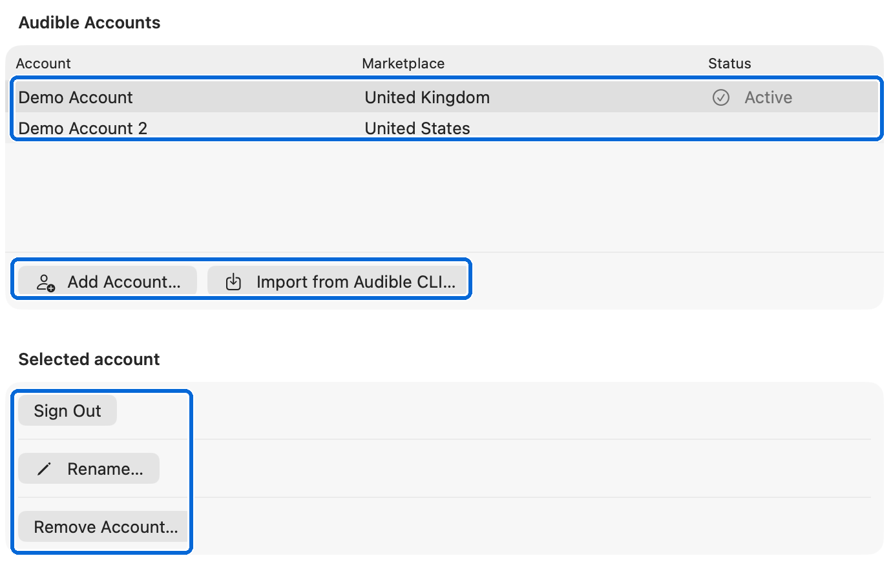

# Accounts and Sign-In

## Choose a sign-in method

On the Accounts page in setup or in **Settings > Accounts**, click **Add Account…**. Choose your Audible marketplace. If you use separate accounts, give this one a name you will recognise in the account menu.

If you use an Audible username, turn on **Sign in with a legacy Audible username**. This option is available for the UK, US, and German marketplaces.

## Sign in with your browser

Choose **Web Browser** in **Sign-in method**, then click **Continue** and **Open Sign-In Page**. Complete the sign-in in your browser, including any verification it asks for.

A blank page or a “Page Not Found” message at the end is expected. Copy the full address of that page from your browser’s address bar, paste it into **Browser address** in DownAudible, then click **Sign In**.

## Enter your credentials in DownAudible

Choose **Enter Credentials** in **Sign-in method**. Enter your Amazon email address or phone number and password, then click **Sign In**. If you turned on legacy username sign-in, enter your Audible username and password.

Follow any verification prompts that appear. If Amazon asks you to approve the sign-in in a notification, approve it before you click **Continue**. If you need another verification method, use **Web Browser**. DownAudible saves the resulting sign-in session in your Mac’s Keychain and discards the password.

## Import from Audible CLI

Click **Import from Audible CLI…** on the Accounts page in setup or in **Settings > Accounts**. Choose **CLI profile** to read profiles from the CLI’s configuration file. DownAudible looks for `config.toml` in the CLI’s configured directory, usually `~/.audible`. Click **Choose…** if your configuration is stored elsewhere.

Choose **Auth file** to open an authentication file directly. Enter its Audible CLI password if it is encrypted. You can give the account a different display name and pick the marketplace if the file needs one. DownAudible saves the imported session in your Mac’s Keychain.

## Switch or remove an account

Use the account menu in the Library toolbar, or select an account in **Settings > Accounts** and click **Switch to This Account**. The library and file matches change with the account. A running batch uses the account it started with.

**Sign Out** clears the saved session, so you can sign in to that profile again later. **Remove Account…** also removes the profile and its file matches. Use **Rename…** to change the name shown in the account menu.

## Related chapters

[Audible Tools](help-08-audible-tools.md)

[Troubleshooting](help-09-troubleshooting.md)

## Keyboard Shortcuts

| Command | Shortcut |
| --- | --- |
| Sign In… / Add Account… in Library | Control–Shift–A |
| Sign In… / Switch to This Account in Settings or setup | Control–Shift–S |
| Import from Audible CLI… | Control–Shift–I |
| Open Sign-In Page | Control–Shift–B |
| Continue or Sign In in the sign-in sheet | Return |
| Sign Out | Control–Shift–Q |

[See all keyboard shortcuts](help-10-keyboard-shortcuts.md)

---

## Support DownAudible

If this app has helped you, a donation is one way to support my work. There’s no pressure or hard sell. DownAudible is and always will be free.

[Make a donation](https://www.paypal.com/donate/?hosted_button_id=WMLX4PLED9PRE)
