# Library and File Matching

## Browse your books

Choose **Sort Library** in the toolbar or **View > Sort Library**. Pick a field and an order. Sort by title, author, narrator, series, purchase date, release year, length, or download status. Books with no value for the chosen field appear last. Click any column header to sort by that column. Click it again to reverse the order. The header and **Sort Library** reflect the same sort, and DownAudible remembers each account’s choice.

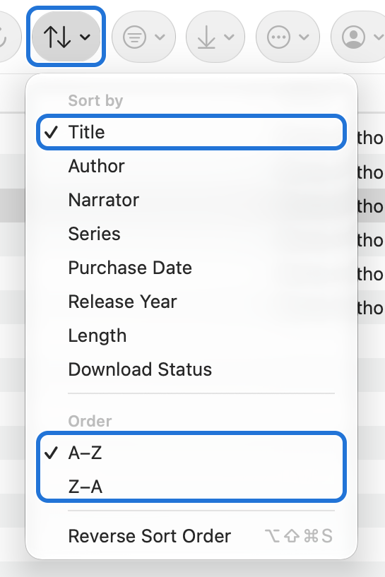

Drag a column header left or right to move that column. DownAudible remembers the column layout across accounts and app launches.

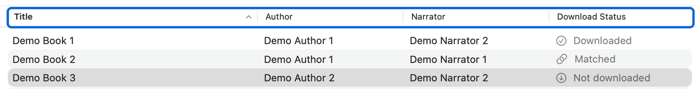

Choose **Filter Library** in the toolbar or **View > Filter Library** to narrow the table by title, author, series, narrator, genre, language, release year, or download status. You can apply several filters together. Choose the same field again to edit it or choose **Remove Filter**. Under **Download Status**, choose **Any Status** to remove that filter. Choose **Clear Filters** to start over. Filters clear when you switch accounts, sign out, or quit DownAudible.

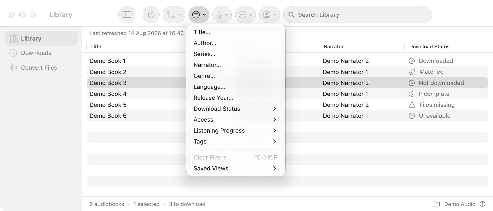

Press Shift–Command–S to open the sort menu or Shift–Command–F to open the filter menu. Use the arrow keys and Return to choose an item. Use Option–Shift–Command–S to reverse the current sort or Option–Shift–Command–F to clear the filters.

When you type a filter, DownAudible suggests values from books that match your search, download status, and other filters. Click a suggestion or use the Up and Down Arrow keys and press Return. You can also enter your own value. To hide suggestions, turn off **Suggest filter values as you type** in **Settings > Library**.

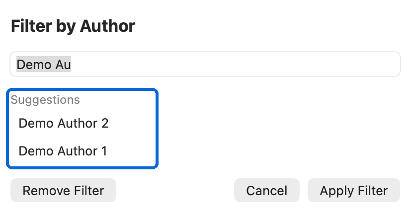

Use **Filter Library > Access** to find Audible Plus titles, titles Audible identifies as available indefinitely, other titles, or titles with unknown access. **Listening Progress** uses the information Audible supplies to filter by **Not Started**, **In Progress**, **Finished**, or **Unknown**.

To return to the same list later, choose **View > Saved Views > Save Current View…**. Enter a name to keep the search, filters, and sort for this account. Choose its name from **Saved Views** to reopen it. **Manage Saved Views…** lets you rename or remove entries.

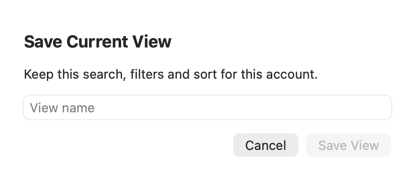

Control-click one or more books and choose **Tags…**. Enter comma-separated names and choose **Add Tags** or **Remove Tags**. Tags belong to the current DownAudible account and apply to the selected books. Choose **Filter Library > Tags** to show books that have a particular tag.

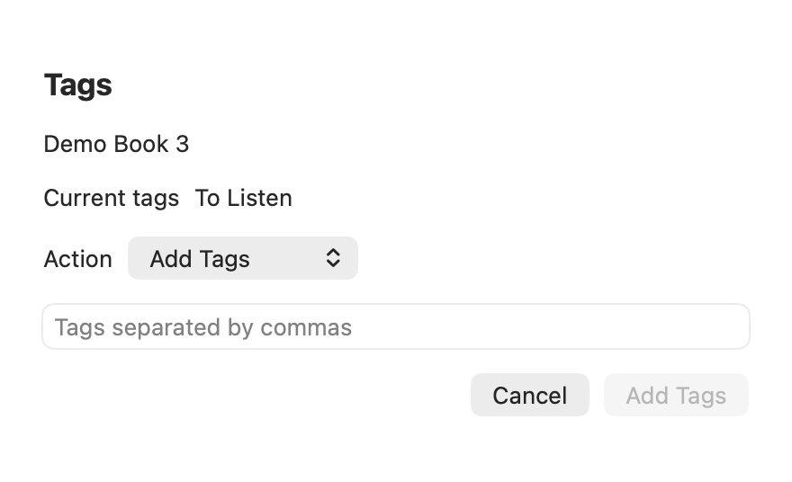

Press Command–F to search by title, author, narrator, series, or ASIN. Search works within your active filters. Click one book, then Command-click to add individual books to the selection. Shift-click selects a range.

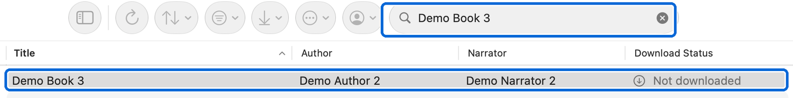

Use **Audiobooks > Library > Refresh Library** to fetch changes. If the library can’t load, read the error in the library and choose **Retry**. In **Settings > Library**, choose whether to show podcast series or individual episodes, set a purchase date range, and set **Library titles per request**. DownAudible loads all matching titles in batches. Refresh after changing these options. [Library settings](help-12-settings.md#library)

**Last refreshed** shows when DownAudible last loaded the library. The last-saved list remains available if a refresh fails while your profile is connected. Open **Library Actions > Library Changes…** to see titles that were added, removed, or updated since the previous successful refresh with the same library settings.

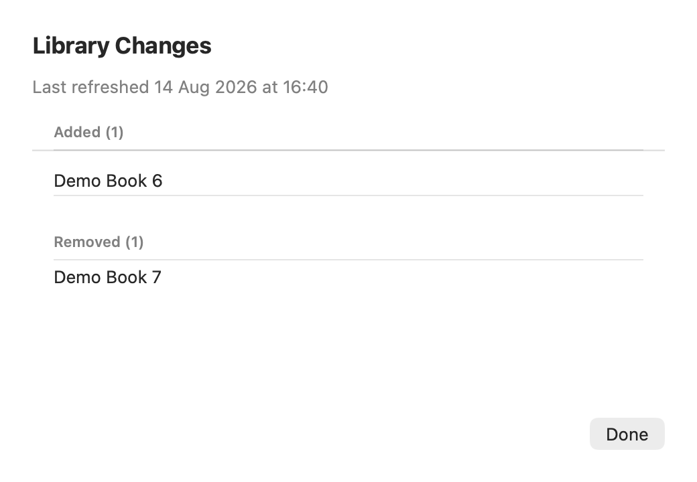

Choose **All Accounts…** from the Audible Accounts menu to search the saved libraries together. Each row shows its account and marketplace. Select a result and choose **Open Account** before working with its files or starting a download. Use **Refresh All Accounts** to fetch changes across signed-in profiles, or turn on **Refresh libraries automatically** in **Settings > Library** to check every 30 minutes when DownAudible is open and transfers are idle.

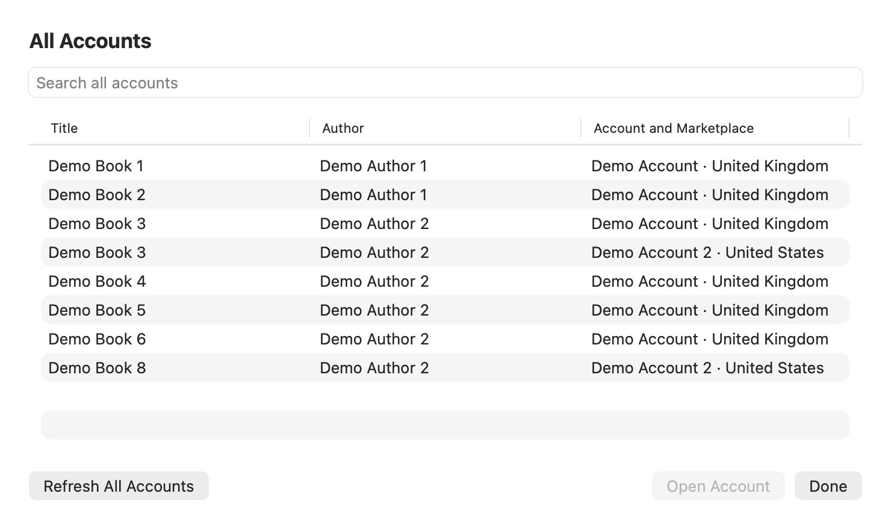

**Audiobooks > Library > Export Library** saves the loaded library as JSON, CSV, TSV, or an Excel workbook (`.xlsx`). Choose **Export Visible Results** there or in the **Library Actions** toolbar menu to export the books shown by your search and filters in their current order.

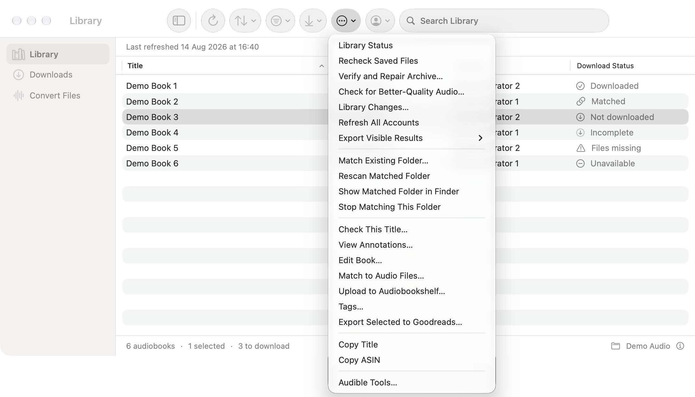

## Export to Goodreads

Choose **Export Visible Results > Goodreads CSV…** from **Library Actions** or **Audiobooks > Library** to use the current search and filters. To export just a selection, Control-click it and choose **Export Selected to Goodreads…**. Review the list, then click **Export CSV…**. The preview marks duplicate editions and titles without a valid identifier as skipped.

The CSV uses the book’s ISBN when available or its Audible ASIN. DownAudible uses listening progress to choose the shelf when Audible provides it and leaves the read date blank. Sign in to Goodreads and upload the file from [Import and Export Library](https://www.goodreads.com/review/import). Review any editions Goodreads could not match after import.

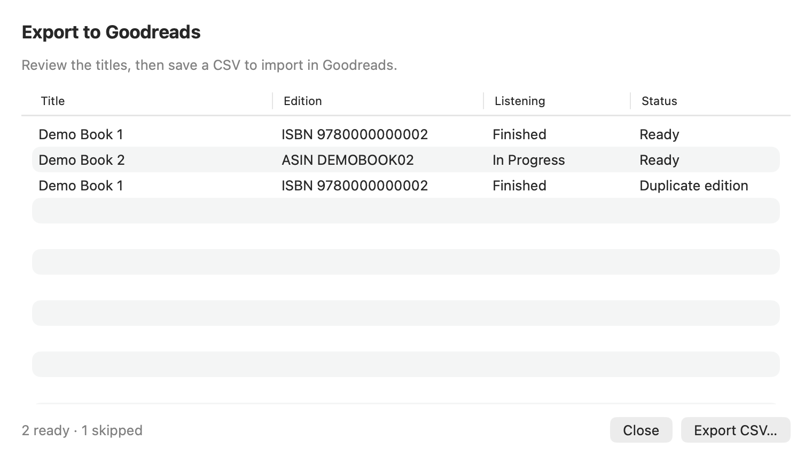

## Check library status

The status bar at the bottom of the Library shows the number of books, how many are selected, and how many are eligible for **Download Missing**. When you search or filter, the first count shows the number of visible books out of the library total. Use **View > Hide Status Bar** or **Show Status Bar** to control it.

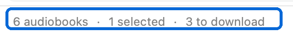

Choose **View > Library Status**, or click the info button in the status bar, to see a breakdown for the active account. Select **To Download**, **Downloaded**, **Matched**, or **Unavailable** to see the titles in that group. The table shows each book’s local audio status and whether Audible offers it for download. Queued and running audio transfers are shown while a batch is active.

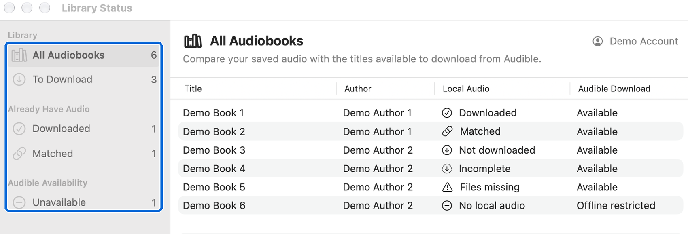

The count covers the loaded library, including any filters from **Settings > Library**. View Wish List entries separately in **Audiobooks > Audible Tools… > Wish List**.

## Match files you already have

Choose **Match Existing Folder…** from the **Library Actions** toolbar menu and select the folder that holds your audio. The scan includes subfolders, so you can select the root of a DownAudible archive organised as `{format}/{author}/{title}` or a folder from another app. It checks AAX, AAXC, AA, M4B, M4A, and MP3 files.

DownAudible compares Audible identifiers, tags, filenames, and title and author folders. It also checks the book’s length when available. Control-click a book and choose **Match to Audio Files…** when the match is ambiguous or the book is split into parts or chapters. For a split book, select its files together.

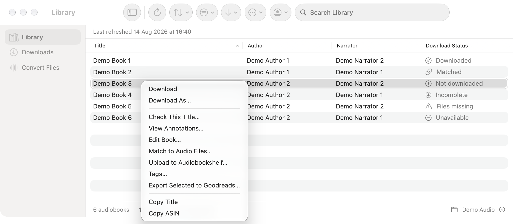

Use **Rescan Matched Folder** after putting more books in the folder. **Show Matched Folder in Finder** opens it. **Stop Matching This Folder** clears the automatic links to that folder. To change a single book, use **Change Matched Files…** or **Remove File Match** in its contextual menu.

## Edit a book

Control-click one book and choose **Edit Book…** to preview its audio and choose which parts or chapters to include in a separate M4B. If the book needs an original download, click **Download Original** in the editor. [Editing a book before conversion](help-05-conversion.md#edit-a-book-before-conversion)

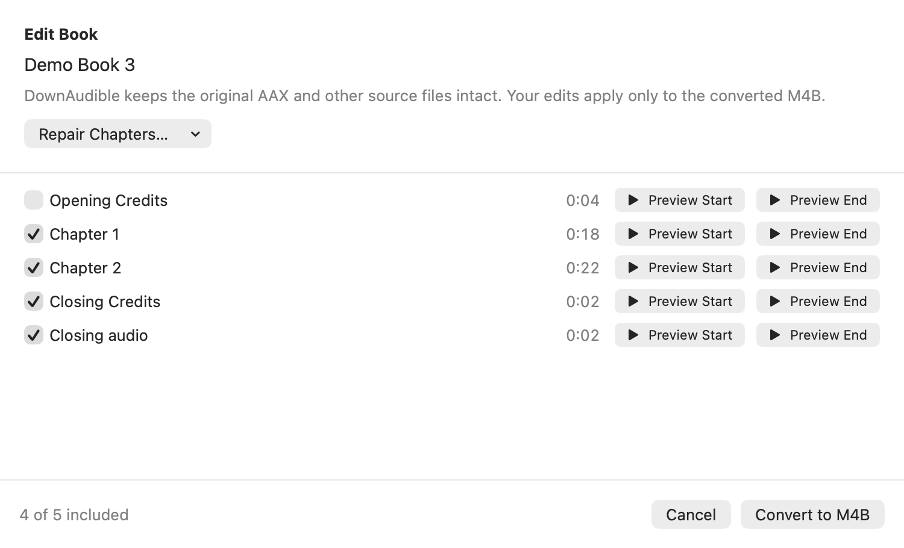

## Downloads and missing files

The **Download Status** column shows six states. **Downloaded** means at least one complete audio copy is in the archive. **Matched** means DownAudible can read the source you linked. **Incomplete** means part of the transfer is saved. **Files missing** means a recorded copy went away. **Not downloaded** means the book has yet to be saved. **Unavailable** means Audible is withholding the download.

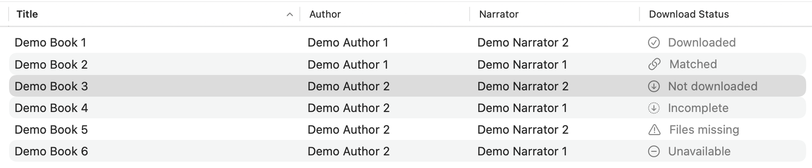

After moving or deleting a file, choose **Audiobooks > Library > Recheck Saved Files** to refresh the status straight away. A warning beside a downloaded book can mean there is a missing companion file or another saved audio copy. To find out which files are missing, hover over the warning or navigate to the **Download Status** cell with VoiceOver. Use **Download Selected As…** with the corresponding option to get that file back.

Choose **Verify and Repair Archive…** from **Audiobooks > Library** for a deeper check of saved books. See [Naming and Folders](help-06-files.md) for how to check and repair the archive.

**Download Missing** queues eligible books whose audio is missing, incomplete, or unsaved. **Download Entire Library** queues all titles in the loaded library. Both commands cover the whole loaded library while you search or filter the table. **Download Visible Results…** queues just the visible books. Choose **Download Selected** to queue just the selected titles. Review the number of books and confirm before starting a bulk download. Use a **Download As…** command to review what to save as well as the number of titles.

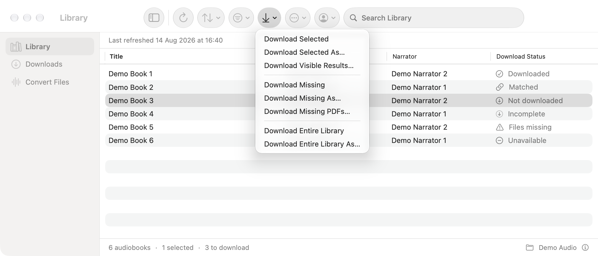

While a download batch is running for the active account, use **Add Selected to Queue…** or **Add Visible Results to Queue…** in the **Download** menu. DownAudible shows the number of books it can add and uses the running batch’s destination and options. When a transfer repeatedly fails partway, Control-click its book and choose **Restart Incomplete Downloads…**.

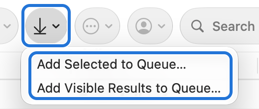

Use **Show Audio in Finder** to locate a selected book’s files. **Add to Apple Books** lets you send original files, M4Bs, or other supported audio already on disk. **Copy Title** and **Copy ASIN** put book details on the clipboard.

## Related chapters

[Downloading Books](help-04-downloads.md)

[Downloads and Recovery](help-07-transfers.md)

[Audible Tools](help-08-audible-tools.md)

[Audiobookshelf](help-14-audiobookshelf.md)

## Keyboard Shortcuts

| Command | Shortcut |
| --- | --- |
| Refresh Library | Command–R |
| Recheck Saved Files | Shift–Command–R |
| Find in Library | Command–F |
| Library Status | Command–4 |
| Match Existing Folder… | Control–Shift–F |
| Match to Audio Files… / Change Matched Files… | Control–Shift–M |

[See all keyboard shortcuts](help-10-keyboard-shortcuts.md)

---

## Support DownAudible

If you like DownAudible, a donation is one way to support my work. There’s no pressure or hard sell. DownAudible is and always will be free.

[Make a donation](https://www.paypal.com/donate/?hosted_button_id=WMLX4PLED9PRE)
