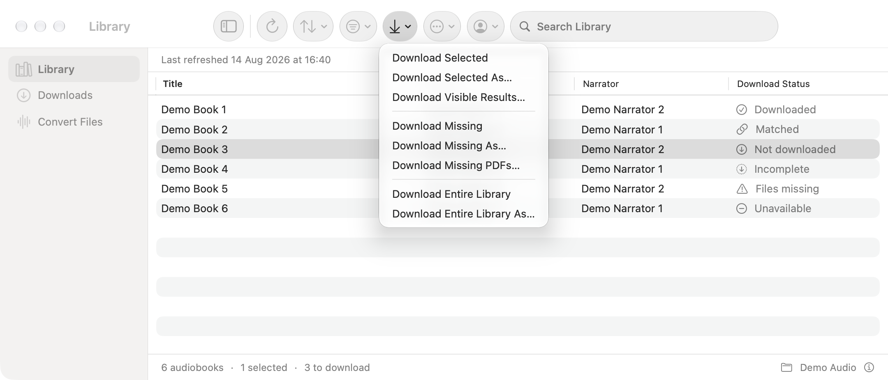
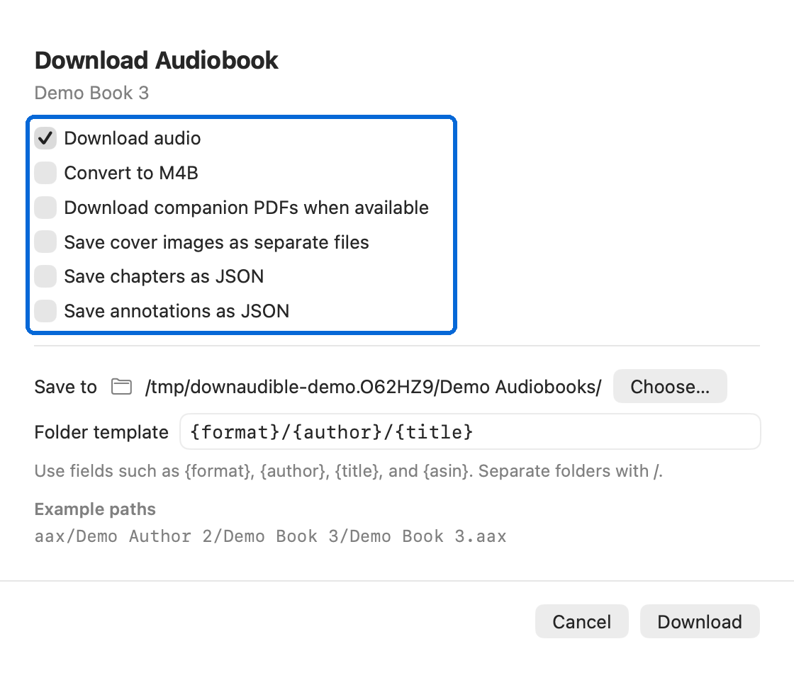
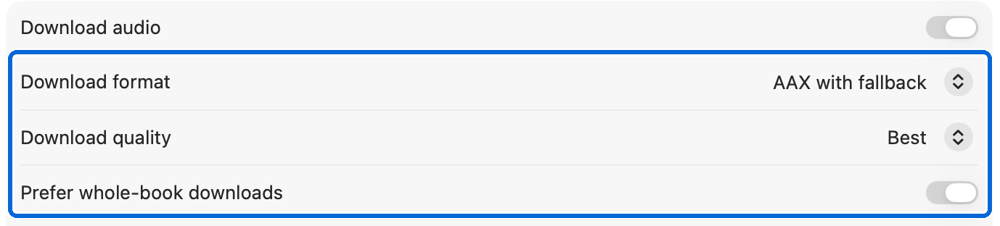
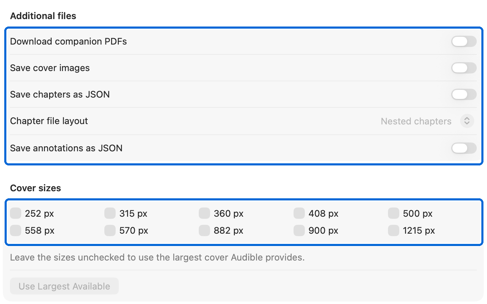
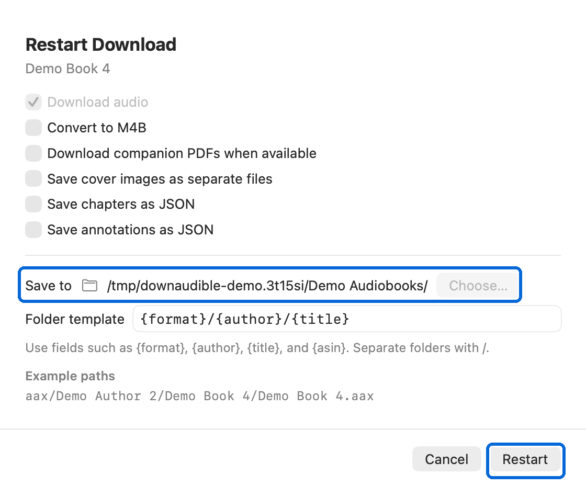

# Downloading Books

## Choose what to save

Use **Download Selected**, **Download Missing**, or **Download Entire Library** from the toolbar’s **Download** menu or **Audiobooks > Download** to start with the saved options. Control-click a book and choose **Download** to do the same for that book.

Choose **Download Selected As…**, **Download Missing As…**, or **Download Entire Library As…** to review what to save, choose a destination, and see example paths before starting. The contextual menu offers **Download As…** for the books you choose there.

Choose **Download Missing PDFs…** to check the loaded library for unsaved companion PDFs in the current archive. Review the number of missing PDFs and choose **Download PDFs**. This works for books with audio you’ve already saved and keeps those audio files in place.

**Download audio** saves the audiobook. Leave it unchecked if you only want companion material. **Download companion PDFs when available** adds the PDFs Audible supplies for those books. **Save cover images as separate files** saves artwork beside the audio or other extras.

**Save chapters as JSON** keeps Audible’s chapter list in its own file. **Save annotations as JSON** saves the bookmarks, notes, and other annotations Audible makes available. Chapter JSON is separate from the chapters embedded in converted audio.

To save only converted audio from a new download, turn off **Keep the original after conversion**. To move a previously saved AAX file to Trash after a new MP3 conversion, also turn on **Move converted AAX files to Trash** in **Settings > Conversion**.

## Choose a format, quality and download layout

**Settings > Downloads** controls the source format and quality. **AAX with fallback** tries AAX, then AAXC if needed. When conversion is on, it also requests AAXC if DownAudible can’t unlock the AAX after trying to refresh the activation bytes. **AAX only** requires an AAX download and needs the account’s activation bytes for conversion. **AAXC** requests AAXC directly and keeps the format Audible supplies. **Settings > Conversion** controls the exported file format.

If you enable Widevine for the account, **AAX with fallback** requests Widevine stereo before trying the usual formats. See [Widevine Stereo](help-13-widevine.md) for when to use it and how to enable it.

**Prefer whole-book downloads** is on by default. DownAudible tries to download one file for the title before requesting individual parts, using the formats allowed by **Download format**. Turn the setting off to request individual files for titles Audible lists as multipart. DownAudible can keep those parts and combine them during conversion. Where available, cover and annotation files can also be downloaded separately.

## Set defaults for later

Under **Settings > Downloads**, choose what to save, which cover sizes to request, and whether chapter JSON uses a nested or flat list. Leave all cover sizes unchecked to use the largest image Audible provides. Starting a download from an **As…** sheet also saves your choices for later.

**Download Missing** includes audio even if your saved options only include companion material. Set your default destination and folder template under **Settings > Files**.

To start a partial download from the beginning, Control-click the book and choose **Restart Incomplete Downloads…**. The restart keeps audio selected and uses the destination that holds the partial download.

## Related chapters

[Converting Audio](help-05-conversion.md)

[Naming and Folders](help-06-files.md)

[Downloads and Recovery](help-07-transfers.md)

## Keyboard Shortcuts

| Command | Shortcut |
| --- | --- |
| Download Selected | Command–D |
| Download Selected As… | Option–Command–D |
| Download Missing | Shift–Command–D |
| Download Missing As… | Option–Shift–Command–D |
| Download Entire Library | Shift–Command–L |
| Download Entire Library As… | Option–Shift–Command–L |
| Download or Restart from the sheet | Return |

[See all keyboard shortcuts](help-10-keyboard-shortcuts.md)

---

## Support DownAudible

If you like DownAudible, a donation is one way to support my work. There’s no pressure or hard sell. DownAudible is and always will be free.

[Make a donation](https://www.paypal.com/donate/?hosted_button_id=WMLX4PLED9PRE)
