# Converting Audio

## Convert a download

Turn on conversion in the download sheet. **Keep the original after conversion** keeps the Audible files alongside the converted output. Turn it off if you only want the converted copy. If a chapter or tag is missing from the source, DownAudible uses the information Audible supplies when available.

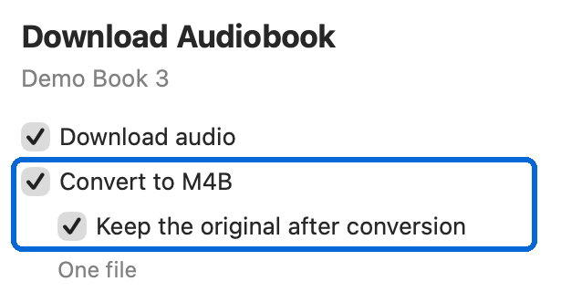

If DownAudible can’t unlock an AAX download, it tries to refresh the activation bytes for the account used for the download. With **AAX with fallback**, it requests AAXC for conversion if it still can’t unlock the AAX. Any AAX originals already saved are kept.

## Convert files already on your Mac

Open **Convert Files**, then click **Add Files…** or **Add Folder…**. DownAudible reads AAX, AAXC, AA, MP3, M4A, and M4B. You can also choose **Open Audio Files…** or **Open Audio Folder…** from the **File** menu, or drag files in from Finder. If a selection includes unsupported items, supported audio still appears in the list. Choose the destination and format at the bottom of Convert Files.

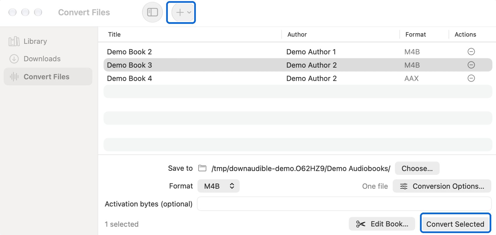

Choose **Audiobooks > Conversion Options…** to open Convert Files and change chapter and audio settings. From Convert Files, you can also click **Conversion Options…** or press Control–Shift–O.

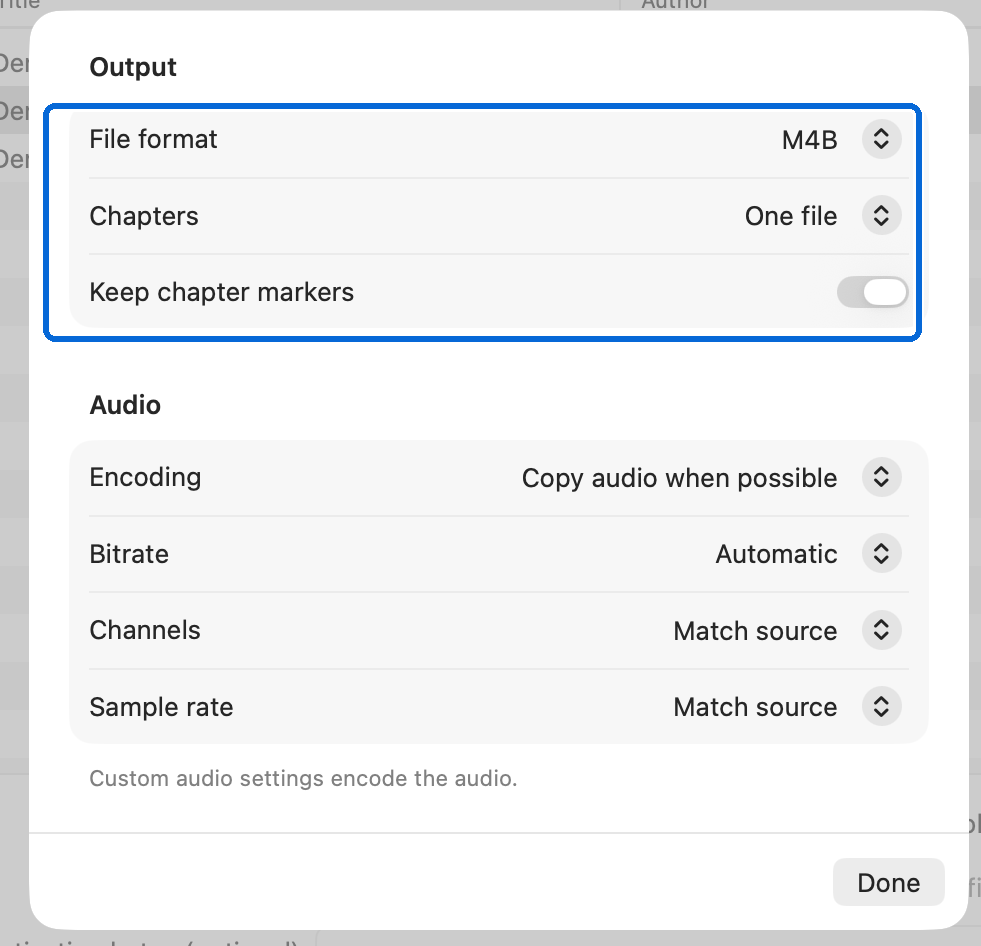

Select rows and click **Convert Selected**. With nothing selected, **Convert All** starts the whole list. With Convert Files open, the **Audiobooks** menu includes actions for the file list. Control-click a row for **Convert**, **Show in Finder**, **Add to Apple Books**, or **Copy Path**.

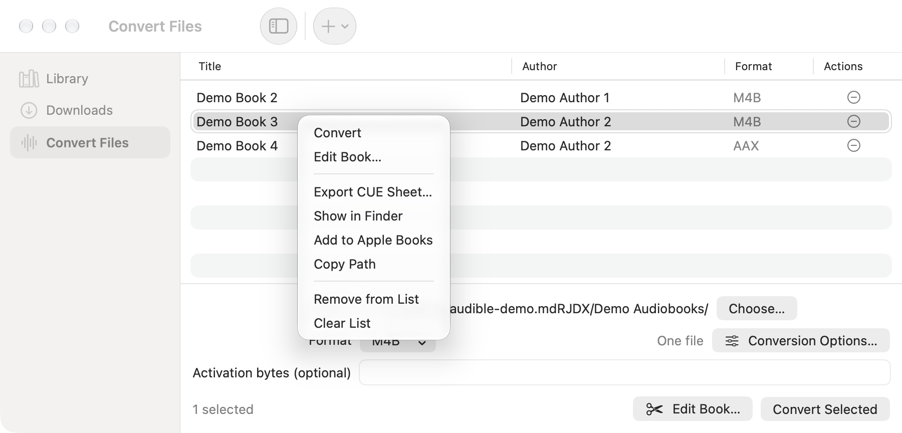

Click a row’s **Remove from List** button to remove that file. To remove one or more selected files, press Backspace or Forward Delete while the list has keyboard focus. Choose **Clear List** to empty the list. The source files stay on disk.

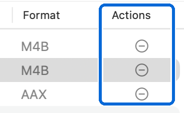

Encrypted AAX files need the eight hexadecimal characters from the account that downloaded them. Leave **Activation bytes (optional)** blank to use the active account and let DownAudible refresh its code if needed. For a file from another account, enter the original account’s code in that field. To fix an activation error, correct the code and retry the transfer.

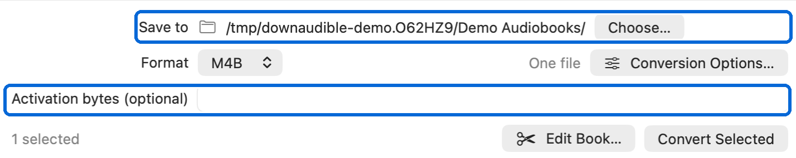

AAXC files need their saved licence or a compatible `.voucher` beside the book. Keep multipart audio and companion files together when moving them.

## Edit a book before conversion

In the Library, Control-click one book and choose **Edit Book…**. If the editor needs to fetch the audio, click **Download Original**. To work with files already on your Mac, select one file or several parts of the same book in **Convert Files**, then click **Edit Book…**. DownAudible orders selected parts by filename.

For matched or previously converted files, the editor uses the chapter markers in the audio. A file without chapter markers appears as one section.

Click **Preview Start** or **Preview End** to hear up to 10 seconds from either end of a part or chapter. Clear the checkbox beside each part or chapter you want to leave out. If a spoken announcement has its own section, you can leave it out the same way. Keep at least one section selected, then click **Convert to M4B** to save a separate copy. When you exclude audio, DownAudible adds ` - Edited` to the filename. The source files stay in place.

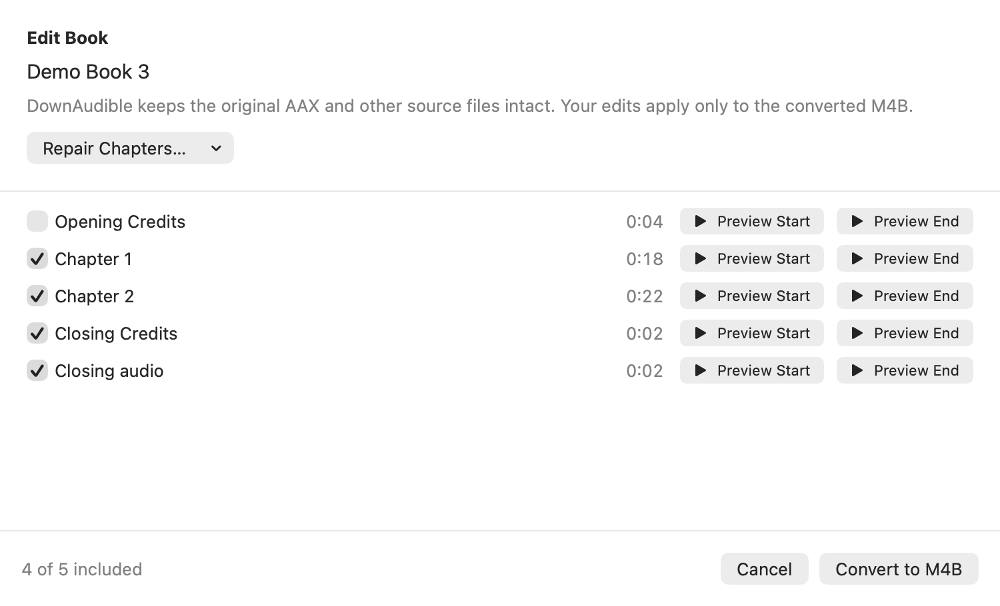

The editor saves one M4B and uses your audio and book details options from **Settings > Conversion**.

## Repair chapter markers

Open **Edit Book…** with the complete audio for one edition. Choose **Repair Chapters… > Get Chapters from Audible** when the editor has an Audible title and you’re signed in. To work offline with a chapter file saved by DownAudible or Audible CLI, choose **Repair Chapters… > Choose Chapter JSON…**. Choose chapter data for the edition you’re editing. DownAudible checks the runtime and any available Audible title identifiers before applying it.

When the chapter data gives timings for Audible’s spoken intro or outro, turn on **Separate Audible Intro and Outro** to give each available announcement its own chapter. Use **Preview Start** or **Preview End** to check the new markers. Loading a different chapter map or changing the intro and outro option checks all sections again. To go back to the audio’s original chapters, choose **Repair Chapters… > Use Existing Chapters**.

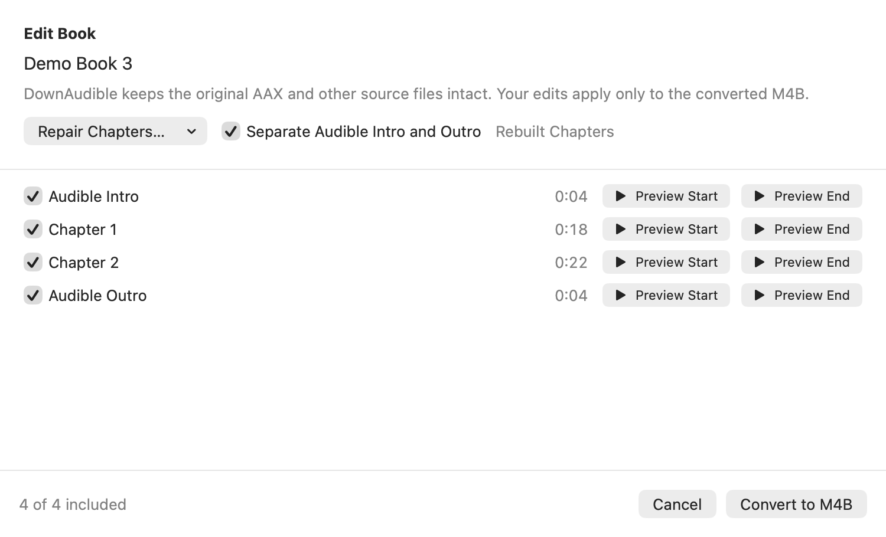

Choose **Convert to M4B** to save a separate copy with the rebuilt chapter markers. With every section checked, DownAudible keeps the complete audio and adds ` - Chapters Repaired` to the filename. Uncheck a section only when you want to omit its audio.

## Move converted AAX files to Trash

In **Settings > Conversion**, choose **MP3**, then turn on **Move converted AAX files to Trash**. DownAudible moves an AAX source queued in **Convert Files** to the Mac’s Trash after all MP3 output for that file has been saved. You can restore the original from Trash in Finder.

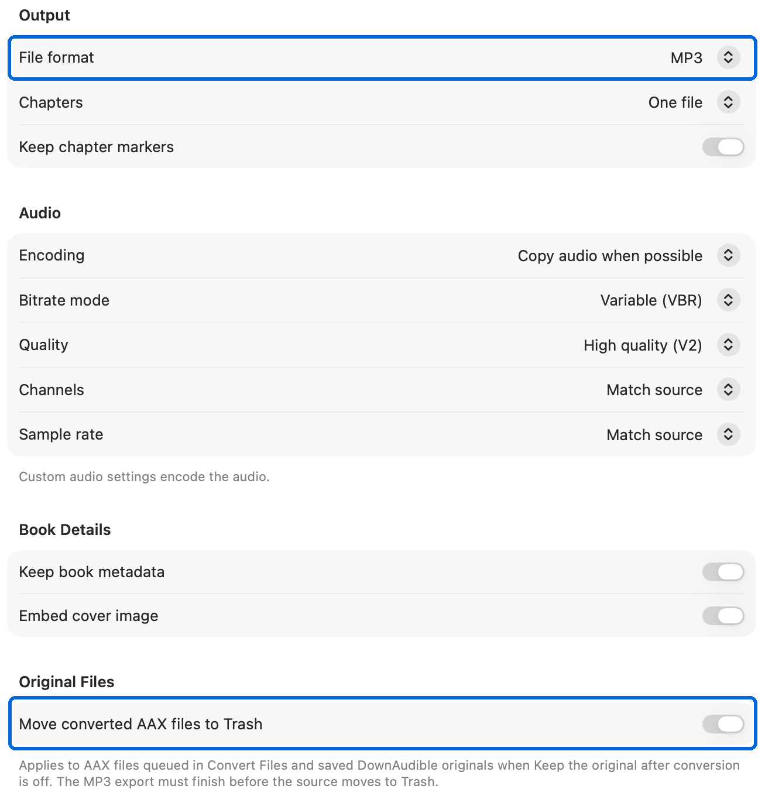

For a Library job, turn off **Keep the original after conversion** to clean up an AAX original that DownAudible previously saved in your archive. A file matched from another location stays there. Queue it from **Convert Files** if you want to move it to Trash after conversion.

Cleanup requires a new, successful conversion. A new job that reuses existing MP3 output keeps the source in place. If moving an AAX file to Trash fails, use **Retry** in **Downloads** to try the move again using the saved MP3 output.

## Format and chapters

In **Settings > Conversion**, choose **M4B**, **M4A**, or **MP3**. An M4B is the usual choice for an audiobook with chapters in one file. Under **Chapters**, choose **One file** to save a book as one file or **Separate chapter files** to write a file for each chapter.

When you convert a download from the Library with **One file** selected, DownAudible joins any parts Audible supplies. If those parts contain spoken continuation announcements, you’ll still hear them in the converted audio.

For a single file, **Copy audio when possible** preserves a compatible audio stream. **Always encode** writes a new stream. Choosing a bitrate, channel count, or sample rate can also require encoding.

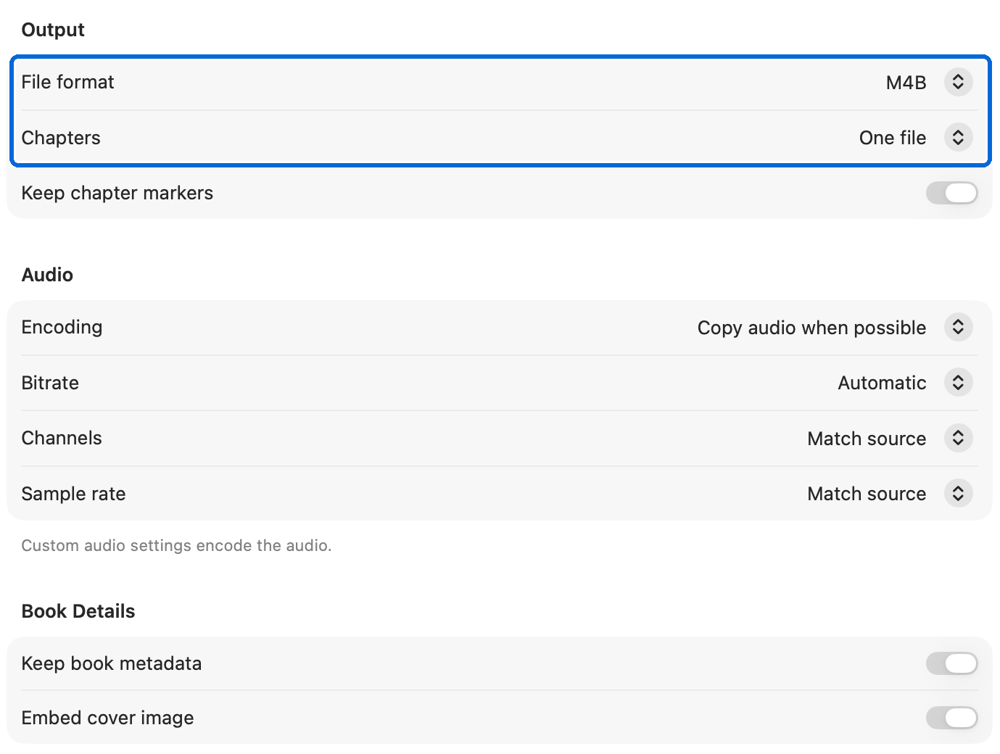

For separate M4B or M4A files, turn on **Copy chapter audio when possible** to keep compatible AAC audio without encoding. Leave bitrate, channels, and sample rate at their defaults. DownAudible encodes MP3, incompatible sources, and chapters spanning two source files. Some players may play extra audio at the edge of a copied chapter. Turn off the option if your player has trouble with the chapter cuts.

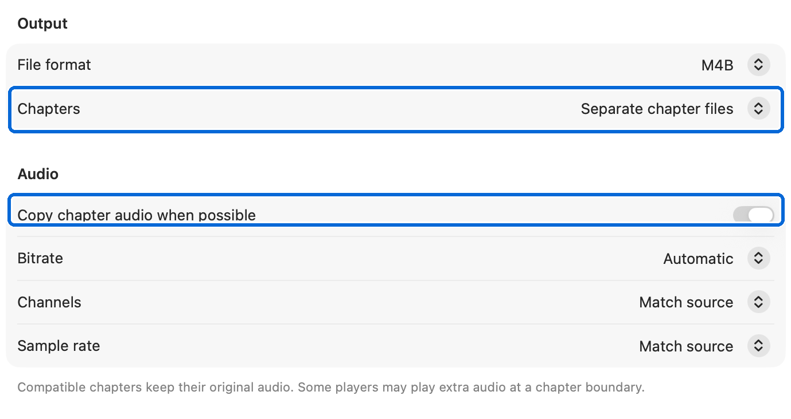

For MP3, **Constant (CBR)** keeps one bitrate throughout the file. **Variable (VBR)** adjusts the bitrate as the audio changes, using the selected quality level. For a single file, turn on **Keep chapter markers** to retain navigation. **Keep book metadata** and **Embed cover image** control the book tags and cover in the output.

With **Separate chapter files** and **Keep book metadata** selected, DownAudible writes the track number and a title such as `Chapter 3 - The Garden`. A heading that already begins with a chapter number keeps its wording. An unnamed chapter uses a title such as `Chapter 3`.

## Choose settings for a player

For Apple Books, use one M4B and keep chapter markers on. For a player that sorts MP3 files by filename, choose MP3 and **Separate chapter files**. Put `{chapterNumber}` before `{chapter}` in the chapter filename template to sort the tracks in order.

If a player requires mono or a particular sample rate, set **Channels** and **Sample rate** before starting. At low MP3 sample rates, some high bitrates are unavailable. Use a lower bitrate or a higher sample rate if Settings flags the combination.

## Related chapters

[Downloading Books](help-04-downloads.md)

[Naming and Folders](help-06-files.md)

[Audible Tools](help-08-audible-tools.md)

## Export a CUE sheet

In **Convert Files**, select one saved M4B, M4A, or MP3 with embedded chapter markers and choose **Export CUE Sheet…** from its context menu. This command also appears in **Library** when you select one title with a single saved playable file. DownAudible saves a `.cue` file beside the audio file using the chapter start positions in that file. Keep the two files together and use a player that supports CUE sheets and your audio format. Each sheet can hold up to 99 chapter indexes.

## Keyboard Shortcuts

| Command | Shortcut |
| --- | --- |
| Convert Files | Command–3 |
| Add Files… | Command–O |
| Add Folder… | Shift–Command–O |
| Choose a destination folder | Control–Shift–Y |
| Conversion Options… | Control–Shift–O |
| Convert All / Convert Selected | Control–Shift–V |
| Show in Finder | Control–Shift–S |
| Add to Apple Books | Control–Shift–B |
| Remove from List | Control–Shift–Delete |
| Remove selected files when the list has focus | Backspace or Forward Delete |

[See all keyboard shortcuts](help-10-keyboard-shortcuts.md)

---

## Support DownAudible

If you like DownAudible, a donation is one way to support my work. There’s no pressure or hard sell. DownAudible is and always will be free.

[Make a donation](https://www.paypal.com/donate/?hosted_button_id=WMLX4PLED9PRE)
