# Downloads and Recovery

## Follow a batch

Open **Downloads** to follow downloads and conversions. Each row shows whether the job is waiting, running, finished, or failed. A finished item can show a warning if a companion file or the Apple Books step failed. Click its folder button or choose **Show Output in Finder** from its contextual menu to see saved files. An error row explains what the app could not finish.

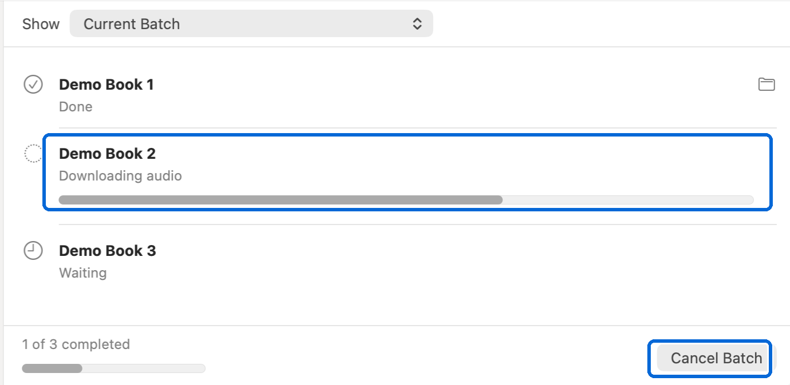

**Cancel Batch** stops the current work. **Retry Incomplete** queues the unfinished items again. In the toolbar’s **Download Actions** menu, **Restart Incomplete Downloads…** discards saved partial audio and downloads those titles from the start. **Clear Completed** removes jobs that finished without warnings. The menu stays available when the list is empty, with unavailable actions dimmed.

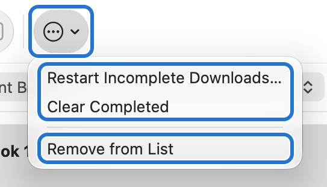

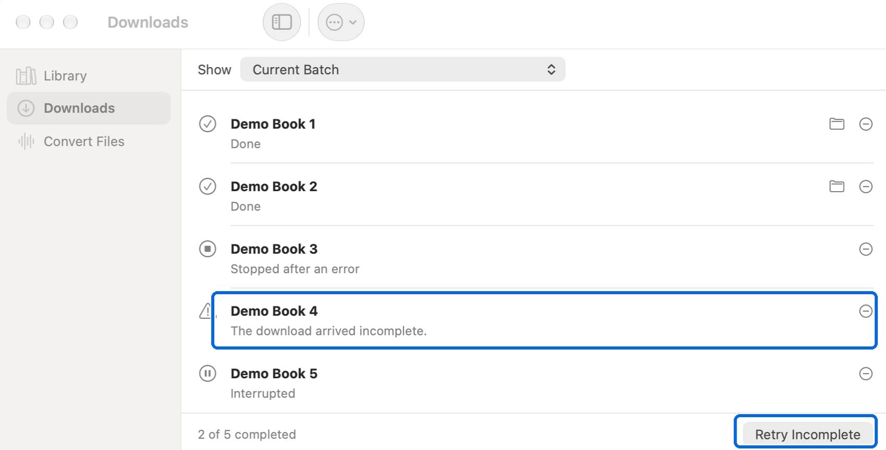

Control-click a row to see its available actions and shortcuts. From the menu, you can cancel, retry, or restart that transfer, show its partial files, copy its error, or open its saved audio with **Add to Apple Books**.

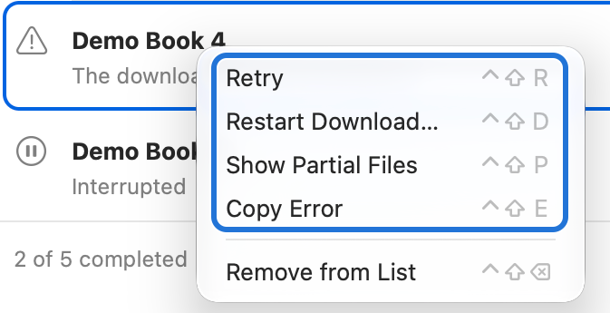

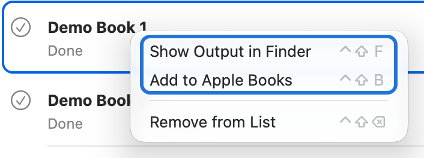

If a finished item warns that Books couldn’t open its files, use **Retry Incomplete** to try the Books step again with the saved audio.

## Remove jobs from the list

When no batch is running, click a row’s **Remove from List** button to remove that job. To remove one or more selected jobs, choose **Download Actions > Remove from List** or press Backspace or Forward Delete while the list has keyboard focus. Files already saved stay on disk.

## Add books to the current batch

While downloads are running, select more titles from the same account in **Library**. Use **Add Selected to Queue…** from the **Download** toolbar menu or **Audiobooks > Download**. Use **Add Visible Results to Queue…** to add the books shown by your search and filters. Review the count before adding them. The added jobs use the current batch’s destination and options. Each title can appear once in a batch.

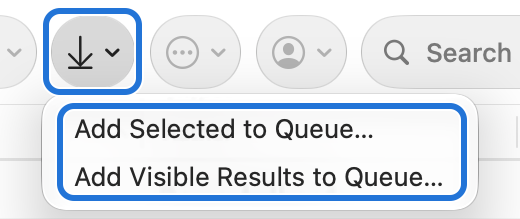

## Find an earlier batch

In **Downloads**, use **Show** to switch between **Current Batch** and **Recent Batches**. DownAudible keeps up to ten earlier batches. Select a job to reveal its saved files or copy an error. When the current batch finishes, the retry commands can resume an earlier batch with its saved settings.

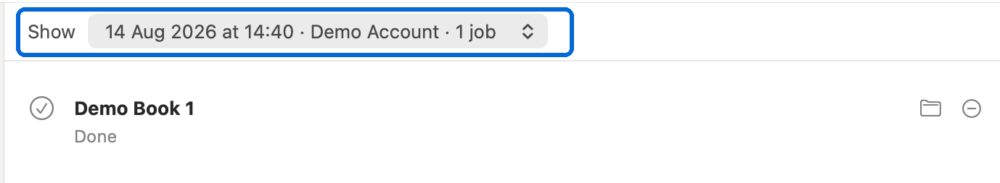

## Resume after quitting

DownAudible asks what to do if you quit while a batch is running. Choose **Keep DownAudible Open** to let it finish. Choose **Quit and Save Progress** to keep your place, then use **Retry Incomplete** in **Downloads** after reopening the app. DownAudible stores the job settings and the list of unfinished items. It resumes an audio download from a partial file when Audible confirms that the source still matches. Otherwise, it downloads that file from the start. A conversion that stopped partway through starts over.

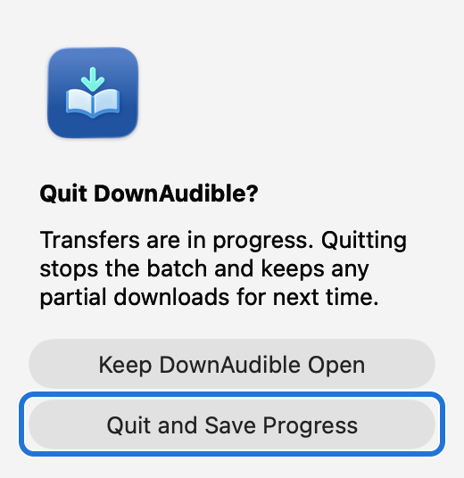

If DownAudible can’t save the queue, use **Keep DownAudible Open** to stay in the app or **Try Saving Again** after addressing the reported problem. **Quit Without Saving** closes the app and may leave the queue at its last saved state. Partial audio stays on disk.

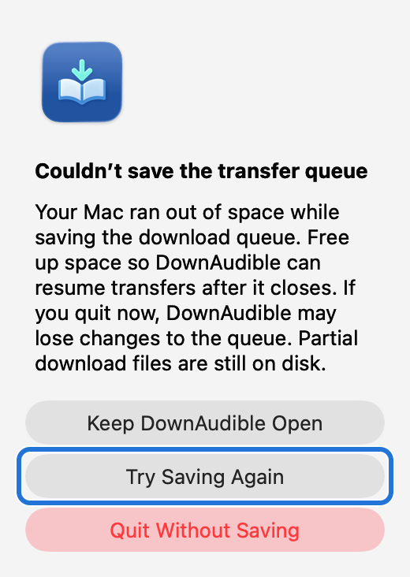

## Set limits

Open **Settings > Jobs** to set simultaneous downloads and conversions. Lower these numbers if the Mac needs more room for other work. **Bandwidth per download (kbps)** applies to each running download. Choose a preset, choose **Custom** and enter a rate in **Custom bandwidth (kbps)**, or choose **Unlimited** to remove the limit. **Request timeout** sets how long DownAudible waits on a network request. Enter zero seconds to turn off the timeout.

**Continue after a job fails** lets other books in the batch run. If you turn it off, DownAudible stops starting new items after a failure. **Show detailed transfer progress** controls the progress bars and detail in **Downloads**.

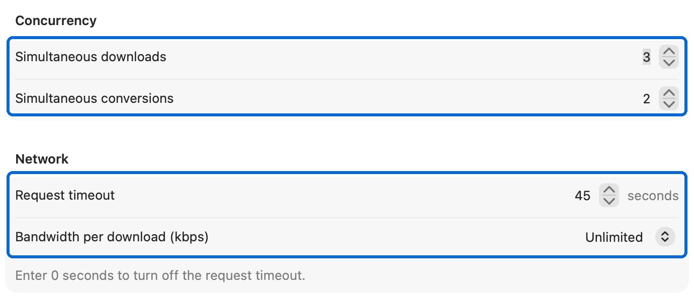

## Set transfer sounds and notifications

Open **Settings > Notifications**. Under **Transfer Events**, select **Download Completed**, **Conversion Completed**, **Download Failed**, **Conversion Failed**, or **Queue Finished**. The list shows each event’s current delivery mode. Set **Delivery** to **Off**, **Notification Only**, **Sound Only**, or **Both**. **Queue Finished** offers **Off** or **Sound Only**.

Check **macOS Notifications** at the top of the pane. Choose **Enable Notifications** to ask macOS for permission. If macOS blocks alerts or has turned off Notification Center entries, choose **Open Notification Settings** and review DownAudible’s settings there. The status updates when you return to the app. Use **Send Test Notification** to check Notification Center delivery silently. **Sound Only** works independently of macOS notification permission.

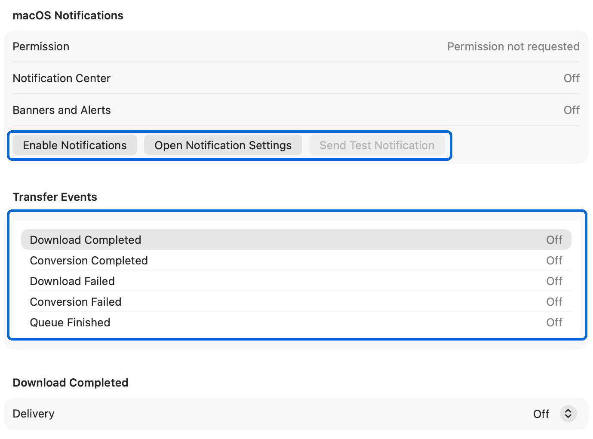

When delivery includes sound, focus the **Sound** list and use Up or Down Arrow to move between built-in chimes and macOS sounds. Each sound plays as you select it. Use **Choose Sound File…** to add or replace your own sound, then find it in the list under **Custom Sound**. Use **Play Sound** to hear the selected sound again.

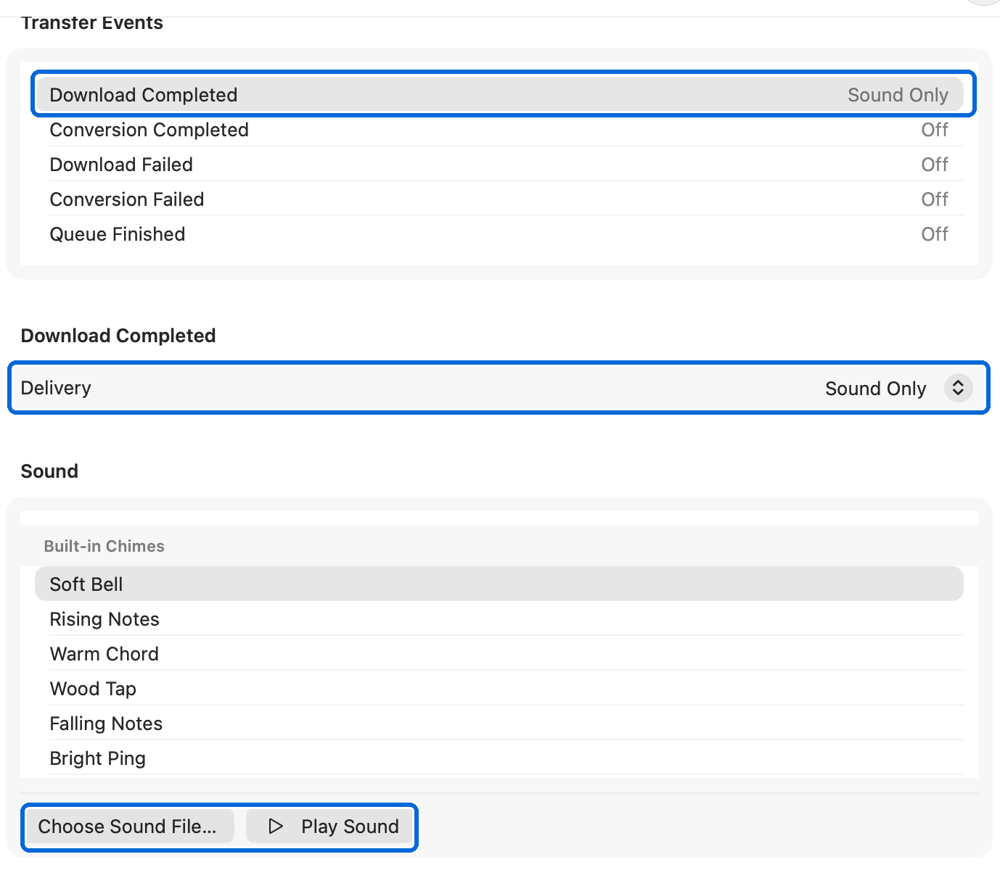

At the end of a batch, DownAudible groups jobs by outcome and reports each outcome once. A title can finish downloading and then fail conversion. Click a transfer notification to open **Downloads** and select its jobs in the current or an earlier batch. **Queue Finished** plays after the separate event sounds. Cancelling the whole batch or reopening the app with a saved queue stays silent.

## Keep a log

In **Settings > Jobs**, choose **Errors only** to keep warnings and errors or **Transfer results** to include completed jobs. Click **Choose…** to write the log somewhere else. **Use Default Location** returns the log to DownAudible’s folder in Application Support.

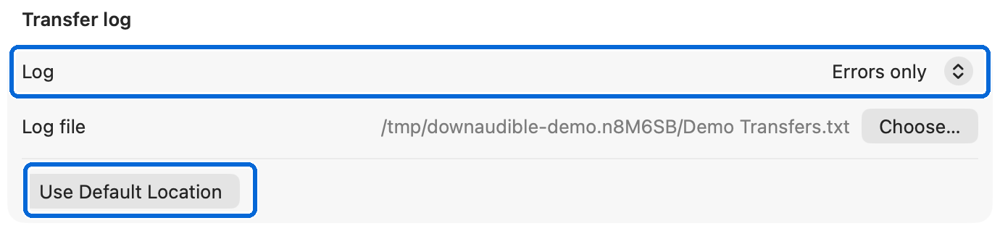

## Related chapters

[Downloading Books](help-04-downloads.md)

[Troubleshooting](help-09-troubleshooting.md)

[Settings Reference](help-12-settings.md)

## Keyboard Shortcuts

| Command | Shortcut |
| --- | --- |
| Downloads | Command–2 |
| Cancel Batch | Control–Command–Period |
| Retry Incomplete | Option–Command–R |
| Restart Incomplete Downloads… | Control–Command–R |
| Retry Selected Transfers | Control–Shift–R |
| Restart Selected Downloads… | Control–Shift–D |
| Show Output in Finder | Control–Shift–F |
| Show Partial Files | Control–Shift–P |
| Copy Error / Copy Errors | Control–Shift–E |
| Clear Completed | Control–Command–K |
| Remove from List | Control–Shift–Delete |
| Remove selected jobs when the list has focus | Backspace or Forward Delete |

[See all keyboard shortcuts](help-10-keyboard-shortcuts.md)

---

## Support DownAudible

If this app has helped you, a donation is one way to support my work. There’s no pressure or hard sell. DownAudible is and always will be free.

[Make a donation](https://www.paypal.com/donate/?hosted_button_id=WMLX4PLED9PRE)
