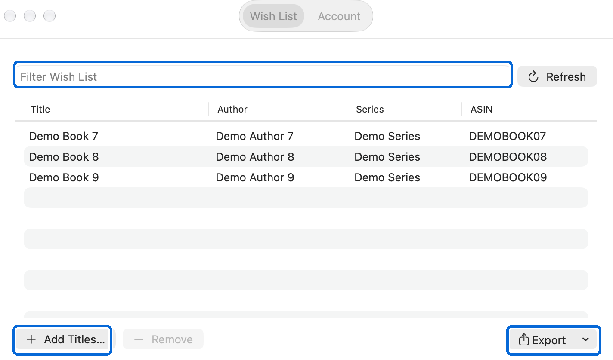
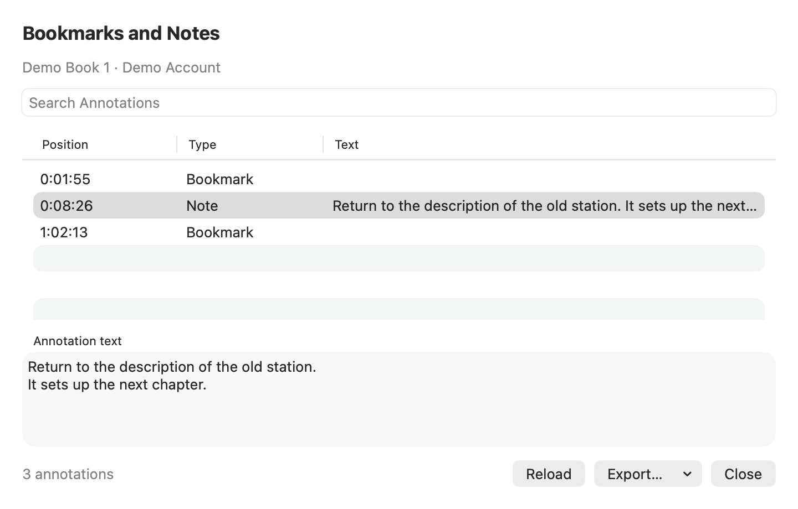
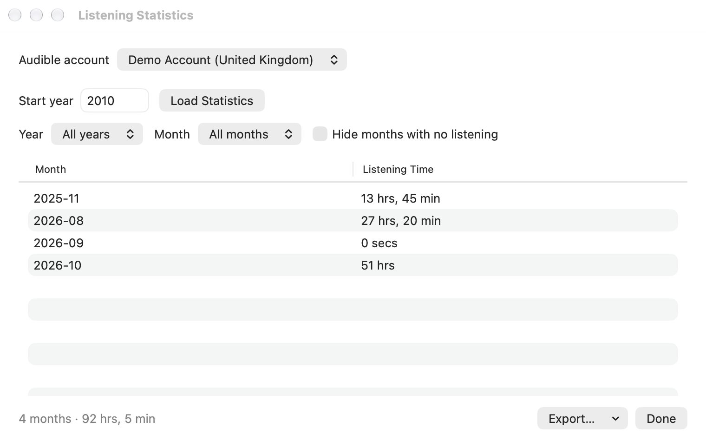
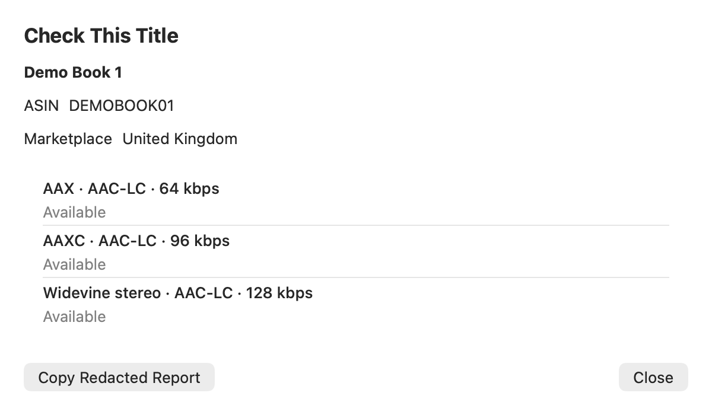
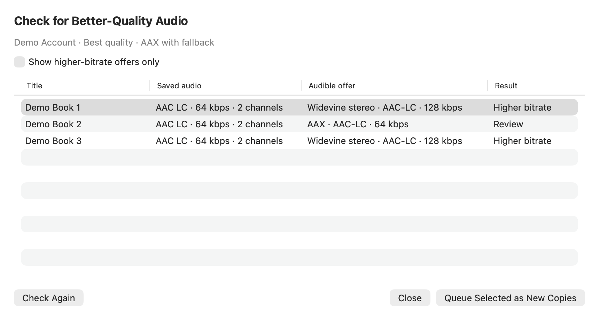

# Audible Tools

## Wish list

Open **Audiobooks > Audible Tools…** and choose **Wish List**. Use **Filter Wish List** to find items you’ve already saved. To add a title, click **Add Titles…**, search by title or ASIN, select the matches, and click **Add to Wish List**. To take an item off the list, select it and click **Remove**. Use **Export** to save the wish list as JSON, CSV, TSV, or an Excel workbook (`.xlsx`).

## Activation bytes

Choose **Account** in Audible Tools to look up the eight-character activation code for the active account. Click **Show**, then **Copy** to use it in another player or converter. If the code fails for files from this account, click **Reload from Audible**.

Audible provides activation bytes separately from your library. If Audible can’t supply the code, choose **AAX with fallback** or **AAXC** in **Settings > Downloads** to convert library downloads using a per-title licence.

## Export a saved account

In the same tab, choose **Export Encrypted Account File…** to move a session to Audible CLI or another copy of DownAudible. Enter and confirm a password, then click **Save Encrypted File…**. Keep the file and its password somewhere private.

## Browse bookmarks and notes

In Library, Control-click one title and choose **View Annotations…**. You can also select a title and choose **Audiobooks > Library > Selected Books > View Annotations…**. DownAudible asks the book’s Audible account for its bookmarks and notes and lists them by playback position when Audible provides one.

Use **Search Annotations** to filter by text, type or playback time. Select a row to read the full note in **Annotation text**. Click **Reload** to fetch the current annotations, or choose **Export…** to save the visible rows as Markdown or CSV.

To save the original annotations and chapter data as JSON, choose those files in the download sheet or set them as defaults in **Settings > Downloads**.

## Listening statistics

Choose **Audiobooks > Listening Statistics…**. Select a signed-in **Audible account**, enter a **Start year** from 1997 through the current year, and click **Load Statistics**. DownAudible asks Audible for the monthly listening time available since January of that year. Use **Cancel Loading** to stop the request.

Use **Year** and **Month** to narrow the table. Turn on **Hide months with no listening** to leave out months Audible reports as zero. The total below the table uses the visible rows. Choose **Export…** to save those rows as JSON, CSV, TSV, or Excel. JSON groups durations by month and includes total hours, minutes, seconds, and the original millisecond count.

## Check a title

In Library, Control-click a title and choose **Check This Title…**. The report shows the marketplace, the formats Audible offers, and audio details or refusal reasons when available. Choose **Copy Redacted Report** to copy the ASIN and offer details for troubleshooting.

## Check for better-quality audio

From **Library Actions**, choose **Check for Better-Quality Audio…**, then **Check Audio**. DownAudible compares a saved copy with the offer it expects to use at **Best** quality for this account’s download format. An offer may only include an estimated bitrate. A higher bitrate is useful for comparing similar audio and can also reflect a different codec.

Select the higher-bitrate results you want and click **Queue Selected as New Copies**. DownAudible requests fresh audio and keeps your earlier files. **Stop Check** ends the audit and keeps the results already shown.

## Related chapters

[Accounts and Sign-In](help-02-accounts.md)

[Downloading Books](help-04-downloads.md)

[Converting Audio](help-05-conversion.md)

## Keyboard Shortcuts

| Command | Shortcut |
| --- | --- |
| Audible Tools… | Command–5 |
| Find in Wish List | Command–F |
| Add Titles… | Control–Shift–A |
| Search in Add Titles | Control–Shift–F, or Return in the search field |
| Add to Wish List in Add Titles | Control–Shift–A |
| Remove selected wish list titles | Control–Shift–Delete |
| Show / Hide activation bytes | Control–Shift–H |
| Copy activation bytes | Control–Shift–C |
| Export Encrypted Account File… | Control–Shift–E |

[See all keyboard shortcuts](help-10-keyboard-shortcuts.md)

---

## Support DownAudible

If you like DownAudible, a donation is one way to support my work. There’s no pressure or hard sell. DownAudible is and always will be free.

[Make a donation](https://www.paypal.com/donate/?hosted_button_id=WMLX4PLED9PRE)
