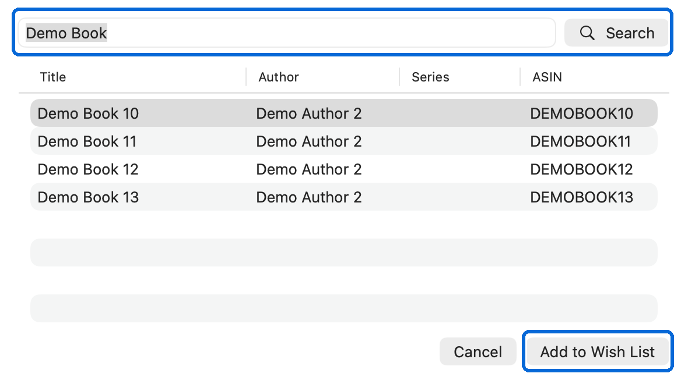
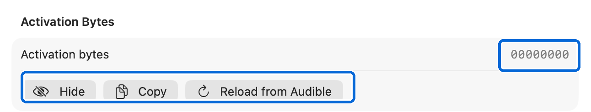
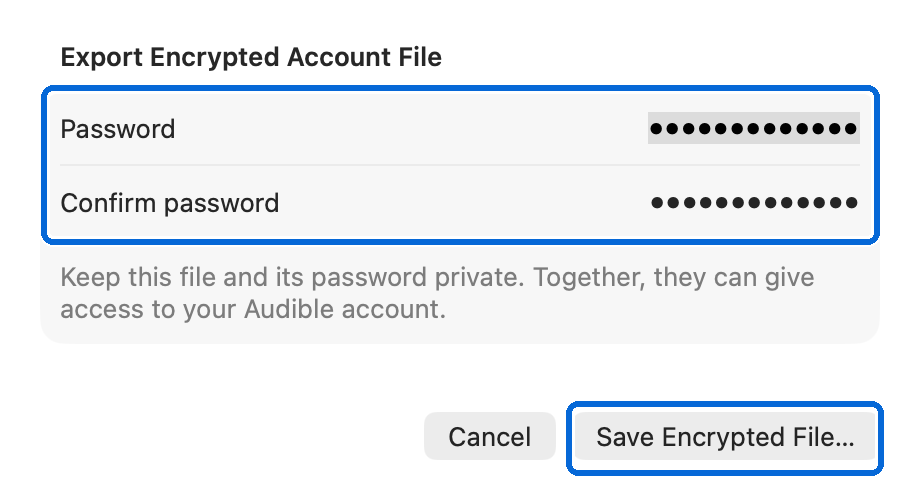

# Audible Tools

## Wish list

Open **Audiobooks > Audible Tools…** and choose **Wish List**. Use **Filter Wish List** to find items you’ve already saved. To add a title, click **Add Titles…**, search by title or ASIN, select the matches, and click **Add to Wish List**. To take an item off the list, select it and click **Remove**. Use **Export** to save the wish list as JSON, CSV, or TSV.

## Activation bytes

Choose **Account** in Audible Tools to look up the eight-character activation code for the active account. Click **Show**, then **Copy** to use it in another player or converter. If the code fails for files from this account, click **Reload from Audible**.

Audible provides activation bytes separately from your library. If Audible can’t supply the code, choose **AAX with fallback** or **AAXC** in **Settings > Downloads** to convert library downloads using a per-title licence.

## Export a saved account

In the same tab, choose **Export Encrypted Account File…** to move a session to Audible CLI or another copy of DownAudible. Enter and confirm a password, then click **Save Encrypted File…**. Keep the file and its password somewhere private.

To download annotations and chapter data for library books, choose those files in the download sheet or set them as defaults in **Settings > Downloads**.

## Related chapters

[Accounts and Sign-In](help-02-accounts.md)

[Downloading Books](help-04-downloads.md)

[Converting Audio](help-05-conversion.md)

## Keyboard Shortcuts

| Command | Shortcut |
| --- | --- |
| Audible Tools… | Command–5 |
| Find in Wish List | Command–F |
| Add Titles… | Control–Shift–A |
| Search in Add Titles | Control–Shift–F, or Return in the search field |
| Add to Wish List in Add Titles | Control–Shift–A |
| Remove selected wish list titles | Control–Shift–Delete |
| Show / Hide activation bytes | Control–Shift–H |
| Copy activation bytes | Control–Shift–C |
| Export Encrypted Account File… | Control–Shift–E |

[See all keyboard shortcuts](help-10-keyboard-shortcuts.md)

---

## Support DownAudible

If this app has helped you, a donation is one way to support my work. There’s no pressure or hard sell. DownAudible is and always will be free.

[Make a donation](https://www.paypal.com/donate/?hosted_button_id=WMLX4PLED9PRE)
