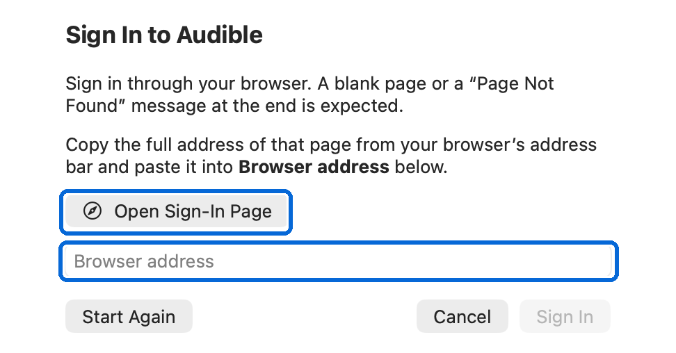
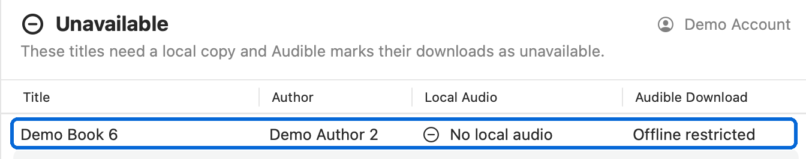
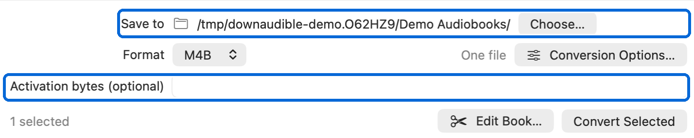
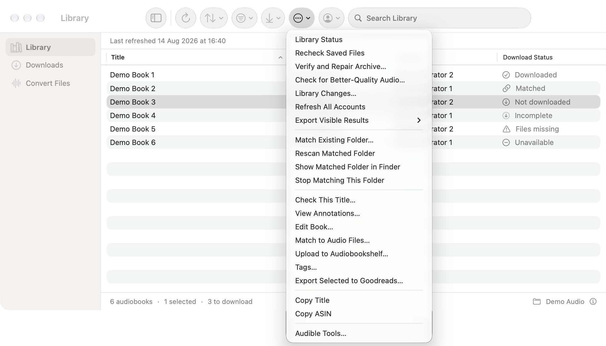
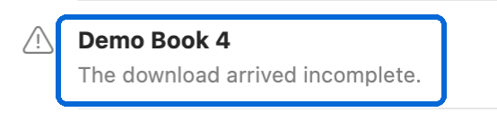
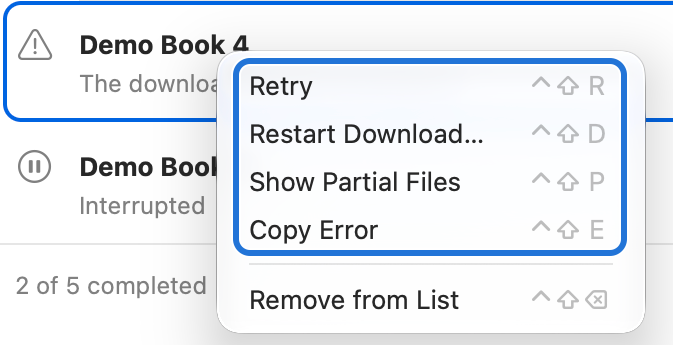
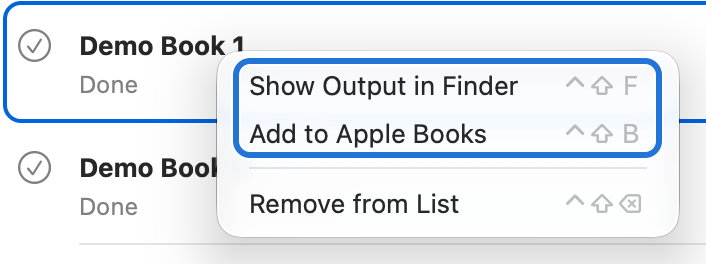
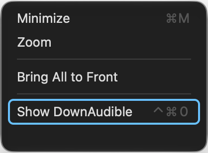

# Troubleshooting

## Sign-in or account trouble

If the browser address is rejected, click **Start Again** and repeat the browser sign-in. Copy the full address of the final page even if it is blank or says “Page Not Found”. If you have trouble with **Enter Credentials**, check your credentials or sign in using **Web Browser** for more verification options.

Check that the selected marketplace is the one where you bought the books. If you recently changed your Amazon credentials, sign out of the saved session and sign in again.

## A book is unavailable

Audible may withhold a download for a preorder, expired loan, or catalogue title that has left your subscription. Refresh the library to check again. If you have a local file, match it to the book or open it in **Convert Files**.

If Audible does not provide an AAX download, try **AAX with fallback** or **AAXC** in **Settings > Downloads**. If Audible refuses the download licence, check that the title is still available to your account in the Audible app. If the request says Audible is limiting downloads, wait before retrying. For a batch, lower **Simultaneous downloads** in **Settings > Jobs**. If Audible keeps limiting individual titles, sign out of the account in **Settings > Accounts**, then sign in again.

## A local file cannot be converted

If the source is missing, reconnect its disk or add the file again from its current location. If the file has no audio track or cannot be read, check that it is complete and plays in an audio player. For AAX, use the activation bytes from the account that downloaded it. For AAXC, use the voucher saved with that file or download a fresh copy.

If conversion runs out of space, free up storage or choose another destination. If DownAudible cannot write to the folder, check its permissions in Finder or choose another folder.

## The archive is on a disk that has been disconnected

Reconnect the disk, make sure the destination still points to the archive, and choose **Recheck Saved Files**. If you moved files inside or outside the archive, use **Match Existing Folder…** again or update individual matches. Use **Download Missing** if the files are gone and you want to replace them.

## A download keeps failing or restarts at zero

Check the error in **Downloads**. If a request times out, check your connection or increase **Request timeout** in **Settings > Jobs**. **Retry** uses any valid partial file. Audible can supply a different file or a server that does not support byte ranges, in which case DownAudible starts from zero. Use **Restart Download…** from the transfer’s contextual menu to discard the partial audio and start again.

## Books opens without the audiobook

Find the file with **Show Output in Finder** in **Downloads**. Books may require authorisation for an original or may refuse that particular Audible format. Use **Convert Files** to create one M4B, then choose **Add to Apple Books** on the result in **Downloads**. Check Books itself to confirm that it imported the file.

## The main window is closed

Choose **Window > Show DownAudible** to bring the main window back. Use the **View** menu to show or hide the sidebar and the library status bar.

## Related chapters

[Accounts and Sign-In](help-02-accounts.md)

[Library and File Matching](help-03-library.md)

[Converting Audio](help-05-conversion.md)

[Downloads and Recovery](help-07-transfers.md)

## Keyboard Shortcuts

| Command | Shortcut |
| --- | --- |
| Open Sign-In Page from the sign-in sheet | Control–Shift–B |
| Refresh Library | Command–R |
| Recheck Saved Files | Shift–Command–R |
| Match Existing Folder… | Control–Shift–F |
| Download Missing | Shift–Command–D |
| Retry Selected Transfers | Control–Shift–R |
| Restart Selected Downloads… | Control–Shift–D |
| Show Output in Finder from Downloads | Control–Shift–F |
| Show DownAudible | Control–Command–0 |

[See all keyboard shortcuts](help-10-keyboard-shortcuts.md)

---

## Support DownAudible

If you like DownAudible, a donation is one way to support my work. There’s no pressure or hard sell. DownAudible is and always will be free.

[Make a donation](https://www.paypal.com/donate/?hosted_button_id=WMLX4PLED9PRE)
