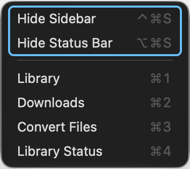
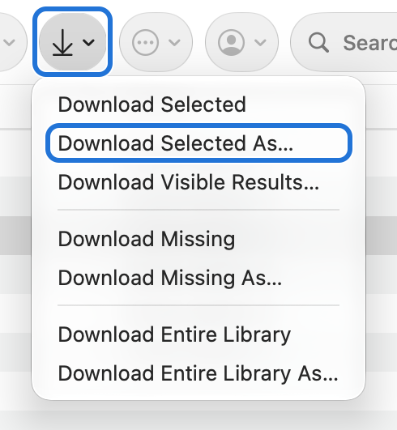
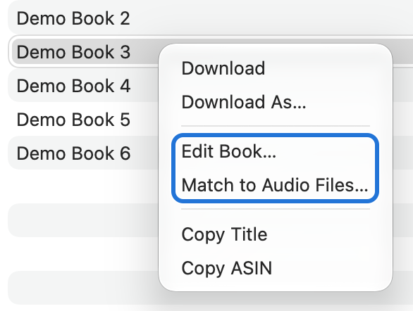
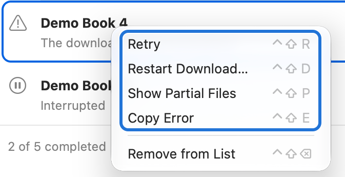
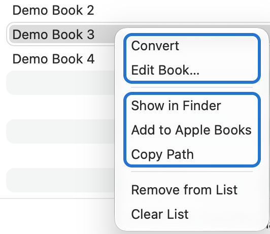
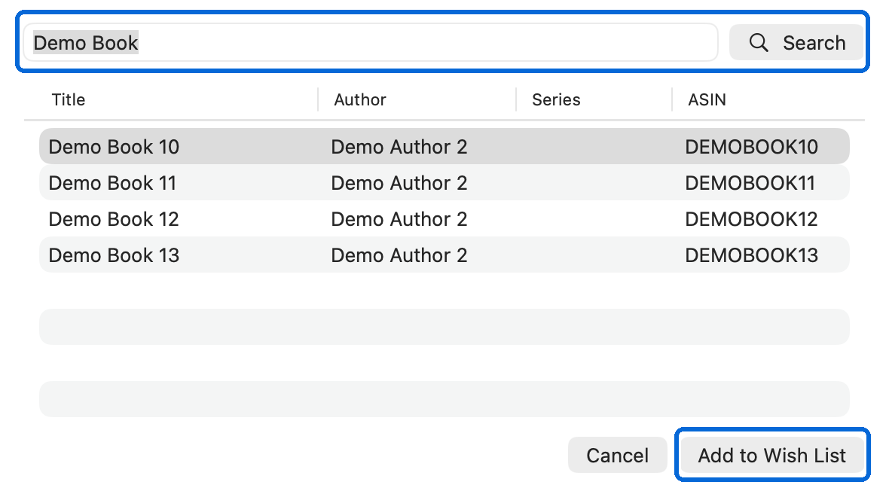
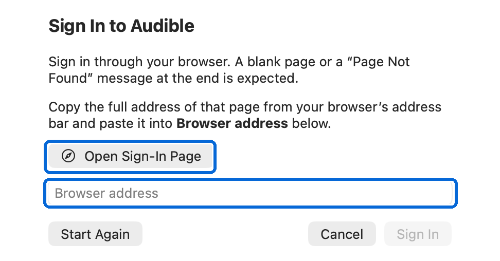
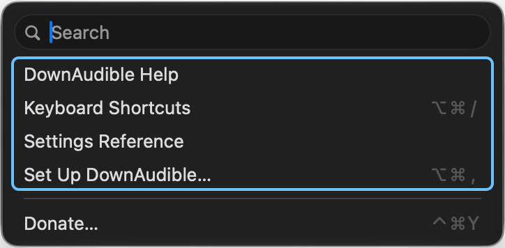

# Keyboard Shortcuts

Menu shortcuts work when their commands are available. Open the named page, window, or sheet for shortcuts specific to it. Menu symbols are ⌃ Control, ⌥ Option, ⇧ Shift, ⌘ Command, and ⌫ Delete.

## Windows, views, and help

| Command | Shortcut |
| --- | --- |
| About DownAudible | Control–Shift–Command–A |
| Settings… | Command–Comma |
| Open Audio Files… | Command–O |
| Open Audio Folder… | Shift–Command–O |
| Hide Sidebar / Show Sidebar | Control–Command–S |
| Hide Status Bar / Show Status Bar | Option–Command–S |
| Library | Command–1 |
| Downloads | Command–2 |
| Convert Files | Command–3 |
| Library Status | Command–4 |
| Audible Tools… | Command–5 |
| Show DownAudible | Control–Command–0 |
| DownAudible Help | Shift–Command–Slash |
| Keyboard Shortcuts | Option–Command–Slash |
| Set Up DownAudible… | Option–Command–Comma |
| Donate… | Control–Command–Y |
| Open the developer’s website from About DownAudible | Control–Shift–W |
| View on GitHub from About DownAudible | Control–Shift–G |

## Library and downloads

The **Audiobooks** menu groups download commands under **Download** and library actions under **Library**. **Download** commands use your saved settings and start immediately. **Download As…** commands open settings for that batch.

| Command | Shortcut |
| --- | --- |
| Refresh Library | Command–R |
| Recheck Saved Files | Shift–Command–R |
| Find in Library | Command–F |
| Open Sort Menu | Shift–Command–S |
| Open Filter Menu | Shift–Command–F |
| Reverse Sort Order | Option–Shift–Command–S |
| Clear Filters | Option–Shift–Command–F |
| Choose a library filter suggestion | Up or Down Arrow, then Return |
| Download Selected | Command–D |
| Download Selected As… | Option–Command–D |
| Download Missing | Shift–Command–D |
| Download Missing As… | Option–Shift–Command–D |
| Download Entire Library | Shift–Command–L |
| Download Entire Library As… | Option–Shift–Command–L |
| Restart Incomplete Downloads… for the selection | Control–Shift–Command–D |
| Export Library as JSON | Control–Command–J |
| Export Library as CSV | Control–Command–C |
| Export Library as TSV | Control–Command–T |
| Choose a destination folder in the download sheet | Control–Shift–Y |
| Download or Restart from the sheet | Return |
| Cancel the download sheet | Escape |

## Library file matching and selected books

| Command | Shortcut |
| --- | --- |
| Match Existing Folder… | Control–Shift–F |
| Rescan Matched Folder | Control–Shift–R |
| Show Matched Folder in Finder | Control–Shift–O |
| Stop Matching This Folder | Control–Shift–U |
| Match to Audio Files… / Change Matched Files… | Control–Shift–M |
| Remove File Match | Control–Shift–Delete |
| Show Audio in Finder | Control–Shift–S |
| Copy Title | Control–Shift–T |
| Copy ASIN / Copy ASINs | Control–Shift–C |
| Add Original Files to Apple Books | Control–Shift–1 |
| Add M4B Files to Apple Books | Control–Shift–2 |
| Add Other Audio to Apple Books | Control–Shift–3 |

## Downloads

| Command | Shortcut |
| --- | --- |
| Cancel Batch | Control–Command–Period |
| Retry Incomplete | Option–Command–R |
| Restart Incomplete Downloads… | Control–Command–R |
| Clear Completed | Control–Command–K |
| Cancel Transfer / Cancel Selected Transfers | Control–Shift–X |
| Retry Selected Transfers | Control–Shift–R |
| Restart Selected Downloads… | Control–Shift–D |
| Confirm Restart Downloads | Return |
| Show Output in Finder | Control–Shift–F |
| Add to Apple Books | Control–Shift–B |
| Show Partial Files | Control–Shift–P |
| Copy Error / Copy Errors | Control–Shift–E |
| Remove from List | Control–Shift–Delete |
| Remove selected jobs when the list has focus | Backspace or Forward Delete |

## Convert Files

| Command | Shortcut |
| --- | --- |
| Add Files… | Command–O |
| Add Folder… | Shift–Command–O |
| Choose a destination folder | Control–Shift–Y |
| Conversion Options… | Control–Shift–O |
| Close Conversion Options with Done | Return |
| Convert All / Convert Selected | Control–Shift–V |
| Show in Finder | Control–Shift–S |
| Add to Apple Books | Control–Shift–B |
| Copy Path | Control–Shift–C |
| Remove from List | Control–Shift–Delete |
| Remove selected files when the list has focus | Backspace or Forward Delete |
| Clear List | Control–Shift–K |

## Audible Tools

| Command | Shortcut |
| --- | --- |
| Find in Wish List | Command–F |
| Refresh the wish list | Control–Shift–R |
| Add Titles… | Control–Shift–A |
| Remove selected wish list titles | Control–Shift–Delete |
| Export Wish List as JSON | Control–Shift–J |
| Export Wish List as CSV | Control–Shift–G |
| Export Wish List as TSV | Control–Shift–T |
| Search in Add Titles | Control–Shift–F, or Return in the search field |
| Add to Wish List in Add Titles | Control–Shift–A |
| Show / Hide activation bytes | Control–Shift–H |
| Copy activation bytes | Control–Shift–C |
| Reload from Audible | Control–Shift–L |
| Export Encrypted Account File… | Control–Shift–E |
| Save Encrypted File… | Return |
| Cancel a sheet or close Audible Tools with Done | Escape |

## Audible accounts and sign-in

| Command | Shortcut |
| --- | --- |
| Sign In… / Add Account… in Library | Control–Shift–A |
| Add Account… in Settings or setup | Control–Shift–A |
| Sign In… / Switch to This Account in Settings or setup | Control–Shift–S |
| Sign Out | Control–Shift–Q |
| Import from Audible CLI… | Control–Shift–I |
| Choose a configuration or auth file in the import sheet | Control–Shift–O |
| Import in the import sheet | Return |
| Continue or Sign In in the sign-in sheet | Return |
| Open Sign-In Page | Control–Shift–B |
| Start Again | Control–Shift–N |
| Rename… in Settings or setup | Control–Shift–N |
| Save in the rename sheet | Return |
| Remove Account… in Settings or setup | Control–Shift–Delete |
| Cancel a sign-in, import, or rename sheet | Escape |

## Settings and setup

| Command | Shortcut |
| --- | --- |
| Refresh Library from Library settings | Control–Shift–R |
| Use Largest Available cover | Control–Shift–L |
| Choose a destination folder in Files settings | Control–Shift–Y |
| Restore Default Template | Control–Shift–D |
| Choose the transfer log file | Control–Shift–G |
| Use Default Location for the transfer log | Control–Shift–K |
| Back in setup | Control–Shift–B |
| Skip Setup / Skip Configuration | Control–Shift–P |
| Continue / Continue Without an Account | Return |
| Open DownAudible at the end of setup | Return |
| View DownAudible Help at the end of setup | Control–Shift–M |

## macOS menu commands

Your keyboard may label Fn with a globe. Dictation and emoji shortcuts can depend on your Mac’s keyboard settings.

| Command | Shortcut |
| --- | --- |
| Close the active window | Command–W |
| Close All | Option–Command–W |
| Minimize the active window | Command–M |
| Minimize All | Option–Command–M |
| Move to another DownAudible window | Command–Grave Accent |
| Enter or exit full screen | Fn–F |
| Fill | Fn–Control–F |
| Center | Fn–Control–C |
| Move & Resize to a half of the screen | Fn–Control–Arrow key |
| Arrange windows in halves | Fn–Control–Shift–Arrow key |
| Arrange one half and two quarters | Fn–Control–Option–Shift–Arrow key |
| Return to Previous Size | Fn–Control–R |
| Hide DownAudible | Command–H |
| Hide Others | Option–Command–H |
| Quit DownAudible | Command–Q |
| Undo | Command–Z |
| Redo | Shift–Command–Z |
| Cut | Command–X |
| Copy | Command–C |
| Paste | Command–V |
| Select All | Command–A |
| Start Dictation… | Dictation key |
| Emoji & Symbols | Globe key when configured |

## Related chapters

[Getting Started](help-01-getting-started.md)

[Library and File Matching](help-03-library.md)

[Downloading Books](help-04-downloads.md)

[Converting Audio](help-05-conversion.md)

[Downloads and Recovery](help-07-transfers.md)

## Keyboard navigation

Turn on **Keyboard navigation** in **System Settings > Keyboard** to move through buttons and other controls with Tab. Use focus to reach items such as account names, help chapters, category filters, settings tabs, and confirmation buttons.

On most Mac keyboards, the key labelled Delete works as Backspace. Press Fn–Delete for Forward Delete.

| Action | Shortcut |
| --- | --- |
| Open DownAudible Help | Shift–Command–Slash |
| Open this shortcut reference | Option–Command–Slash |
| Move to the next or previous control | Tab or Shift–Tab |
| Follow a focused chapter link, press a button, open a menu, or change a checkbox | Space |
| Move through a menu, list, table, or picker | Arrow keys |
| Extend a table or list selection | Shift–Up Arrow or Shift–Down Arrow |
| Choose the highlighted menu item | Return |
| Close a menu | Escape |
| Focus the macOS menu bar | Control–F2, or Fn–Control–F2 on some keyboards |

---

## Support DownAudible

If this app has helped you, a donation is one way to support my work. There’s no pressure or hard sell. DownAudible is and always will be free.

[Make a donation](https://www.paypal.com/donate/?hosted_button_id=WMLX4PLED9PRE)
