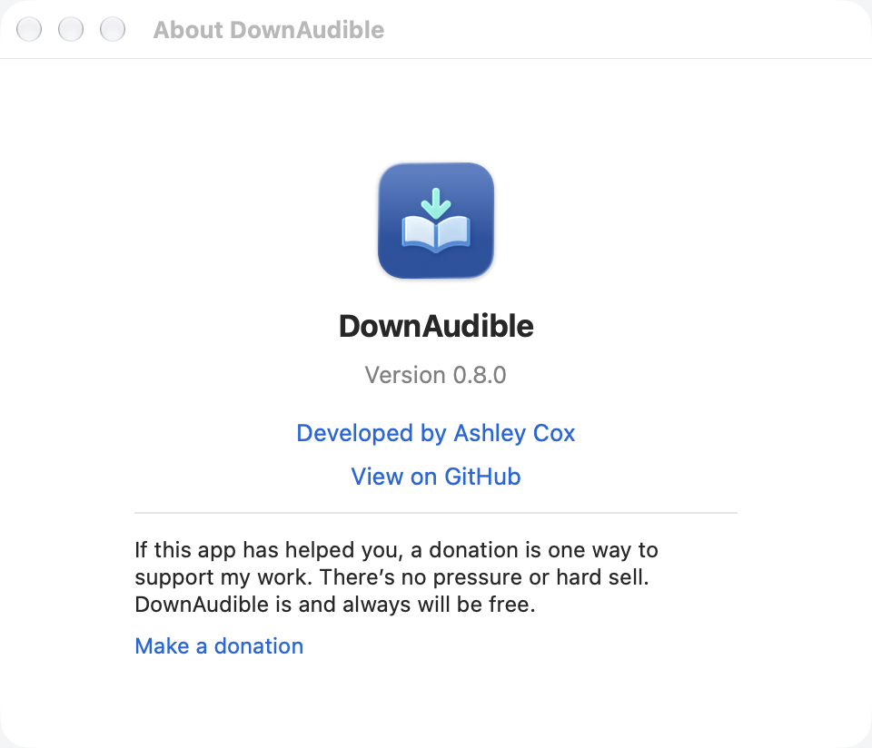
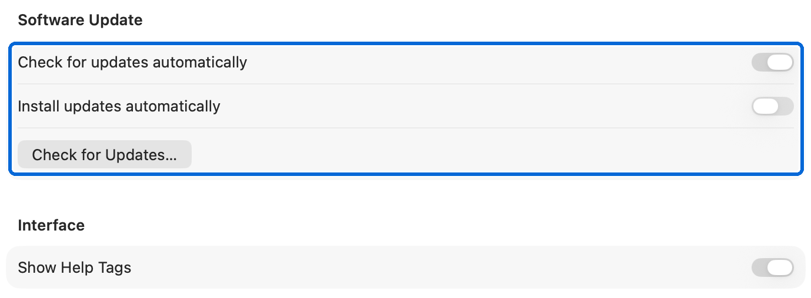

# Credits

## DownAudible

Ashley Cox develops DownAudible. The source is available under version 3 of the GNU Affero General Public License.

[Ashley Cox](https://ashleycox.co.uk/)

[DownAudible source](https://github.com/ashleycox/DownAudible)

[DownAudible licence](https://github.com/ashleycox/DownAudible/blob/main/LICENSE)

## Software updates

DownAudible uses Sparkle to check for and install updates. Sparkle is available under the MIT licence. The app includes Sparkle’s licence and third-party notices.

[Sparkle project](https://sparkle-project.org/)

[Sparkle 2.10.1 licence and notices](https://github.com/sparkle-project/Sparkle/blob/2.10.1/LICENSE)

## Audio and conversion

DownAudible uses its bundled FFmpeg 8.1.2 tools to inspect and convert audio. The build includes `ffmpeg` and `ffprobe` under the GNU Lesser General Public License, version 2.1 or later.

[FFmpeg 8.1.2 source](https://github.com/FFmpeg/FFmpeg/tree/n8.1.2)

[FFmpeg 8.1.2 licence](https://github.com/FFmpeg/FFmpeg/blob/n8.1.2/COPYING.LGPLv2.1)

The bundled FFmpeg build links LAME 4.0 for MP3 encoding. The app includes the LAME licence text for version 2 of the GNU Library General Public License. FFmpeg also uses the zlib library supplied by macOS.

[LAME 4.0 source release](https://sourceforge.net/projects/lame/files/lame/4.0/)

[LAME 4.0 licence](https://svn.code.sf.net/p/lame/svn/tags/RELEASE__4_0/COPYING)

[zlib project](https://www.zlib.net/)

[zlib licence](https://www.zlib.net/zlib_license.html)

[DownAudible media build script](https://github.com/ashleycox/DownAudible/blob/main/Scripts/prepare-media.sh)

## Audible helper

The bundled helper uses mkb79’s Audible library to communicate with Audible and Audible CLI’s library, catalogue and configuration code to work with your books and profiles. Both are licensed under the GNU Affero General Public License, version 3.

[Audible library source](https://github.com/mkb79/Audible)

[Audible 0.13.1 licence](https://github.com/mkb79/Audible/blob/v0.13.1/LICENSE)

[Audible CLI source](https://github.com/mkb79/audible-cli)

[Audible CLI 0.6.0 licence](https://github.com/mkb79/audible-cli/blob/v0.6.0/LICENSE)

The helper runs on Python 3.13, sends requests with HTTPX and parses HTML with Beautiful Soup. The dependency lock lists the versions of its direct and transitive Python packages.

[CPython 3.13 source](https://github.com/python/cpython/tree/3.13)

[Python 3.13 licences](https://docs.python.org/3.13/license.html)

[HTTPX source](https://github.com/encode/httpx)

[HTTPX BSD 3-Clause licence](https://github.com/encode/httpx/blob/0.28.1/LICENSE.md)

[Beautiful Soup project and MIT licence](https://www.crummy.com/software/BeautifulSoup/)

[DownAudible helper dependency lock](https://github.com/ashleycox/DownAudible/blob/main/Scripts/Audible/uv.lock)

## Build tools

DownAudible is written in Swift and built with Xcode and the macOS SDK. The Swift project uses the Apache 2.0 licence with a Runtime Library Exception.

[Xcode and Apple SDKs](https://developer.apple.com/xcode/)

[Xcode and Apple SDKs licence](https://www.apple.com/legal/sla/docs/xcode.pdf)

[Swift source](https://github.com/swiftlang/swift)

[Swift licence](https://www.swift.org/LICENSE.txt)

The build uses uv to install the locked dependencies and PyInstaller to package the helper. uv is available under either the MIT or Apache 2.0 licence. PyInstaller is available under the GNU General Public License, version 2 or later, with a packaging exception described in its licence file.

[uv source and licences](https://github.com/astral-sh/uv#license)

[PyInstaller source](https://github.com/pyinstaller/pyinstaller)

[PyInstaller licence and exception](https://github.com/pyinstaller/pyinstaller/blob/v6.22.3/COPYING.txt)

## Workflow references

Libation and AAX Audio Converter informed DownAudible’s download and conversion workflow. Both projects publish their source under the GNU General Public License, version 3.

[Libation source](https://github.com/rmcrackan/Libation)

[Libation licence](https://github.com/rmcrackan/Libation/blob/master/LICENSE)

[AAX Audio Converter source](https://github.com/audiamus/AaxAudioConverter)

[AAX Audio Converter licence](https://github.com/audiamus/AaxAudioConverter/blob/master/LICENSE)

## Keyboard Shortcuts

| Action | Shortcut |
| --- | --- |
| Open DownAudible Help | Shift–Command–Slash |
| Keyboard Shortcuts | Option–Command–Slash |
| Move to the next or previous control | Tab or Shift–Tab |
| Open a focused link | Space |

[See all keyboard shortcuts](help-10-keyboard-shortcuts.md)

---

## Support DownAudible

If this app has helped you, a donation is one way to support my work. There’s no pressure or hard sell. DownAudible is and always will be free.

[Make a donation](https://www.paypal.com/donate/?hosted_button_id=WMLX4PLED9PRE)
