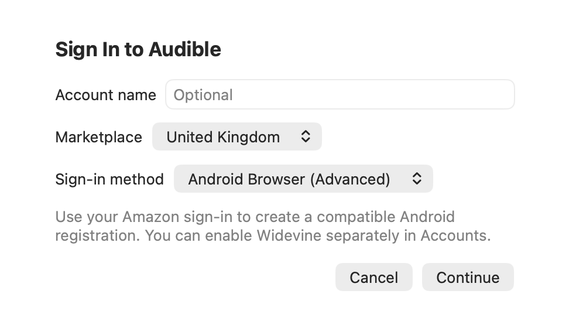
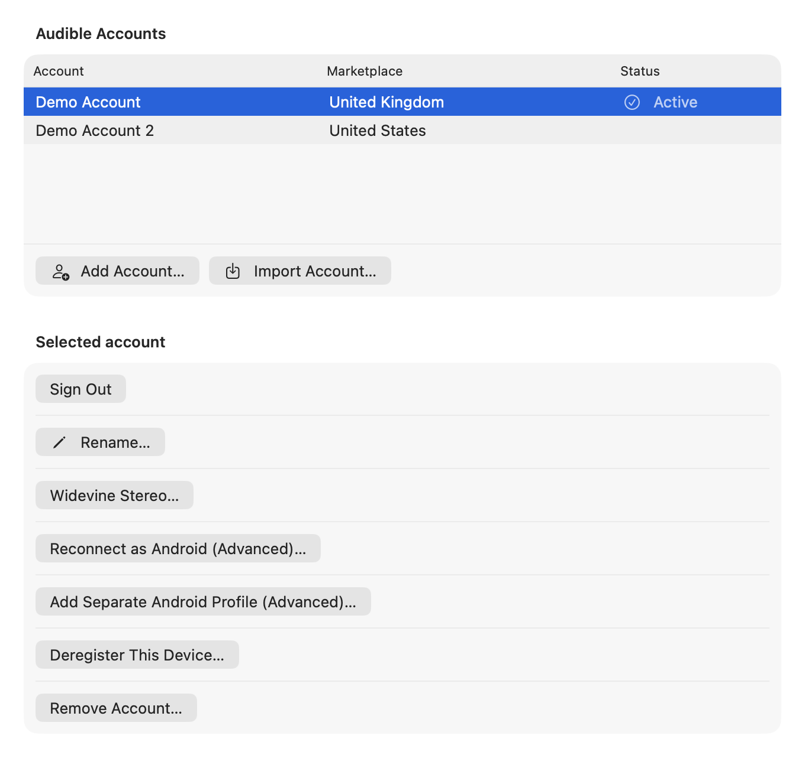
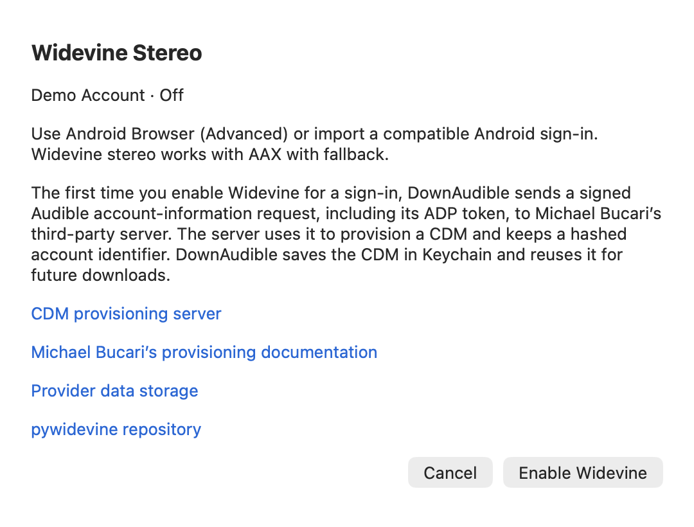
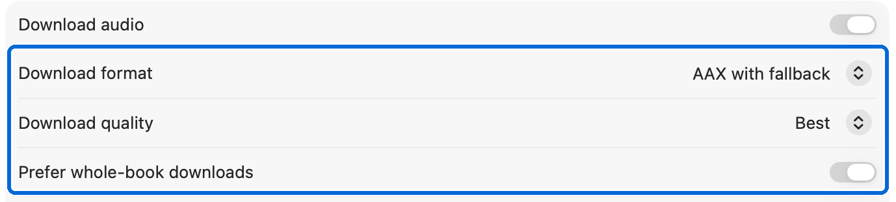

# Widevine Stereo

## When to use Widevine

Widevine is one way Audible delivers protected audio. On some titles, Audible offers a stereo version through Widevine that differs from the AAX or AAXC download, sometimes at a higher bitrate. Availability and quality depend on the title, marketplace and your account’s download rights.

Widevine is optional and off by default. Leave it off if your usual downloads meet your needs. If you want to try the extra stereo source, connect a compatible Android sign-in and enable Widevine for that account.

## Connect a compatible Android sign-in

To add an Audible account, open **DownAudible > Settings… > Accounts** and click **Add Account…**. Choose your **Marketplace** and set **Sign-in method** to **Android Browser (Advanced)**. Click **Continue**, then **Open Sign-In Page**. Sign in with your existing Amazon account in the browser. Copy the full address from the final browser page, paste it into **Browser address**, and click **Sign In**. The final page may be blank or say “Page Not Found”. Keep its address private.

If the account is already in DownAudible, finish any running transfers and select the account in **Settings > Accounts**. Use the option that suits how you want to keep your profiles.

- **Reconnect as Android (Advanced)…** keeps the selected DownAudible profile, its name, file matches and saved transfers. It saves the new registration after verifying that you signed in to the same Audible account in the same marketplace.
- **Add Separate Android Profile (Advanced)…** makes a second DownAudible profile for the same Audible library after the same verification. It has its own sign-in and file matches. The original profile keeps its saved transfers and file matches.

If a saved profile is signed out, make it active with **Switch to This Account** if needed, then use **Sign In…** before choosing either Android action. You can also use **Import Account…** if you already have a compatible Android registration. Widevine starts off for the resulting profile.

[Accounts and Sign-In](help-02-accounts.md)

## Enable Widevine and choose the download format

1. Select the account in **Settings > Accounts** and click **Widevine Stereo…**.
2. Read the provider details and click **Enable Widevine**.
3. Switch to that account to download its books. In **Settings > Downloads**, set **Download format** to **AAX with fallback** and choose your **Download quality**. Choose **Best** to request the highest available quality.

With **AAX with fallback**, DownAudible requests a compatible Widevine stereo version first. When Audible reports that this format is unavailable, DownAudible tries AAX and then AAXC. Choose **AAX only** or **AAXC** to request that source directly.

To try Widevine for a book DownAudible already downloaded, go to **Settings > Files**, set **If a file is already saved** to **Save another copy**, and download the title again. If the book is linked to local audio, first choose **Remove File Match** in Library. The local audio stays on disk.

[Downloading Books](help-04-downloads.md)

## What DownAudible shares

When you click **Enable Widevine** and a content decryption module (CDM) is needed, DownAudible sends a signed Audible account-information request to Michael Bucari’s independent provisioning server. The request includes the Audible ADP token and the request signature. The provider uses it to verify the Audible account and supply the CDM. Its documentation describes retaining a shortened hash of the account identifier.

DownAudible stores the CDM in your Mac’s Keychain and reuses it for that account, including after a verified Android reconnect or when adding a separate verified Android profile. To disable requests for Widevine, reopen **Widevine Stereo…** and choose **Turn Off Widevine**. The profile keeps its saved CDM for reuse. Signing out or removing a profile clears the CDM saved for that profile.

[CDM provisioning server](https://ollj0gz40d.execute-api.us-west-2.amazonaws.com/default/AudibleCdm) · [Provisioning API](https://github.com/mkb79/audible-cli/issues/155#issuecomment-2788239962) · [Provider data storage](https://github.com/mkb79/audible-cli/issues/155#issuecomment-2788472372) · [pywidevine repository](https://github.com/devine-dl/pywidevine)

## If you cannot enable or use Widevine

- If DownAudible asks for a compatible Android sign-in, use **Android Browser (Advanced)** or import a compatible Android registration.
- If DownAudible reports a different account or cannot verify an existing profile, start a fresh browser sign-in in the original marketplace using the same Amazon account. The saved profile stays available. You can also start from **Add Account…** to create a new Android profile.
- If the provisioning server cannot issue a CDM, try **Enable Widevine** again later.
- If a title fails through Widevine, check that Audible still allows your account to download it. If the title is available, choose **Turn Off Widevine** and try the download again with **AAX with fallback**.

---

## Support DownAudible

If you like DownAudible, a donation is one way to support my work. There’s no pressure or hard sell. DownAudible is and always will be free.

[Make a donation](https://www.paypal.com/donate/?hosted_button_id=WMLX4PLED9PRE)
