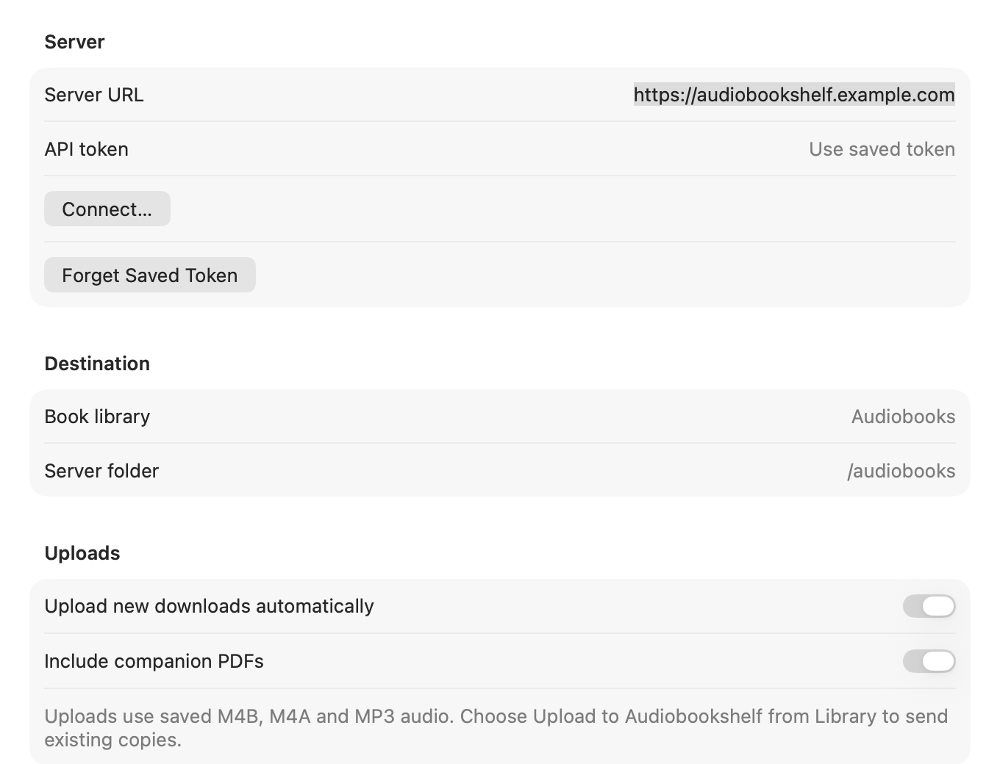
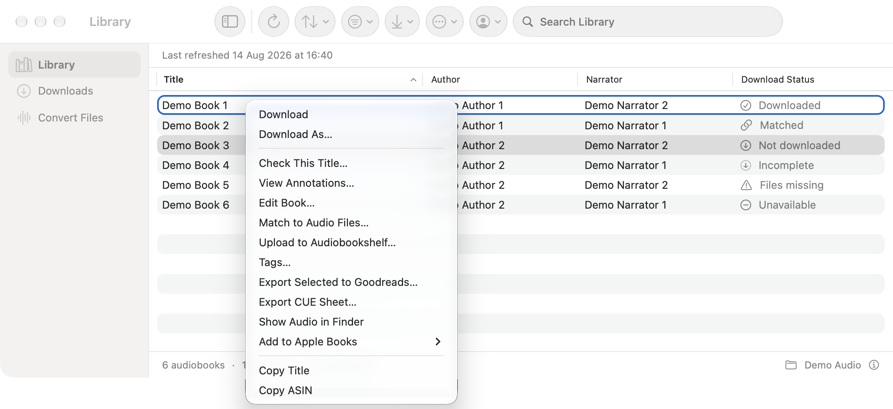
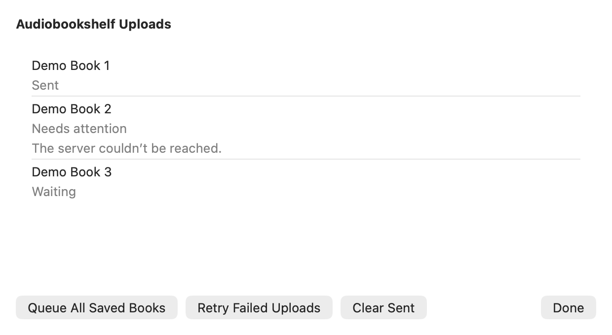

# Audiobookshelf

Audiobookshelf is a server you can run to listen to your audiobook library on other devices. Connect DownAudible when you want books saved on your Mac to appear on that server. You can send individual books, send your existing library, or have DownAudible upload new playable downloads automatically. DownAudible keeps your local files.

## Connect your server

1. Get your server’s base address and an API key for a user who can see the destination library and upload to it. An Audiobookshelf administrator can create a key in the server’s web interface under **Settings > Users > API Keys**. [Audiobookshelf’s API key guide](https://audiobookshelf.org/docs/documentation/server-management/api-keys/)
2. Open **Settings > Audiobookshelf** in DownAudible. Enter the address in **Server URL**, paste the key into **API token**, and choose **Connect…**. Use HTTPS for a server outside your local network. For a server on your network that uses HTTP, enter its local IP address. If macOS asks for local network access, allow it so DownAudible can reach the server.
3. Select a **Book library** and **Server folder**. DownAudible saves the token in Keychain. When you reconnect to the same address, leave **API token** blank to reuse it.

## Send books you have already saved

Select one or more titles in **Library**, then Control-click the selection and choose **Upload to Audiobookshelf…**. To send every eligible book for the current Audible profile, open **Downloads > Audiobookshelf Uploads…** and choose **Queue All Saved Books**.

DownAudible needs a complete set of saved M4B, M4A, or MP3 audio for each book. Audio you’ve matched in Library can also be used. If you have a protected AAX or AAXC original, convert it to a playable format first. DownAudible includes saved cover art where available. Turn on **Include companion PDFs** in Audiobookshelf settings to send saved PDFs with the audio.

## Upload new downloads automatically

Turn on **Upload new downloads automatically** in **Settings > Audiobookshelf**. Turn on conversion when downloading protected originals so the batch produces playable audio. DownAudible queues eligible new files after saving them. To upload books you saved earlier, use the Library command or **Queue All Saved Books**.

## Check or retry uploads

Open **Downloads > Audiobookshelf Uploads…** to see waiting, uploading, sent, or failed books. **Sent** means the server accepted the files or the book was already in its library. Audiobookshelf may take a moment to show a newly uploaded book.

If a row says **Needs attention**, read the message for that book. Check the server connection and the token’s upload permissions, then choose **Retry Failed Uploads**. If a saved file moved or changed, update its match if needed and queue it again from Library. **Clear Sent** clears completed entries from DownAudible’s upload list and keeps the books on the server. To disconnect, choose **Forget Saved Token** in **Settings > Audiobookshelf**.

## Related chapters

[Library and File Matching](help-03-library.md)

[Converting Audio](help-05-conversion.md)

[Downloads and Recovery](help-07-transfers.md)

---

## Support DownAudible

If you like DownAudible, a donation is one way to support my work. There’s no pressure or hard sell. DownAudible is and always will be free.

[Make a donation](https://www.paypal.com/donate/?hosted_button_id=WMLX4PLED9PRE)
