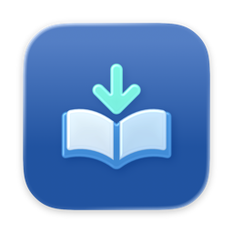

# DownAudible



DownAudible backs up your Audible library on a Mac, or a Windows PC. Keep the original DRM-protected Audible files, which can still be played in Apple's Books app, or convert them to M4B, M4A, or MP3 and play them on any device, with support for embedded and split chapters and embedded cover art.

## Why I built DownAudible

I built DownAudible one morning after discovering Audible had removed the download button from their website, removing access to the books we bought and paid for. I have been an Audible user for years and have amassed a library of thousands of books.

I refuse to use the Audible app. It is an atrocity, especially on macOS. We must all fight against our right to ownership being stripped from us. I have spent thousands of pounds over many years building a library of books, and I will do with them as I please within the remit of legal personal use. If you pay for something without the explicit knowledge that you are renting it, you should own access to it, even if the product is digital.

## Download

[**Download DownAudible for Mac (.zip)**](https://github.com/ashleycox/DownAudible/releases/latest/download/DownAudible.zip)

DownAudible runs on Apple silicon and Intel Macs, running MacOS 15 Catalina or later. Unzip the download and drag DownAudible to your Applications folder.

Choose **DownAudible → Check for Updates…** to check for a new release. Enable automatic updates in **Settings → General** or on the General page during setup.

### Windows Version

After a lot of requests, I built a Windows version of DownAudible. Choose the latest installer or portable ZIP for your PC architecture.

| Windows PC | Installer | Portable ZIP |
| --- | --- | --- |
| ARM64 | [Download ARM64 installer](https://github.com/ashleycox/DownAudible/releases/latest/download/DownAudible-Windows-ARM64-Installer.exe) | [Download ARM64 ZIP](https://github.com/ashleycox/DownAudible/releases/latest/download/DownAudible-Windows-ARM64-Portable.zip) |
| x64 (Intel or AMD) | [Download x64 installer](https://github.com/ashleycox/DownAudible/releases/latest/download/DownAudible-Windows-x64-Installer.exe) | [Download x64 ZIP](https://github.com/ashleycox/DownAudible/releases/latest/download/DownAudible-Windows-x64-Portable.zip) |

See the [Windows README](Windows/README.md) for setup and help related to the Windows version.

## Manual and keyboard shortcuts

Start with the [DownAudible manual](DownAudible/Help/Manual/README.md). The Windows manual is [here](Windows/Manual/README.md)

Open **Help → DownAudible Help** for the manual, or choose **Settings Reference**, **Keyboard Shortcuts**, **Widevine Stereo**, or **Audiobookshelf** to go straight to that chapter. **Settings → General → Show Tooltips** controls the tips shown when you point to DownAudible controls. [Settings reference](DownAudible/Help/Manual/help-12-settings.md) · [Keyboard shortcuts](DownAudible/Help/Manual/help-10-keyboard-shortcuts.md) · [Windows Settings reference](Windows/Manual/help-12-settings.md) · [Windows Keyboard shortcuts](Windows/Manual/help-10-keyboard-shortcuts.md)

## Features

### Library and accounts

- Multiple Audible accounts and marketplaces
- Audible CLI and OpenAudible account import, and password-protected account export
- Advanced Android browser sign-in, with options to reconnect an existing profile or add a separate profile for the same Audible account
- Look up and copy Audible activation bytes
- Library search, sorting and filters
- Saved library views, local book tags, and filters for access type and listening progress
- Browse the last saved library offline, see titles from all accounts together, review changes, and optionally refresh accounts in the background
- Automatic and manual matching for audio files you already have
- Library and wish list export as JSON, CSV, TSV or Excel (`.xlsx`)
- Goodreads CSV export for selected or filtered library titles, with an edition preview
- Browse and search Audible bookmarks and notes, and export them as Markdown or CSV
- Audible catalogue search and wish list management
- Monthly listening statistics with account, year and month filters and JSON, CSV, TSV or Excel export
- Read-only title diagnostics and confirmed deregistration of a saved Audible device

### Downloads

- Download selected books, missing books or the entire library
- Save original AAX or AAXC files
- AAX with fallback by default and optional, per-account Widevine stereo for eligible titles. [macOS guide](DownAudible/Help/Manual/help-13-widevine.md) · [Windows guide](Windows/Manual/help-13-widevine.md)
- Request whole-book downloads first, with a fallback to individual parts
- Save companion PDFs, covers, chapter lists and annotations where available
- Find and download missing companion PDFs for books already in the archive
- Resume interrupted downloads and revisit earlier batches
- Show when Audible-refused titles can be retried and defer repeated bulk attempts
- Set limits for simultaneous downloads, conversions and bandwidth per download
- Optional rolling 24-hour download limits by book count or data size for all titles or Audible Plus only
- Transfer sounds and macOS notifications

### Conversion and editing

- Convert downloads or local audio to M4B, M4A or MP3
- Convert local audio without signing in to Audible
- Save one file with chapter markers or separate files with chapter titles and track numbers
- Repair chapter markers from Audible chapter data and separate Audible’s intro and outro when identified in the metadata
- Export CUE sheets from saved M4B, M4A or MP3 files with chapter markers
- Join multipart books into one file
- Copy compatible AAC audio without re-encoding, including separate M4A or M4B chapter files
- Preview parts and chapters and choose which sections to include in a new M4B while keeping the source files intact
- Keep available book metadata and cover art

### Files and playback

- Custom folder and filename templates with optional sections for details such as series names
- Find missing or damaged files and repair the archive
- Compare saved audio with Audible’s available quality and queue selected upgrades as new copies
- Import original Audible files or M4Bs into Apple Books
- Send saved books to Audiobookshelf or upload new playable downloads automatically, with saved cover art and optional companion PDFs. [macOS guide](DownAudible/Help/Manual/help-14-audiobookshelf.md) · [Windows guide](Windows/Manual/help-14-audiobookshelf.md)

## Build and run

### MacOS

To build from source, you’ll need an Apple silicon Mac with Xcode 27.2, uv, and Rosetta. The build produces a universal app for macOS 15 and later. The first build downloads the Audible helper’s dependencies and compiles FFmpeg and LAME for both architectures. Later builds reuse the tools. [Xcode](https://developer.apple.com/xcode/) · [Install uv](https://docs.astral.sh/uv/getting-started/installation/) · [Install Rosetta](https://support.apple.com/en-gb/102527)

Xcode resolves the pinned Sparkle update framework through Swift Package Manager.

Open `DownAudible.xcodeproj`, choose the **DownAudible** scheme, and choose product>run or press Command-R. To build from Terminal, run

```sh
xcodebuild -scheme DownAudible \
  -configuration Debug \
  -derivedDataPath DerivedData build
open DerivedData/Build/Products/Debug/DownAudible.app
```

Automatic signing is enabled. The checked-in settings sign builds to run locally. To use your Apple development team, sign in under **Xcode > Settings > Accounts**, then create `Signing.local.xcconfig` beside `App.xcconfig` with your Team ID.

```xcconfig
DEVELOPMENT_TEAM = YOUR_TEAM_ID
CODE_SIGN_IDENTITY = Apple Development
```

Git ignores this file. Set the team here so Xcode leaves the shared project file free of team-specific settings. Xcode uses the signing identities in your Keychain or Apple’s signing service.

### Checks

Run the archive checks and the Audible helper’s mocked network tests without signing in.

```sh
Scripts/check-archive.sh
PYTHONPATH=Scripts/Audible \
  UV_PROJECT_ENVIRONMENT=.build/audible-tests \
  uv run --project Scripts/Audible \
  --locked --python 3.13 \
  python -m unittest discover \
  -s Scripts/Audible/tests
```

### Windows

Windows build instructions are in [Windows/BUILD.md](Windows/BUILD.md). It is possible to build windows assets on MacOS and an Apple SIlicon Mac, or on a Windows host. See that file for further instructions. The Windows packages are currently unsigned. Windows SmartScreen may show a warning, and some security policies may block them.

### Contributing

I welcome contributions to any of my open source projects. For guidance, see [CONTRIBUTING.md](CONTRIBUTING.md)


## Credits

DownAudible is developed by [Ashley Cox](https://ashleycox.co.uk). The source is licensed under the GNU Affero General Public License, version 3. [Licence](LICENSE)

The Audible helper uses mkb79’s Audible and Audible CLI libraries. Libation and AAX Audio Converter were references for the download and conversion workflow. [Audible](https://github.com/mkb79/Audible) · [Audible CLI](https://github.com/mkb79/audible-cli) · [Libation](https://github.com/rmcrackan/Libation) · [AAX Audio Converter](https://github.com/audiamus/AaxAudioConverter)

The build script pins and builds the bundled FFmpeg and LAME sources. [FFmpeg](https://ffmpeg.org/) · [LAME](https://lame.sourceforge.io/) · [Build script](Scripts/prepare-media.sh)

[Credits and licences](DownAudible/Help/Manual/help-11-credits.md)

## Support DownAudible

If you like DownAudible and you’d like to support my work, you can [make a donation](https://www.paypal.com/donate/?hosted_button_id=WMLX4PLED9PRE). There’s no pressure or hard sell. DownAudible is and always will be free.
