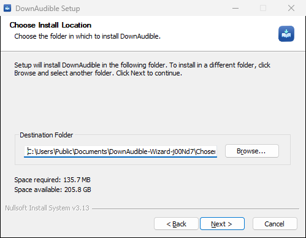
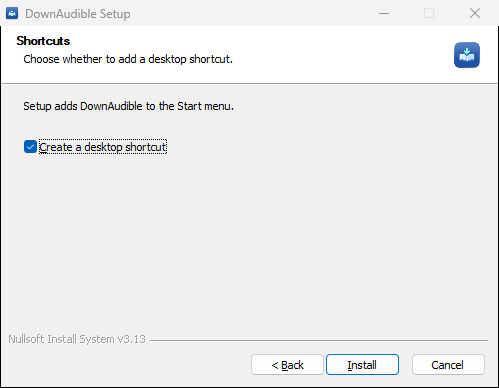
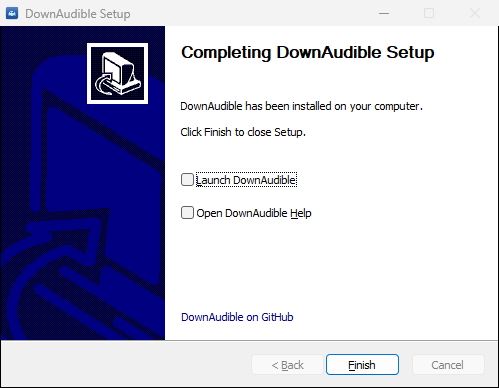
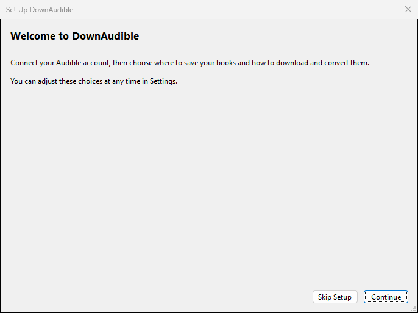
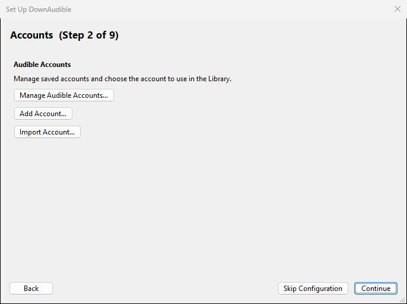
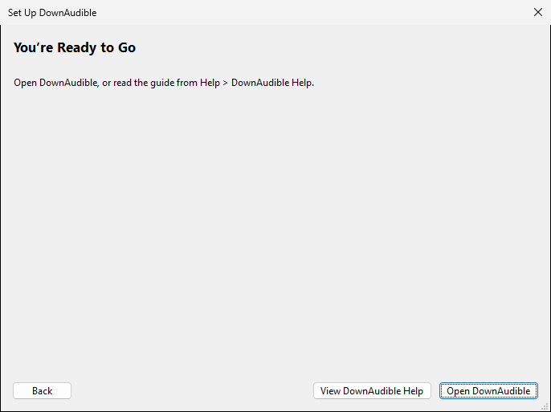
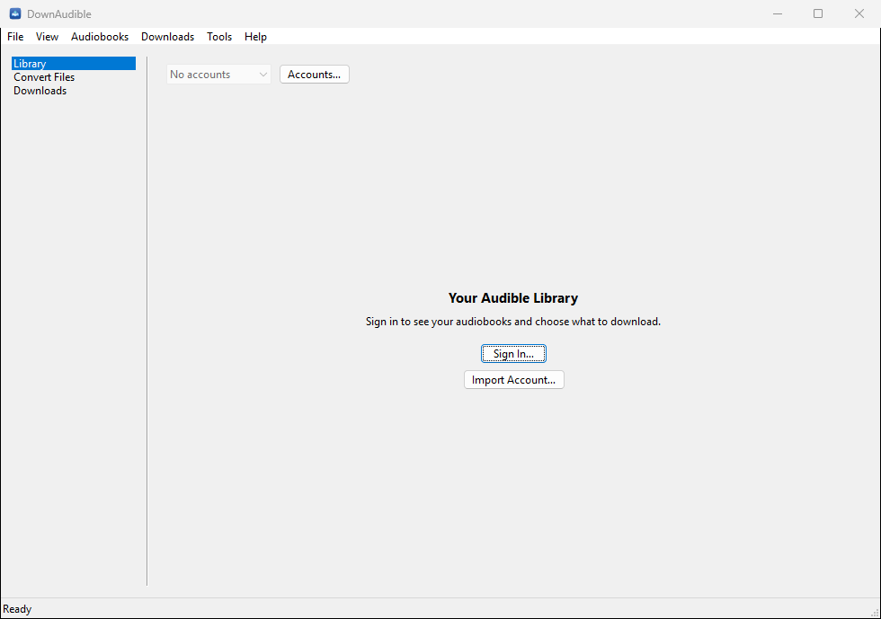
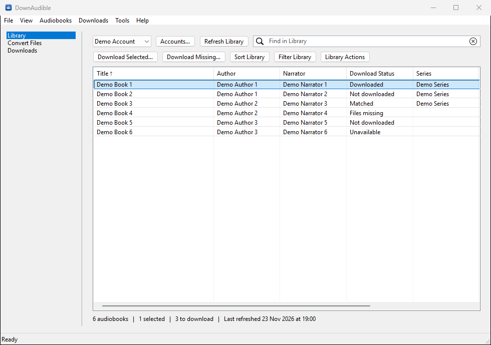
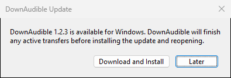
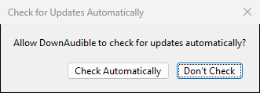

# Getting Started

DownAudible lets you save and organise audiobooks from your Audible library. You can also convert local files without connecting an account when the source audio can be read directly.

## Install DownAudible

Open the installer and choose **Next**. Keep the suggested folder for your Windows account, or choose **Browse…** and pick a new or empty folder. If you are updating DownAudible, Setup uses the current installation folder.

On **Shortcuts**, select **Create a desktop shortcut** if you want one. Setup always adds DownAudible to Start. Choose **Install**.

On the last page, select **Launch DownAudible** or **Open DownAudible Help** if you want either to open when you choose **Finish**. **DownAudible on GitHub** opens the project’s repository in your browser.

If you downloaded the portable ZIP, extract the entire folder and open **DownAudible.exe** inside it.

## Set up DownAudible

1. Open **DownAudible**.
2. Choose **Continue** in setup. The pages use the same controls as **File > Settings…**.
3. On **Accounts**, choose **Add Account…** to connect Audible, or **Import Account…** to bring in an existing account. See [Accounts and Sign-In](help-02-accounts.md).
4. On **Files**, choose your archive folder. Review **Downloads**, **Conversion**, **Jobs**, and **Notifications** as needed.
5. Choose **Open DownAudible** or **View DownAudible Help**.

Choose **Skip Setup** to go to the final page with the default settings. From a settings page, **Skip Configuration** keeps your choices and goes to the final page. **Back** returns to the last page you visited. To return to the wizard later, choose **Help > Set Up DownAudible…**.

## Your first download

Select your account in **Library** and choose **Refresh Library**. If you have no account connected, use **Sign In…** or **Import Account…** in the Library. Select an audiobook, choose **Download Selected…**, and review what to save and the destination. Choose **Download** to start the job. Open **Downloads** to follow it.

By default, DownAudible saves into the **Audiobooks** folder in your Documents folder. To play a converted file, select its finished job in **Downloads** and choose **Open in Player** from **Download Actions**.

## The workspaces

| Workspace | Use it to |
| --- | --- |
| **Library** | Browse, search, manage and download Audible books. |
| **Convert Files** | Queue local audio for conversion and open the book editor. |
| **Downloads** | Follow active jobs, see earlier batches and resume incomplete work. |

Choose a workspace in the sidebar or open it from **View**. **Show Sidebar** and **Show Status Bar** control which parts of the main window are shown.

## Software updates

Choose **Help > Check for Updates…** to look for a newer Windows release. In a signed installation with a trusted publisher, choose **Download and Install** to verify the installer, finish any active transfers, and reopen DownAudible after installation. In a portable copy or an experimental unsigned build, choose **Open Release Page** to download the update.

After setup, DownAudible asks whether to check for updates automatically the next time you open it. Choose **Check Automatically** or **Don’t Check**. If you also turn on **Install updates automatically** in a signed installation, DownAudible downloads verified updates and installs them when you exit with the transfer queue idle. Review your update preferences in [Settings Reference](help-12-settings.md).

## Help and keyboard navigation

Press **F1** or choose **Help > DownAudible Help**. The manual opens in your browser from files installed with the app. Use **Tab** to reach controls, the arrow keys to move in lists, and **Shift+F10** for the contextual menu where available.

The **Help** menu also opens [Widevine Stereo](help-13-widevine.md) and [Audiobookshelf](help-14-audiobookshelf.md) directly.

[See all keyboard shortcuts](help-10-keyboard-shortcuts.md)

## Support DownAudible

If you like DownAudible and you’d like to support my work, you can [make a donation](https://www.paypal.com/donate/?hosted_button_id=WMLX4PLED9PRE). There’s no pressure or hard sell. DownAudible is and always will be free.
