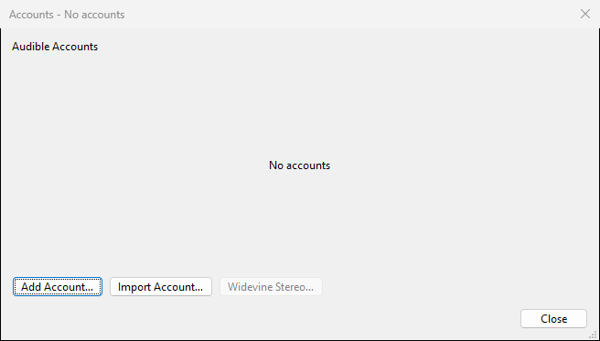
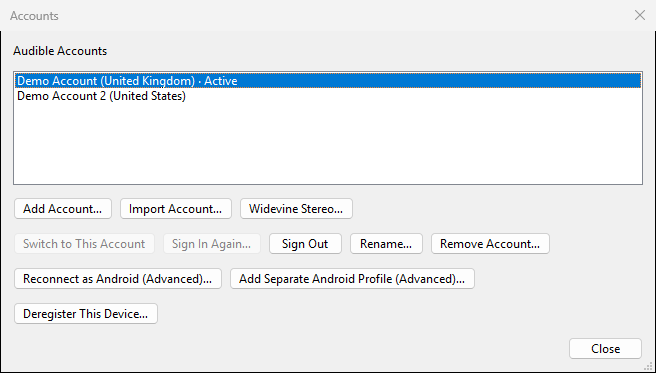
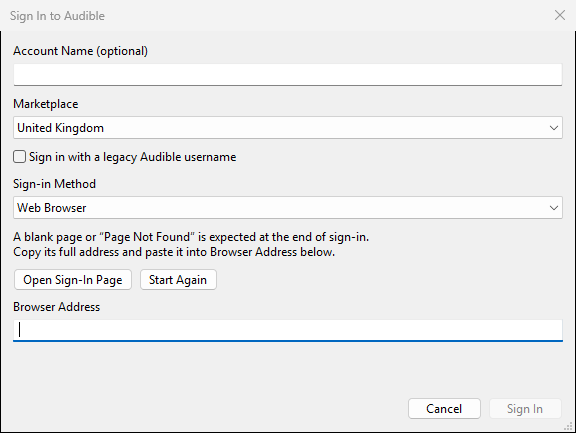
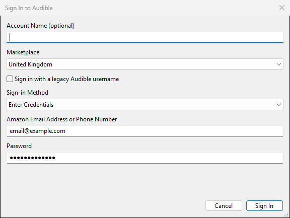
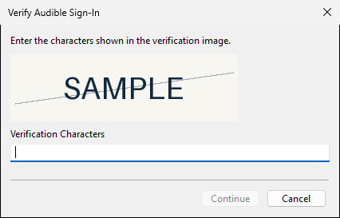
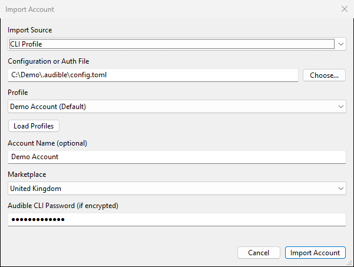
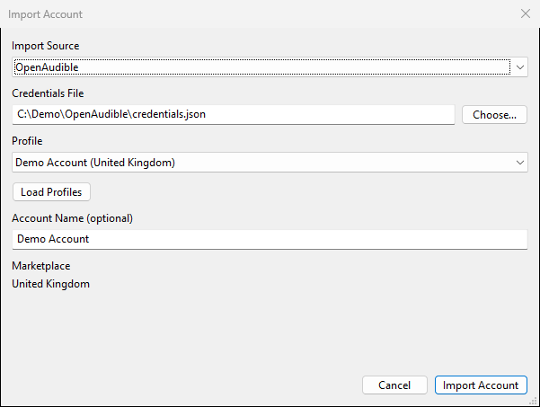
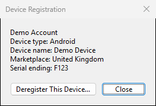

# Accounts and Sign-In

## Choose a sign-in method

In setup, open the **Accounts** page. In the app, open **File > Settings > Accounts** or choose **Accounts…** in the Library. The Accounts window shows **No accounts** until you add or import an Audible account. Select **Add Account…** and choose your Audible marketplace. Give the account a name you will recognise if you use several accounts.

Turn on **Sign in with a legacy Audible username** if you use an Audible username. This option is available for the United Kingdom, United States, and Germany.

## Sign in with your browser

1. Set **Sign-in Method** to **Web Browser** and select **Open Sign-In Page**.
2. Complete the sign-in in your browser, including any verification it asks for. The last page may be blank or display a “Page Not Found” message.
3. Copy the full address of the last page to **Browser Address** in DownAudible and select **Sign In**.

Choose **Start Again** if you need to clear the pasted address and start a new sign-in. Select **Open Sign-In Page** to continue in your browser.

If DownAudible could not open your browser, choose **Copy Sign-In Link**, then paste the link into your browser’s address bar.

Press Control+Shift+B to open the sign-in page or Control+Shift+N to start again.

## Enter your credentials

Set **Sign-in Method** to **Enter Credentials**. Enter your Amazon email address or phone number and password, then select **Sign In**. If you turned on legacy username sign-in, enter your Audible username and password.

Follow the verification prompts. If a verification image fails to load, choose **Open Verification Image in Browser** to see it. If Amazon asks you to approve the sign-in on another device, approve it first, then confirm in DownAudible. Use **Web Browser** if you need another way to verify. Windows encrypts the saved session for your Windows account. DownAudible discards the password.

## Sign in with an Android registration

Choose **Android Browser (Advanced)** to prepare a new profile for optional Widevine. To use the same Audible account in an existing or separate profile, see [Widevine Stereo](help-13-widevine.md#prepare-an-android-sign-in).

## Import an account

Select **Import Account…** on the **Accounts** page or in the **Accounts** window. Choose **CLI Profile** to load the profiles in `config.toml`. DownAudible looks in the configured Audible CLI folder, usually `.audible` in your home folder. Select **Choose…** or press Control+Shift+O to locate another configuration. DownAudible reads it and selects the default profile when one is available.

Choose **Auth File** and select **Choose…** to open an authentication file directly. DownAudible checks the file and shows the password field if the file is encrypted. You can give the imported account a name and choose its marketplace if the file does not identify it. Select **Import Account** to save the session.

## Import from OpenAudible

Choose **Import Account…**, set **Import Source** to **OpenAudible**, and choose the `credentials.json` file saved by OpenAudible. Select a **Profile** and check its marketplace. You can change the name shown in DownAudible before selecting **Import Account**.

DownAudible verifies the saved sign-in with Audible, then stores it encrypted for your Windows account. Repeat these steps to import another profile from the file. If Audible rejects a sign-in, reconnect that account in OpenAudible and choose its current file.

The apps share the imported device registration. **Deregister This Device…** in DownAudible also revokes that registration for OpenAudible. Use **Match Existing Folder…** to connect audio you saved in OpenAudible. [Library and File Matching](help-03-library.md)

## Enable Widevine stereo

Widevine is off by default and applies to the selected profile. Open [Widevine Stereo](help-13-widevine.md#enable-widevine-and-review-what-is-shared) for the account requirements, provider information, and steps to enable it.

## Switch or remove an account

Choose an account from the account list in the Library toolbar. You can also open **Accounts…**, select the account and choose **Switch to This Account**. The Library loads the selected account. Transfers already queued keep the account they started with.

**Sign Out** clears the saved session. To use the same entry and marketplace again, select **Sign In Again…**. Choose **Remove Account…** to clear the session, the account entry, and the file matches for that account. Use the matching commands in Library to connect existing audio to another account.

Select **Rename…** to change the name shown in DownAudible. Wait for an active download or conversion batch to finish before signing out or removing an account.

## Deregister this saved device

Select a signed-in profile in **Tools > Audible Accounts…**, then choose **Deregister This Device…**. Review the marketplace and saved device details. Choose **Deregister This Device…** in the dialog and confirm **Deregister Device** when ready.

Once Amazon confirms deregistration, DownAudible clears the saved sign-in and Widevine setup for the selected profile. Your profile and saved audio remain. Choose **Sign In Again…** to connect a fresh device registration.

[Library and File Matching](help-03-library.md) · [Audible Tools](help-08-audible-tools.md)

## Support DownAudible

If you like DownAudible and you’d like to support my work, you can [make a donation](https://www.paypal.com/donate/?hosted_button_id=WMLX4PLED9PRE). There’s no pressure or hard sell. DownAudible is and always will be free.
