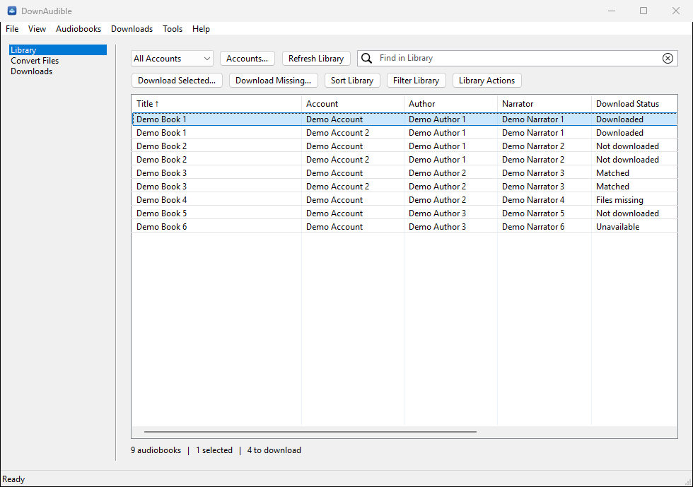
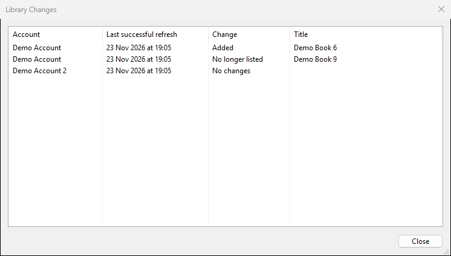
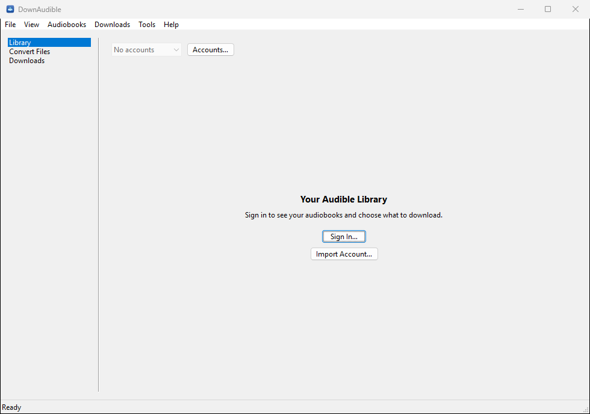
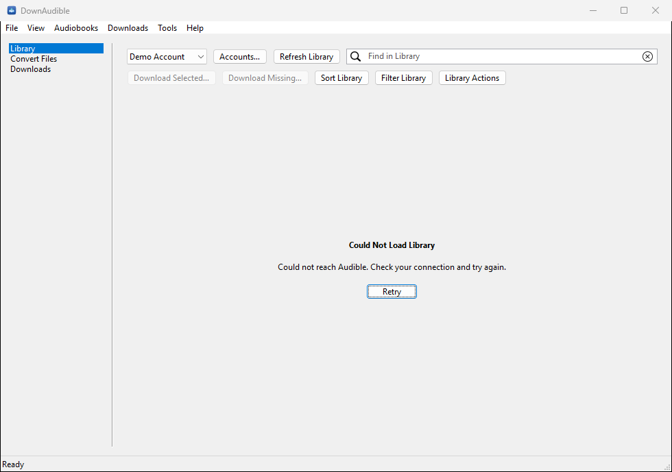
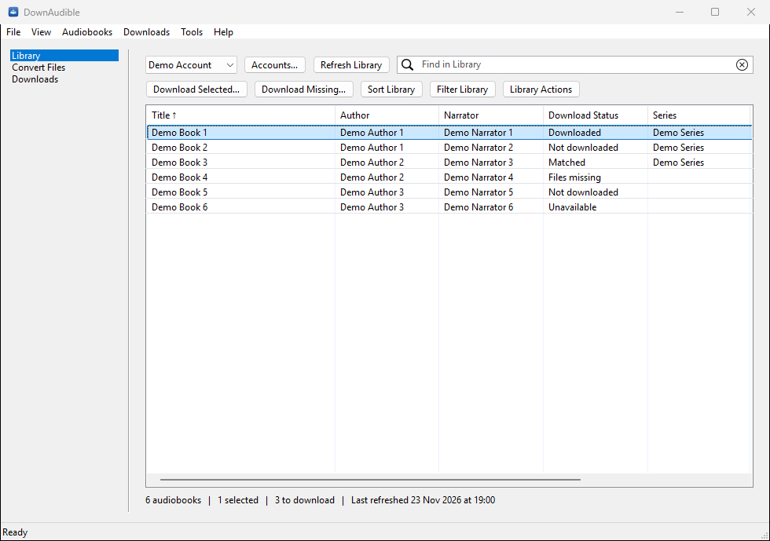
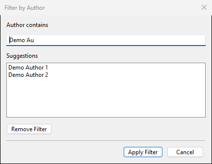
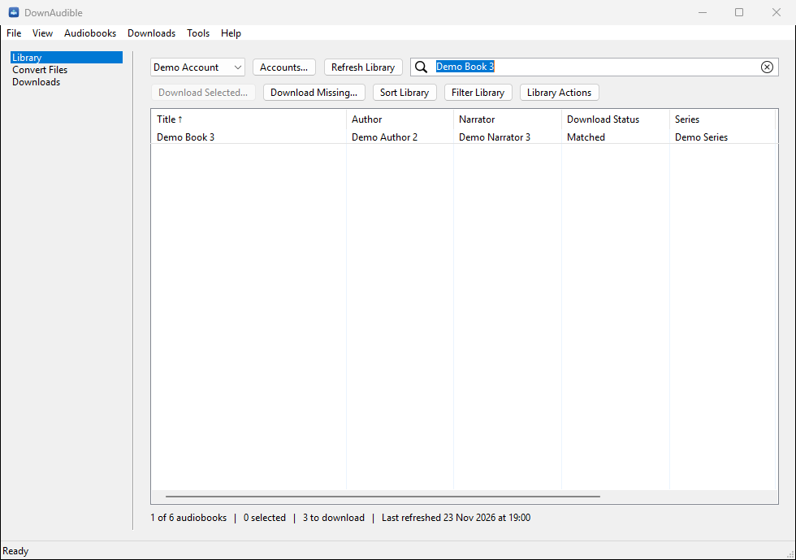
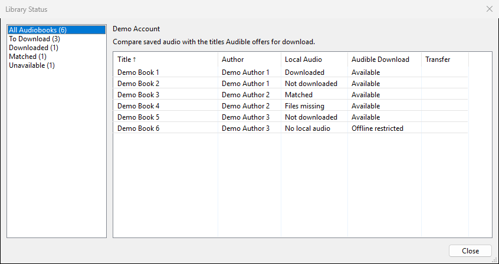
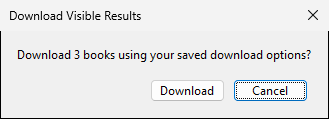
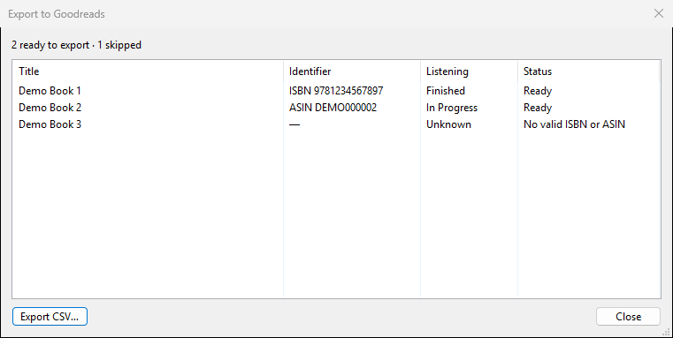

# Library and File Matching

## Browse your books

Choose **Library** in the sidebar or press Control+1. If the Library is signed out, choose **Sign In…** or **Import Account…**. **Refresh Library** loads the active Audible account’s titles. If the library could not load, read the message and choose **Retry**. If your existing titles are still visible, choose **Refresh Library** to try again.

DownAudible keeps the last successful library refresh for each signed-in account. You can browse, search, and export those titles while offline. The status line shows the refresh time in a single-account view. Choose **All Accounts** in the Library account list to browse saved titles together. The **Account** column identifies each title’s profile. Downloads use the account on each row. Choose an individual profile for its folder matching and archive verification.

Choose **Audiobooks > Refresh All Accounts** to refresh every signed-in profile. Choose **Audiobooks > Library Changes…** to see added and no-longer-listed titles since the last successful refresh with the same request settings. In **Settings > Library**, turn on **Refresh signed-in accounts in the background** to check every 30 minutes while DownAudible is open.

Select **Sort Library** and choose a field and direction. You can also select a column header and select it again to reverse the sort. Books with no value for the sort field appear last. DownAudible remembers the sort for each account.

Drag a column header to move that column. DownAudible remembers the column order across accounts and app launches.

Select **Filter Library** to filter by title, author, series, narrator, genre, language, release year, tag, access, listening progress, or download status. Use **Access** to show **Audible Plus**, **Indefinite Access**, **Other Titles**, or **Unknown**. Use **Listening Progress** to show **Not Started**, **In Progress**, **Finished**, or **Unknown**. Enter a year from 1 through 9999 for **Release Year**. Several filters can apply at once, and the Library lists them above the table. Choose **Clear Filters** to show all results that match the search.

As you type, DownAudible suggests values from books that match your search and other filters. Press Up or Down Arrow to move to the suggestions, then press Enter to apply the selected value. In **Settings > Library**, turn off **Suggest values for library filters** to hide suggestions.

Press Control+F or focus **Find in Library** to search by title, author, narrator, series, or ASIN. Search applies within the current filters. Press Enter to move from the search field to the results. Hold Control to select individual books or Shift to select a range. Press Control+A in the results to select all visible books, or Shift+F10 to open the selected book's context menu. In **File > Settings > Library**, choose a podcast option, set the purchase date range, or change **Items per request**. Refresh the library after changing request options.

In **Audiobooks > Saved Views**, choose **Save Current View…** and name a reusable search, filter and sort combination. Each profile has its own saved views. **All Accounts** has its own saved views too. Choose a name from the menu to apply it. **Manage Saved Views…** renames or deletes saved views. To tag selected books, open their context menu and choose **Tags…**. Enter comma-separated names, or clear the field to remove the tags. Tags stay in DownAudible and work with **Find in Library** and the **Tag** filter.

## Check library status

The bottom of the Library shows how many titles are visible, selected, and eligible for **Download Missing**. Choose **View > Library Status…** or select **Library Status…** from **Library Actions**. Choose **To Download**, **Downloaded**, **Matched**, or **Unavailable** to see the titles in that group. The table shows the state of your saved audio, whether Audible offers a download, and any transfer in progress. Select a heading to sort the report. When saved files are missing, the status names the files. **Show Status Bar** in the **View** menu controls the Library counts.

| Status | Meaning |
| --- | --- |
| Not downloaded | Audio has not been saved. |
| Incomplete | Part of the download is saved. |
| Files missing | A recorded copy is missing from disk. |
| Downloaded | Audio is saved in the archive. |
| Matched | A linked local audio file is available. |
| Unavailable | Audible does not offer a download for this title. |

After moving or deleting files, choose **Library Actions > Recheck Saved Files** to update the Library.

## Match audio files

Choose **Library Actions > Match Existing Folder…** and select the folder that contains your audio. The scan includes subfolders. DownAudible compares audiobook identifiers, tags and filenames, and uses a book’s duration when available.

Choose **Rescan Matched Folder** after adding or moving files. Choose **Show Matched Folder in File Explorer** to open the folder. **Stop Matching This Folder** disconnects its automatic matches and keeps the audio files and individual matches.

For a particular book, open its context menu and choose **Match to Audio Files…** or **Change Matched Files…**. Select all the files that belong to the title if it spans more than one file. To unlink a selection, choose **Remove File Match**. To check saved and matched audio, choose **Library Actions > Verify and Repair Archive…**.

Open a book’s context menu or **Library Actions > Selected Books**, then choose **Edit Book…** to work with its audio in the editor. For books with saved files, choose **Show Audio in File Explorer** to find the files or **Open Audio in Default Player** to open them with their Windows file associations. Choose **Copy Title** or **Copy ASIN** to copy book information.

## Download or export books

In **Audiobooks > Download**, choose **Download Selected** to use the saved settings or **Download Selected As…** to review the options. **Download Missing** and **Download Entire Library** work across the loaded library. **Download Visible Results…** includes the current search and filter results only. Review the count before starting a bulk download, or choose one of the **As…** commands to review the options too.

During a download, use **Add Selected to Queue…** or **Add Visible Results to Queue…** to include more books from the current account using the batch’s destination and options.

If a partial download repeatedly fails, select its title and choose **Restart Incomplete Downloads…** from the context menu to start it from the beginning.

Choose **Library Actions > Export Library…** to save the loaded library as JSON, CSV, TSV, or an Excel workbook (`.xlsx`). Choose **Export Visible Results…** to save the search and filter results in their displayed order.

## Export to Goodreads

Choose **Audiobooks > Export Visible Results to Goodreads…** to export the current search and filter results. To export a selection, open its context menu and choose **Export Selected to Goodreads…**. Review the preview and choose **Export CSV…**. The preview shows titles skipped for missing identifiers or duplicate editions.

The CSV uses the book’s ISBN when available and its Audible ASIN otherwise. DownAudible uses Audible’s listening progress to choose the shelf when that progress is available and leaves the read date blank. Sign in to Goodreads and use its [Import and Export Library](https://www.goodreads.com/review/import) page to upload the CSV. Review any editions Goodreads could not match after import.

## Keyboard shortcuts

| Command | Shortcut |
| --- | --- |
| Library | Control+1 |
| Find in Library | Control+F |
| Refresh Library | Control+R |
| Select All Books | Control+Shift+A |
| Library Status | Control+Shift+S |
| Edit Book | Control+E |

[Downloading Books](help-04-downloads.md) · [Downloads and Recovery](help-07-transfers.md) · [Audible Tools](help-08-audible-tools.md)

## Support DownAudible

If you like DownAudible and you’d like to support my work, you can [make a donation](https://www.paypal.com/donate/?hosted_button_id=WMLX4PLED9PRE). There’s no pressure or hard sell. DownAudible is and always will be free.
