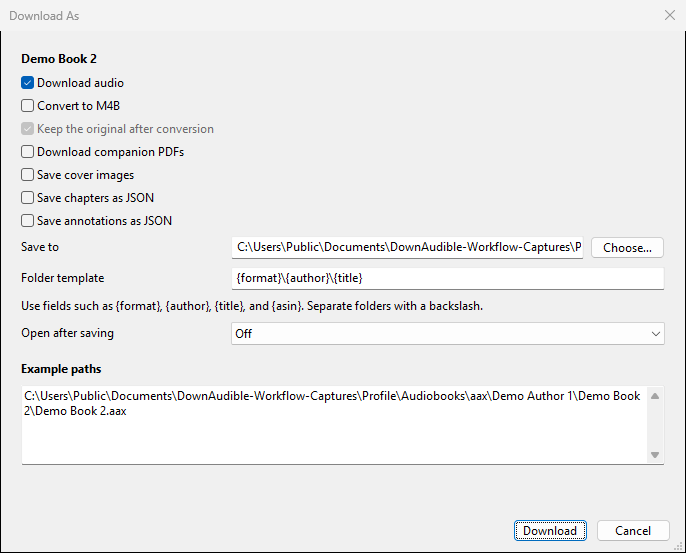
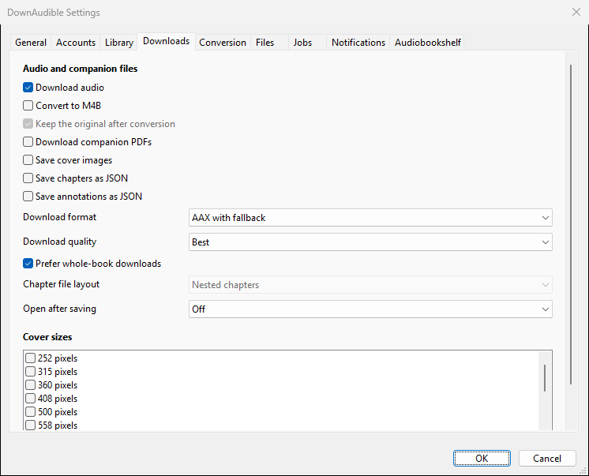

# Downloading Books

## Choose books and files

In **Library**, select one or more books. Choose **Download Selected** to use your saved options. When several books are selected, confirm the count first. Choose **Download Selected As…** to review the options. **Download Entire Library** covers the loaded library, including books outside the current search. **Download Visible Results…** includes only the titles shown by the current search and filters. Confirm the count to use your saved options, or choose **Download Entire Library As…** to review the options first.

**Download Missing** rechecks saved and matched files for eligible titles whose audio is unsaved, incomplete, or missing. It requests audio even when your saved options only include companion files. **Download Missing As…** opens the options with **Download audio** checked.

Choose any combination of audio, available PDFs, cover images, chapter JSON and annotation JSON. For companion files only, clear **Download audio**. **Convert to M4B**, **M4A**, or **MP3** uses your chosen conversion profile. With conversion on, **Keep the original after conversion** saves the source file too. **Open after saving** can open the first original audio file or the first converted file in the Windows app associated with that format.

Choose **Audiobooks > Download > Download Missing PDFs…** to find titles in the current account view with a PDF available and no complete PDF recorded in the selected archive. Confirm **Download PDFs** to queue only the missing companion PDFs. This also checks titles with saved audio. The audio stays in place.

Use **Save to** and **Folder template** to choose where the files go. **Example paths** shows where DownAudible expects to save the first title. Choosing **Download** saves your choices, destination and template for later downloads.

## Format and quality

Open **File > Settings… > Downloads** to choose defaults and the format requested from Audible.

| Setting | Choices |
| --- | --- |
| **Download format** | **AAX with fallback** is the default. It tries AAX and requests AAXC if needed. **AAX only** requires AAX. **AAXC** requests AAXC directly. |
| **Download quality** | **Best**, **High**, or **Normal**. The title and marketplace determine the files Audible can supply. |
| **Prefer whole-book downloads** | Request a single file before trying parts. Turn it off to prefer individual parts for titles that Audible lists as multipart. |
| **Chapter file layout** | Save nested chapters or a flat list when saving chapter JSON. |
| **Cover sizes** | Check one or more sizes. **Use Largest Available** clears the choices and uses Audible’s largest available cover. |

With **AAX with fallback**, you can also enable [Widevine Stereo](help-13-widevine.md) for a compatible Android Audible sign-in. Available quality depends on what Audible supplies for the title and account.

## Continue an interrupted download

In **Downloads**, choose **Retry Incomplete** to resume eligible partial audio. DownAudible resumes when Audible confirms that the source matches the partial file. Use **Restart Incomplete Downloads…** to discard partial audio and start at the beginning. See [Downloads and Recovery](help-07-transfers.md) for retry and recovery controls.

To restart a title from **Library**, open its contextual menu and choose **Restart Incomplete Downloads…**. The dialog keeps audio selected and uses the destination that holds the partial download. Choose **Restart** to discard the partial audio and download the title again.

- [Converting Audio](help-05-conversion.md)
- [Naming and Folders](help-06-files.md)
- [Settings Reference](help-12-settings.md)

## Support DownAudible

If you like DownAudible and you’d like to support my work, you can [make a donation](https://www.paypal.com/donate/?hosted_button_id=WMLX4PLED9PRE). There’s no pressure or hard sell. DownAudible is and always will be free.
