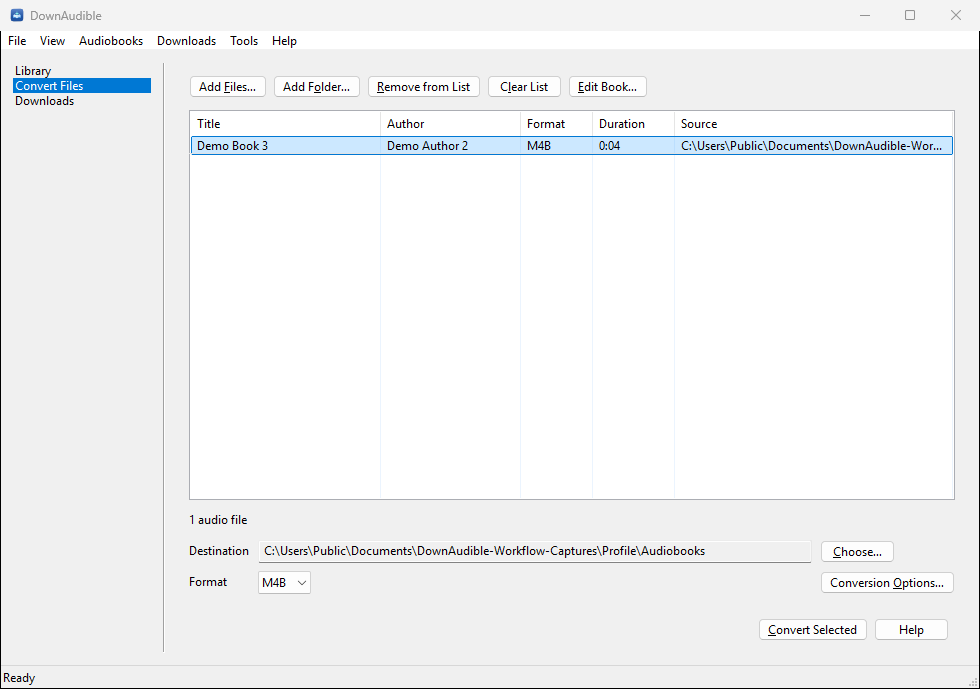
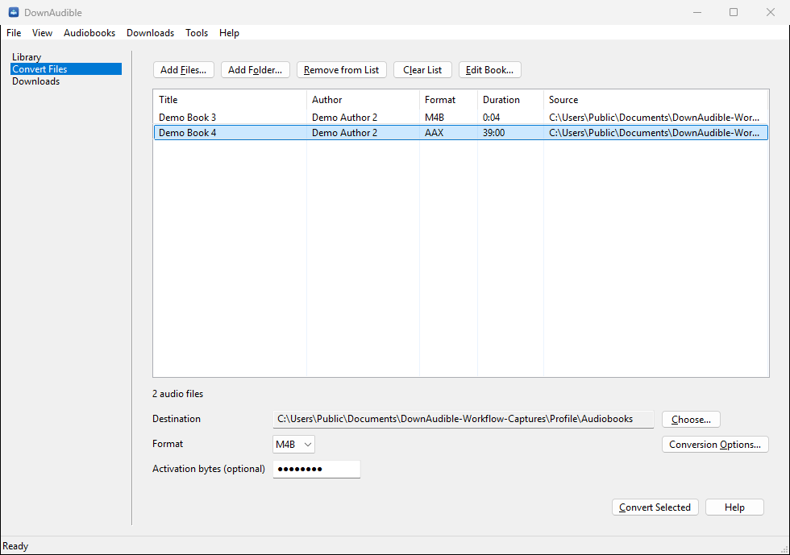
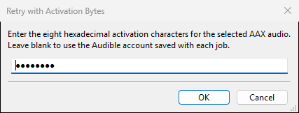
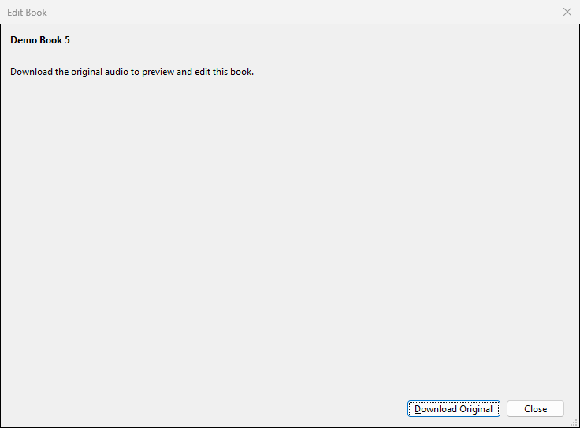
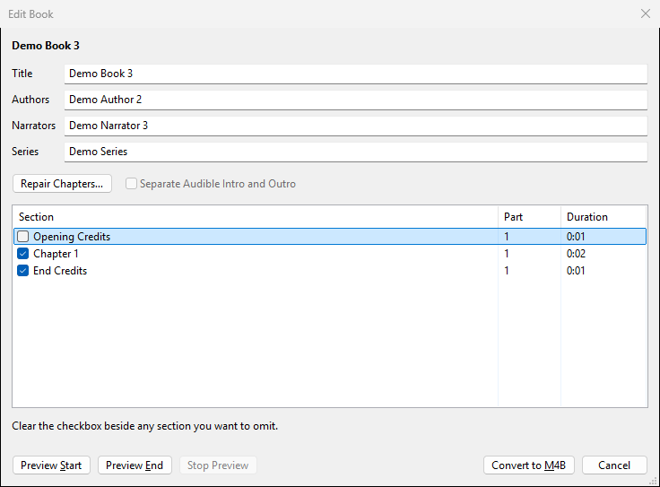
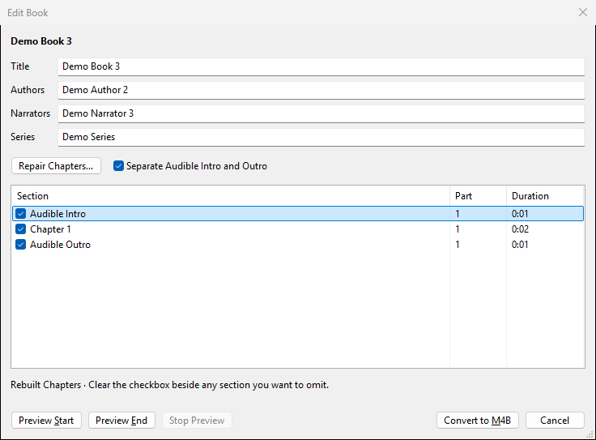
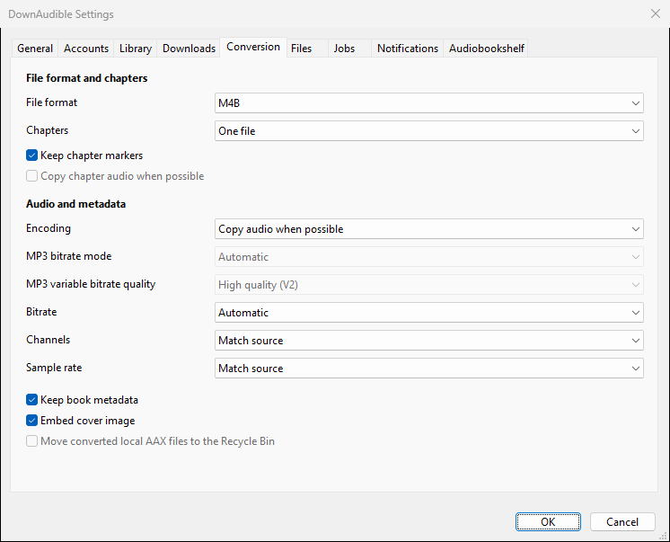
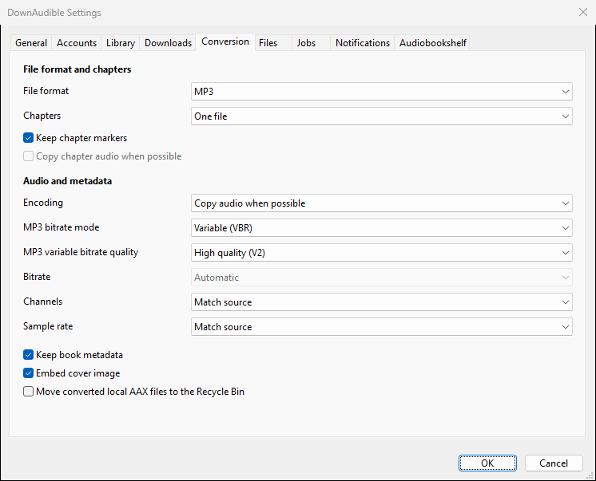
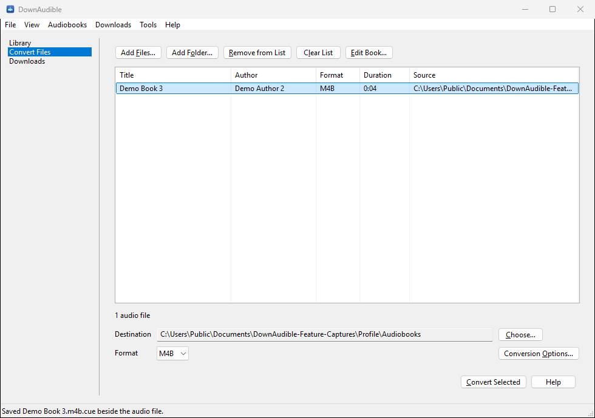

# Converting Audio

## Convert a download

Select **Convert to M4B**, **Convert to M4A**, or **Convert to MP3** in the download dialog. The label reflects the format you choose under **Settings > Conversion**. Select **Keep the original after conversion** to save the Audible files alongside the output. When available, DownAudible adds book details supplied by Audible.

If an AAX download cannot be unlocked, DownAudible tries the account’s activation bytes again. With **AAX with fallback** selected, DownAudible requests an AAXC copy for conversion if the activation bytes still fail. Any AAX copy already saved stays in your archive.

## Convert files already on your PC

Open **Convert Files**. Choose **Add Files…** or **Add Folder…**, or drag audio from File Explorer into the list. DownAudible reads AAX, AAXC, AA, M4B, M4A and MP3. You can also use **File > Add Audio Files…** or **File > Add Audio Folder…**. DownAudible keeps the supported files if some of the items you selected cannot be opened.

Choose the destination and format below the list. These are the same settings DownAudible uses for other conversions and downloads. The archive’s folder and filename templates apply to the output.

Select one or more rows and choose **Convert Selected**. With nothing selected, choose **Convert All** to queue every file in the list. Select **Conversion Options…** to change the format, chapter layout, encoding, or metadata options. You can also find these commands under **Audiobooks > Conversion**. Track progress under **Downloads**.

Click a column heading to sort the list. Press **Ctrl+A** with the list focused to select every row. Right-click a selection to convert it, edit it, show files in File Explorer, or copy their paths. Choose **Open Audio in Default Player** to open selected M4B, M4A or MP3 files. Select **Remove from List**, or press Delete or Backspace while the list has focus, to remove selected entries. Use **Clear List** to remove every entry. Removing an entry keeps the source file on disk.

## Activation bytes and AAXC licences

When the list includes an AAX file, **Activation bytes (optional)** appears below the list. Leave it blank to use the connected Audible account. For a file downloaded from another account, enter that account’s eight hexadecimal activation characters before converting. If the job fails with an activation error, select it in **Downloads** and choose **Download Actions > Retry with Activation Bytes…** to enter the corrected code. Leave the dialog blank to use the Audible account saved with the job.

An AAXC file needs its saved licence. For a compatible `.voucher` file, keep it in the same folder with the same base name as the audio file. Keep multipart audio and its companion files together when you move them.

## Edit a book before conversion

Select one book in **Library** and choose **Edit Book…** from its context menu. If the archive has no copy, choose **Download Original**. The editor shows download progress and loads the audio when it is ready. If the download fails, choose **Retry Download**. If the editor cannot read the saved audio, choose **Try Again**. In **Convert Files**, select the file or the parts of the same book and choose **Edit Book…**. DownAudible puts local parts in filename order.

The editor uses the chapter markers in matched or converted files. A file without markers appears as one section. Select a row, then choose **Preview Start** or **Preview End** to hear up to ten seconds at that end of the section. Use **Stop Preview** to stop playback. Clear the checkbox beside each section you want to omit. The sections list also works from the keyboard. Press Space with a row selected to change its checkbox.

For a multipart book, open a section’s context menu to keep, omit or preview its entire part.

With **Keep book metadata** enabled in **Settings > Conversion**, edit the title, authors, narrators or series to change the tags in the output. Keep at least one section checked and choose **Convert to M4B**. DownAudible saves a separate M4B and adds ` - Edited` to the filename when you omit audio. The source files stay in place.

## Repair chapter markers

Open **Edit Book…** with the complete audio for one edition. Choose **Repair Chapters… > Get Chapters from Audible** when the editor has an Audible title and you’re signed in. To work offline with a chapter file saved by DownAudible or Audible CLI, choose **Repair Chapters… > Choose Chapter JSON…**. Choose chapter data for the edition you’re editing. DownAudible checks the runtime and any available Audible title identifiers before applying it.

When the chapter data gives timings for Audible’s spoken intro or outro, turn on **Separate Audible Intro and Outro** to give each available announcement its own chapter. Use **Preview Start** or **Preview End** to check the new markers. Loading a different chapter map or changing the intro and outro option checks all sections again. To go back to the audio’s original chapters, choose **Repair Chapters… > Use Existing Chapters**.

Choose **Convert to M4B** to save a separate copy with the rebuilt chapter markers. With every section checked, DownAudible keeps the complete audio and adds ` - Chapters Repaired` to the filename. Uncheck a section only when you want to omit its audio.

## Move converted AAX files to the Recycle Bin

For a local conversion, choose **MP3** and turn on **Move converted local AAX files to the Recycle Bin** in **Settings > Conversion**. DownAudible can recycle an AAX source after saving the converted audio. Restore it from the Recycle Bin if you need it again. If Windows cannot recycle the file, DownAudible leaves it in place and shows a warning in **Downloads**.

For a Library conversion, clear **Keep the original after conversion** to recycle an AAX that DownAudible previously saved in your archive. Audio files you matched from another folder stay there. Cleanup requires a new, successful conversion. If recycling fails, use **Retry Incomplete** in **Downloads** to try the cleanup again using the saved MP3.

## Format and chapters

In **Settings > Conversion**, choose M4B, M4A or MP3. Use **One file** for a single audiobook or **Separate chapter files** to save each chapter as its own track. For one file, **Copy audio when possible** preserves a compatible audio stream. **Always encode** writes a new stream. Selecting a specific bitrate, channel count or sample rate can require encoding.

For separate M4B or M4A files, select **Copy chapter audio when possible** and leave bitrate, channels and sample rate at their defaults to copy compatible AAC chapter audio. DownAudible encodes other chapters, including chapters that span two source files. If your audio player plays extra audio at a copied chapter boundary, clear the setting and convert again.

For MP3, **Constant (CBR)** uses one bitrate throughout. **Variable (VBR)** uses the selected quality level and changes the bitrate as the audio changes. If a bitrate is unavailable at the chosen sample rate, use a lower bitrate or a higher sample rate.

Use **Keep chapter markers** for a single file with chapter navigation. **Keep book metadata** controls tags and **Embed cover image** controls cover art. Separate chapter files include a track number and a title like `Chapter 3 - The Garden` when metadata is enabled.

Use one M4B with chapter markers for a player that supports audiobook chapters. If your player sorts MP3 files by name, select **Separate chapter files** and place `{chapterNumber}` before `{chapter}` in the chapter filename template.

## Export a CUE sheet

In **Convert Files**, select one saved M4B, M4A, or MP3 with embedded chapter markers and choose **Export CUE Sheet…** from its context menu. This command also appears in **Library** when you select one title with a single saved playable file. DownAudible saves a `.cue` file beside the audio file using the chapter start positions in that file. Keep the two files together and use a player that supports CUE sheets and your audio format. Each sheet can hold up to 99 chapter indexes.

## Keyboard shortcuts

| Command | Shortcut |
| --- | --- |
| Convert Files | Ctrl+3 |
| Add Audio Files… | Ctrl+O |
| Add Audio Folder… | Ctrl+Shift+O |
| Edit Book… | Ctrl+E |
| Select all in the conversion list | Ctrl+A |
| Remove selected entries from the conversion list | Delete or Backspace |

## Related chapters

- [Downloading Books](help-04-downloads.md)
- [Naming and Folders](help-06-files.md)
- [Audible Tools](help-08-audible-tools.md)

## Support DownAudible

If you like DownAudible and you’d like to support my work, you can [make a donation](https://www.paypal.com/donate/?hosted_button_id=WMLX4PLED9PRE). There’s no pressure or hard sell. DownAudible is and always will be free.
