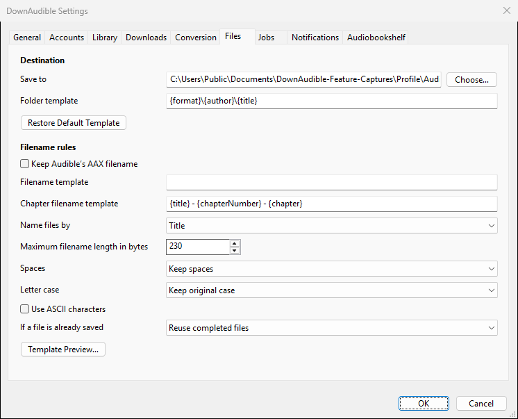
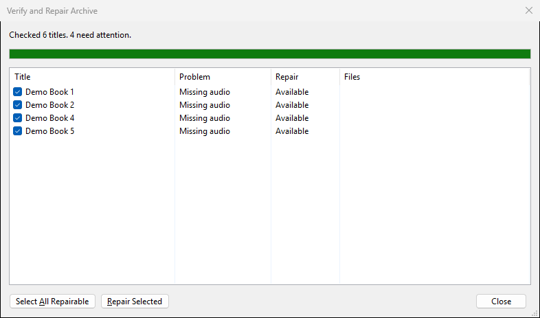

# Naming and Folders

## Destination and matching

Choose the archive destination under **Settings > Files**. The Library uses saved audio from that destination when it shows which books are downloaded. To link files from another archive, open **Library Actions > Match Existing Folder…** and choose the folder. You can also select a single book and choose **Match to Audio Files…** from its context menu. When you match the parts of one book, keep all its parts available.

DownAudible uses available book identifiers, titles, authors and audio duration to match a folder. You can match a file manually if its tags are missing or if there are multiple candidates.



## Verify and repair the archive

Choose **Audiobooks > Verify and Repair Archive…**. DownAudible checks the current account’s saved audio for the destination set in **Settings > Files**. It also checks matched files and identifies partial downloads for that destination. It decodes M4B, M4A and MP3 audio to check playback. For Audible originals, it checks the file structure and the recorded size when available. Select **Cancel** to stop the check.

The report lists titles with missing, incomplete, or unreadable audio. If a saved or partial copy needs attention and Audible no longer offers that title for download, the report shows repair as **Unavailable**. Check the titles to repair. To select repairable rows using the keyboard, highlight the rows and press Space, or choose **Select All Repairable**. Choose **Repair Selected** to queue replacement audio in **Downloads**. Repair uses your saved conversion options and adds replacement audio alongside existing files.



## Templates

Use a backslash (`\`) in **Folder template** to start another folder. Enter one separator between folder names. The default `{format}\{author}\{title}` puts an Audible original and its converted copy in different folders. A book named *Sample Book* by *Example Author* can yield these files.

```text
aax\Example Author\Sample Book\Sample Book.aax
m4b\Example Author\Sample Book\Sample Book.m4b
```

DownAudible replaces tokens in braces with details about the book or file. You can use `{title}`, `{subtitle}`, `{author}`, `{authors}`, `{narrator}`, `{narrators}`, `{series}`, `{seriesNumber}`, `{publisher}`, `{year}`, `{language}`, `{asin}` and `{format}`. Use `{chapter}` and `{chapterNumber}` for chapter files and `{partNumber}` for a multipart download. A token can be blank when the book has no value for it.

Use `{?field|text}` to include text only when that field has a value. For example, `{?series|{series} - }{title}` includes the series and the dash when the book belongs to a series. A template such as `{author}\{?series|{series}}\{title}` skips the series folder when the series is blank. A segment can contain tokens and literal text. Keep each segment within one folder component and outside other conditional segments.

Choose **Template Preview…** to see the result for a sample title. Choose **Restore Default Template** to restore the folder template.

DownAudible also accepts forward slashes in folder templates and saves them as backslashes.

## Filename rules

Use **Filename template** to name files or leave it blank to use **Name files by**. **Chapter filename template** names separate chapter files. DownAudible adds the correct extension. Set **Spaces**, **Letter case**, or **Use ASCII characters** to suit your player. The **Maximum filename length in bytes** includes the extension. DownAudible substitutes safe characters and shortens generated names when Windows requires it. If your destination path is too long, choose a folder closer to the drive root.

Select **Keep Audible’s AAX filename** to keep a usable name supplied by Audible. The folder template still controls the folder. If the name cannot be used, DownAudible uses your filename rules. When a name is already taken, a new copy gets a numbered suffix. **If a file is already saved** controls whether a completed transfer can reuse its files.

## Related chapters

- [Downloading Books](help-04-downloads.md)
- [Converting Audio](help-05-conversion.md)
- [Downloads and Recovery](help-07-transfers.md)

## Support DownAudible

If you like DownAudible and you’d like to support my work, you can [make a donation](https://www.paypal.com/donate/?hosted_button_id=WMLX4PLED9PRE). There’s no pressure or hard sell. DownAudible is and always will be free.
