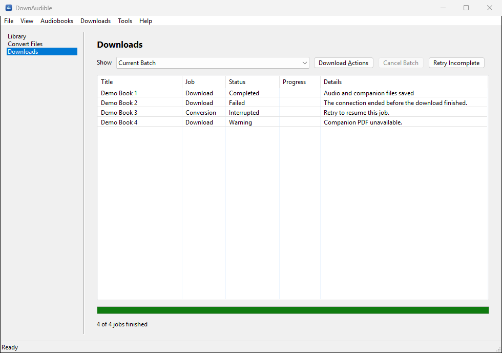
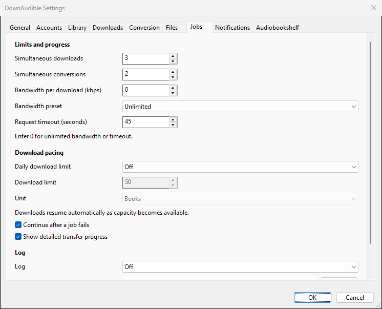
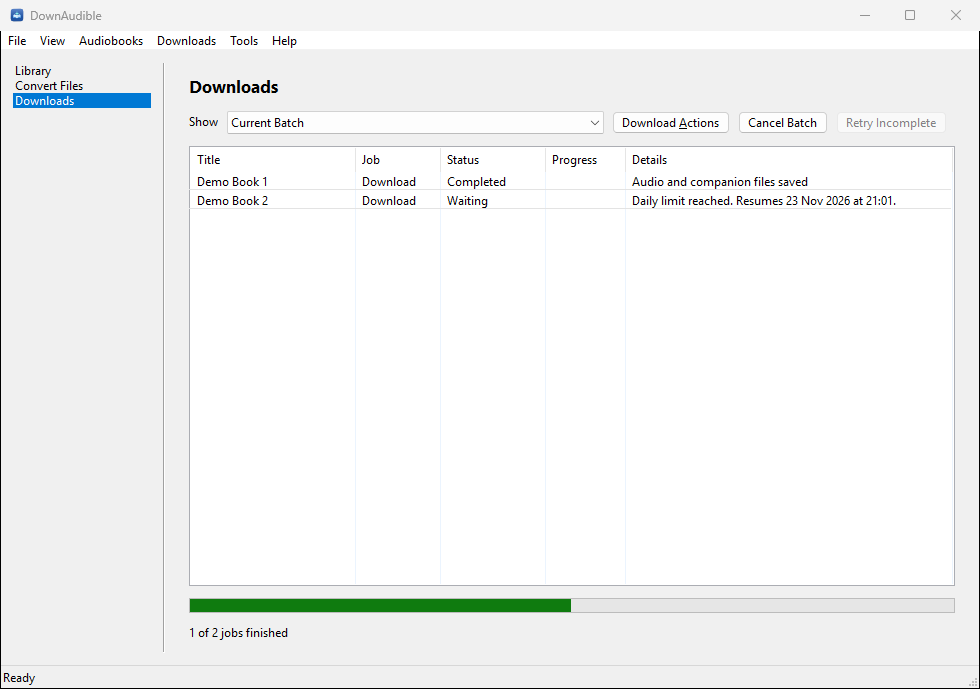
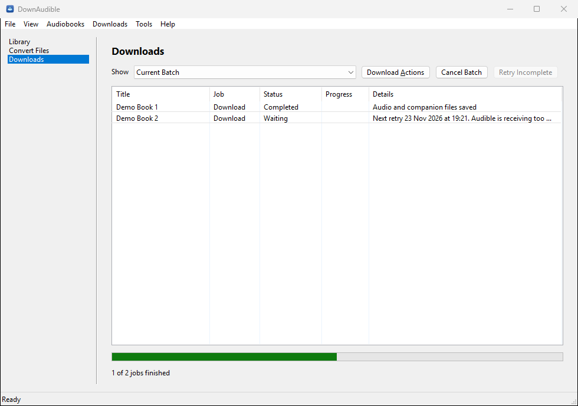
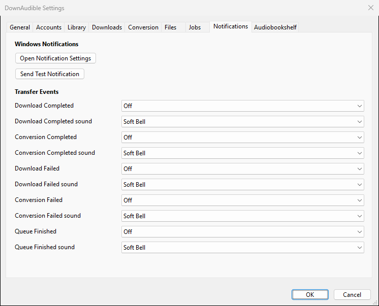

# Downloads and Recovery

## Follow the current batch

Choose **Downloads** from the sidebar or press **Ctrl+2**. Each row names the title, job type, status, progress and details. **Cancel Batch** stops pending work and asks running jobs to stop. **Retry Incomplete** queues unfinished jobs again. A warning can appear when a job saves audio but fails to save a companion file.

## Work with selected jobs

Open **Download Actions**, or press Shift+F10 with the transfers list focused to open its contextual menu.

| Command | What it does |
| --- | --- |
| **Cancel Selected Transfers** | Requests cancellation of the selected waiting or running jobs. |
| **Retry Selected Transfers** | Resumes incomplete jobs where possible and retries a failed player launch from the saved audio. |
| **Retry with Activation Bytes…** | Retries selected AAX conversions or edits with the entered activation bytes. Leave the field blank to use each job’s saved Audible account. |
| **Restart Selected Downloads…** | Removes saved partial audio and starts the selected downloads that have partial audio again. |
| **Show Output in File Explorer** | Reveals the available files saved by the selected jobs. |
| **Open in Player** | Opens saved audio in the Windows application associated with the file type. |
| **Show Partial Files** | Opens the folders containing the selected incomplete downloads. |
| **Copy Errors** | Copies the selected errors and warnings as text. |
| **Clear Completed** | Removes successful rows from the batch you’re viewing. |
| **Remove from List** | Removes selected rows when the list is idle. Saved files stay on disk. |

## Add more titles to a running batch

In **Library**, select more books from the account that started the downloads. Choose **Audiobooks > Download > Add Selected to Queue…** or **Add Visible Results to Queue…** and confirm the count. The added jobs use the batch’s destination and options. Each title appears once in the batch.

## Earlier batches and quitting

Use **Show** to switch between the current batch and up to ten recent batches. You can reveal the files or copy an error from an earlier batch. After the current batch finishes, retry jobs in an earlier batch with their saved settings, clear successful rows, or remove selected jobs. Removing the last job removes the earlier batch from **Show**.

If a batch is running when you close the app, choose **Keep DownAudible Open** to let it finish or **Exit and Save Progress** to stop work and keep your place. When you reopen the app, choose **Retry Incomplete**. DownAudible resumes matching partial downloads and starts incomplete conversions again.

## Limits, feedback and logs

In **File > Settings… > Jobs**, set the number of simultaneous downloads and conversions. **Bandwidth per download** applies to each download. Set it to zero for unlimited bandwidth. **Request timeout** is in seconds. Use zero to turn it off. Turn off **Continue after a job fails** to stop starting further jobs after a failure.

Under **Download pacing**, set **Daily download limit** to **All titles** or **Audible Plus only**. The Plus setting applies to titles Audible identifies as part of Plus. Set **Download limit** and **Unit** to count books, MB, or GB within the last 24 hours. **Off** is the default.

At the limit, new audio downloads wait and the queue shows when they can resume. They resume automatically while DownAudible is open. Use **Retry Incomplete** after reopening the app. Downloads already receiving audio can finish, so the data used can go over the amount you chose. Companion-only downloads and local conversions can continue. The data limit counts newly received audio from successful requests, including the new bytes in a resumed download. Audio already saved locally is excluded.

If Audible explicitly reports too many requests, a throttled licence, or temporary service unavailability, DownAudible pauses requests for that profile. The affected row shows **Next retry** with a time. DownAudible tries each affected job again once while open. After another refusal, review the failure in **Downloads** and use **Retry Incomplete** when ready. Account authorization and entitlement failures show the reason and wait for you to resolve it.

In **Notifications**, choose the delivery and sound for each transfer event. **Send Test Notification** posts a sample notice. **Open Notification Settings** opens the Windows controls for banners and Notification Center. Select **Custom Sound**, then **Choose Audio…** to use your own sound. DownAudible groups completed and failed jobs at the end of each batch. Clicking a transfer notification opens its batch.

In **Jobs**, set **Log** to **Errors only** to record warnings and failures, or **Transfer results** to include successful transfers. Choose a regular file in an existing folder for a custom log. **Use Default Location** returns the log to DownAudible’s per-user data folder.

- [Audiobookshelf](help-14-audiobookshelf.md) covers the separate queue for sending saved books to your server.
- [Downloading Books](help-04-downloads.md)
- [Troubleshooting](help-09-troubleshooting.md)
- [Keyboard Shortcuts](help-10-keyboard-shortcuts.md)

## Support DownAudible

If you like DownAudible and you’d like to support my work, you can [make a donation](https://www.paypal.com/donate/?hosted_button_id=WMLX4PLED9PRE). There’s no pressure or hard sell. DownAudible is and always will be free.
