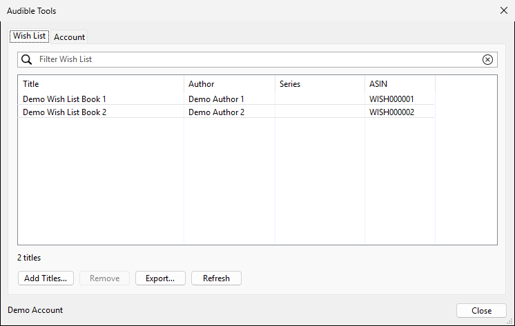
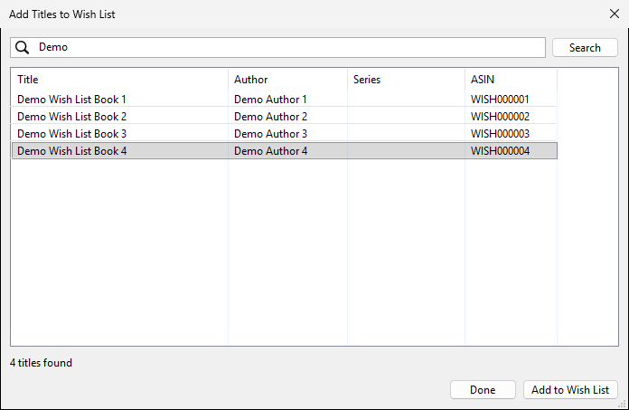
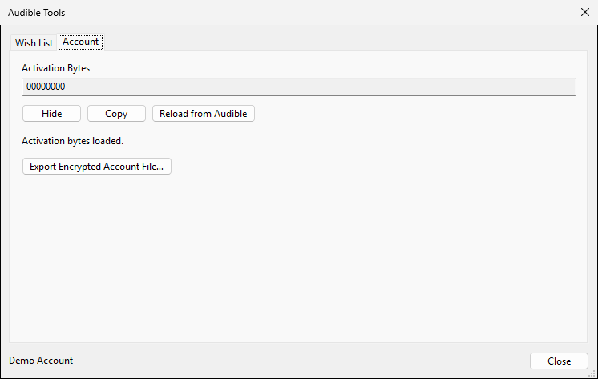
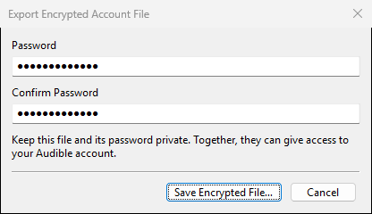
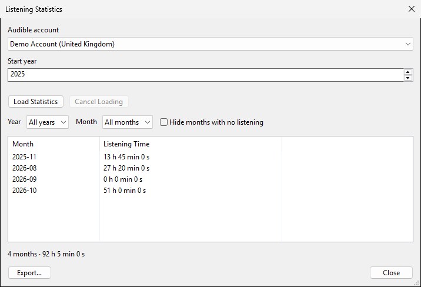
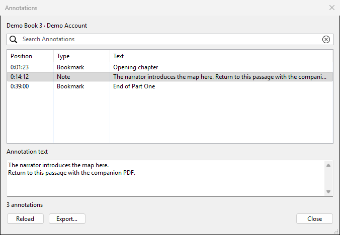
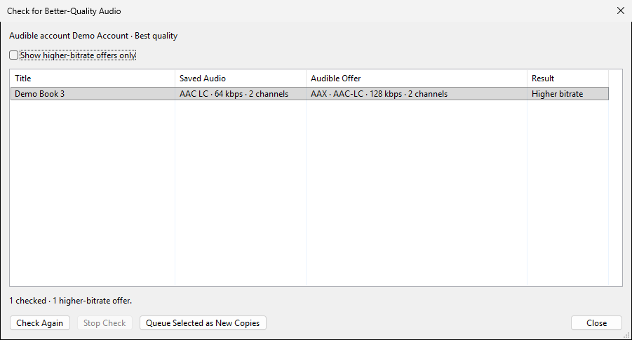

# Audible Tools

## Wish list

Choose **Tools > Audible Tools…** and open **Wish List**, or choose **Tools > Wish List…** directly. Use **Filter Wish List** to search saved titles by title, author, series, or ASIN. Select one or more titles and choose **Remove** to take them off your list. Choose **Export…** to save the full wish list as JSON, CSV, TSV, or an Excel workbook (`.xlsx`).

Choose **Add Titles…** to search the Audible catalogue. Enter a title or its ASIN and choose **Search**. The results omit titles already on the wish list. Select the results you want and choose **Add to Wish List**. The Wish List refreshes once the titles are added. If Audible rejects any titles, the search stays open and shows the error.

## Activation bytes

Open the **Account** tab in **Audible Tools**. Choose **Show** to request and display the eight-character activation code. Use **Copy** to send it to the clipboard for another player or converter. Choose **Hide** to mask the code, or **Reload from Audible** to request it again.

If Audible cannot supply the activation code, choose **AAX with fallback** or **AAXC** under **Settings > Downloads** to use an Audible per-title licence for downloads when available.

## Export a saved account

In the **Account** tab, choose **Export Encrypted Account File…**. Enter and confirm a password, select **Save Encrypted File…**, and choose the destination. Keep the exported file and its password somewhere private. Import the file in Audible CLI or another copy of DownAudible when you need the saved session there.

## Listening statistics

Choose **Tools > Listening Statistics…**. Select an **Audible account**, enter a **Start year**, then choose **Load Statistics**. The table shows the listening time Audible reports for each month in that account’s marketplace. Use **Cancel Loading** to stop a request.

Use **Year**, **Month**, and **Hide months with no listening** to narrow the table. The total below the table reflects the months shown. Choose **Export…** to save those months as JSON, CSV, TSV, or an Excel workbook (`.xlsx`).

## Browse bookmarks and notes

Select one title in the Library and choose **View Annotations…** from its context menu or from **Audiobooks > Selected Books**. DownAudible requests the title’s saved bookmarks and notes from its Audible account. Entries appear by playback position when Audible provides one.

Type in **Search Annotations** to narrow the list. Press Control+F to focus the search field. Select a row to read the complete entry in **Annotation text**. Choose **Reload** to fetch the current annotations, or **Export…** to save the entries shown as Markdown or CSV.

## Check for higher-bitrate audio

Choose **Tools > Check for Better-Quality Audio…** and select an account if prompted. Choose **Check Audio** to compare saved files with the current Audible offer for your download settings at **Best** quality. The report checks the offers before you choose whether to download new copies. Choose **Stop Check** to stop the scan and keep the finished rows.

Turn on **Show higher-bitrate offers only** to narrow the results. A bitrate marked **about** is an estimate from the offer’s file size and duration. Use **Check This Title…** from a book’s context menu to see individual sources and refusal details. [Troubleshooting](help-09-troubleshooting.md#check-a-title)

Select the offers you want and choose **Queue Selected as New Copies**. Your saved audio stays in place while DownAudible downloads the new copies.

## Keyboard shortcuts

| Command | Shortcut |
| --- | --- |
| Find in Wish List | Control+F |
| Refresh Wish List | Control+Shift+R |
| Add Titles or Add to Wish List | Control+Shift+A |
| Search in Add Titles | Control+Shift+F or Enter |
| Remove selected wish list titles | Control+Shift+Delete |
| Export Wish List as JSON | Control+Shift+J |
| Export Wish List as CSV | Control+Shift+G |
| Export Wish List as TSV | Control+Shift+T |
| Show or hide activation bytes | Control+Shift+H |
| Copy activation bytes | Control+Shift+C |
| Reload activation bytes | Control+Shift+L |
| Export Encrypted Account File | Control+Shift+E |

[Accounts and Sign-In](help-02-accounts.md) · [Downloading Books](help-04-downloads.md)

## Support DownAudible

If you like DownAudible and you’d like to support my work, you can [make a donation](https://www.paypal.com/donate/?hosted_button_id=WMLX4PLED9PRE). There’s no pressure or hard sell. DownAudible is and always will be free.
