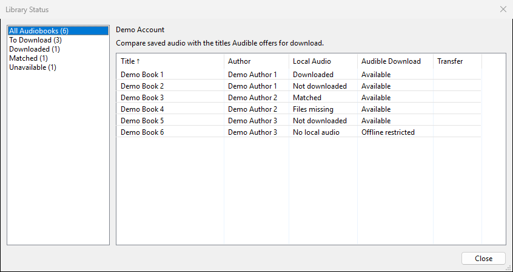
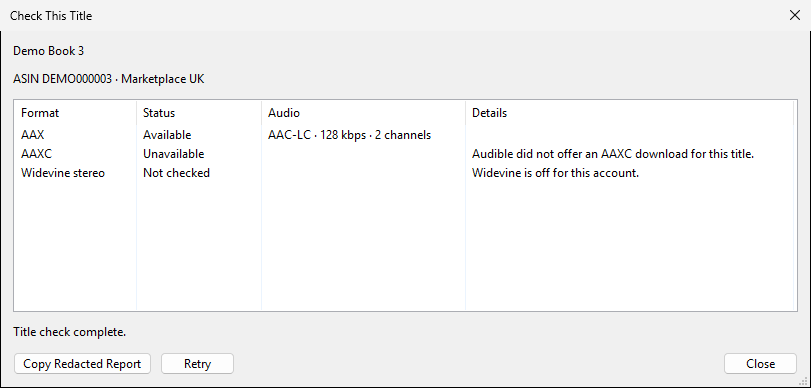
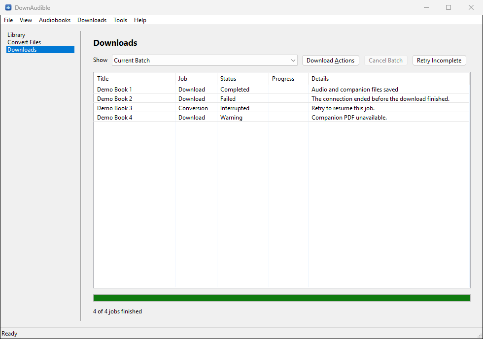

# Troubleshooting

## Sign-in or account trouble

Check that the selected marketplace matches your Audible account. For browser sign-in, open the sign-in page, complete the prompts in your browser and paste the final address into **Browser address**. Keep that address private. Try **Import Account…** if you have an existing account file. See [Accounts and Sign-In](help-02-accounts.md).

## A book is unavailable

Open **View > Library Status…** and select **Unavailable** to inspect affected titles. Refresh the library after changing accounts or modifying your Audible library. The selected account and Audible’s current availability determine which audio files can be requested.

## Check a title

Open a book’s context menu in **Library** and choose **Check This Title…** to review AAX, AAXC, and Widevine stereo offers for its Audible account. The report shows the codec, bitrate, and channels when Audible supplies them. If DownAudible reports a refusal, check the title’s availability for the selected account. An offer marked **Not checked** shows the reason, such as Widevine being off for that account.

Choose **Copy Redacted Report** to copy the book’s ASIN, marketplace, and offer details for troubleshooting. Use **Retry** to check again after changing the account’s settings or after a temporary Audible limit clears.

## A local file cannot be converted

Check that the file is a supported AA, AAX, AAXC, M4A, M4B, or MP3 file. AAX may need the activation value of the account that downloaded it. For AAXC, keep the original account available when converting a title associated with the Audible library. Try an automatic bitrate and matching source channels and sample rate if the encoding settings are incompatible.

## Files are missing or a drive is disconnected

Reconnect the drive before retrying a transfer. In **Settings > Files**, check the selected archive destination. A complete copy at another location can be matched through **Audiobooks > Match Existing Folder…**. Choose **Verify and Repair Archive…** to see which saved copies and matched files need attention.

## A download repeatedly fails

In **Downloads**, select the failed job and choose **Copy Errors** for the details. If the job has partial audio, **Show Partial Files** opens its staging folder. Try **Retry Selected Transfers** first. To discard saved partial audio, choose **Restart Selected Downloads…**.

## The transfer queue could not be restored

If DownAudible opens with **Could Not Restore Transfer Queue**, the message gives the location of the previous queue file. Use **Verify and Repair Archive…** to check saved audio. **Download Missing** checks for titles without a complete saved or matched copy and can resume partial downloads.

## Audio does not open in the player

Check the saved format and Windows default app for that file extension. Use **Show Output in File Explorer** to find the file and try opening it directly. You can queue a local conversion to M4B, M4A or MP3 if your current player does not accept the original.

## The window or sidebar is missing

Open DownAudible from Start if the app is closed. Choose **View > Show Sidebar** or use **Ctrl+1**, **Ctrl+2**, and **Ctrl+3** to open the main workspaces.

[See all keyboard shortcuts](help-10-keyboard-shortcuts.md)

## Support DownAudible

If you like DownAudible and you’d like to support my work, you can [make a donation](https://www.paypal.com/donate/?hosted_button_id=WMLX4PLED9PRE). There’s no pressure or hard sell. DownAudible is and always will be free.
