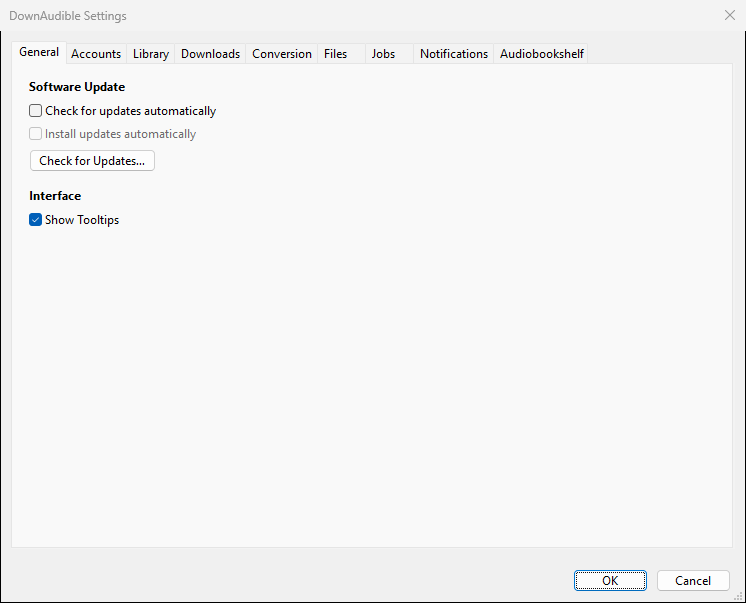
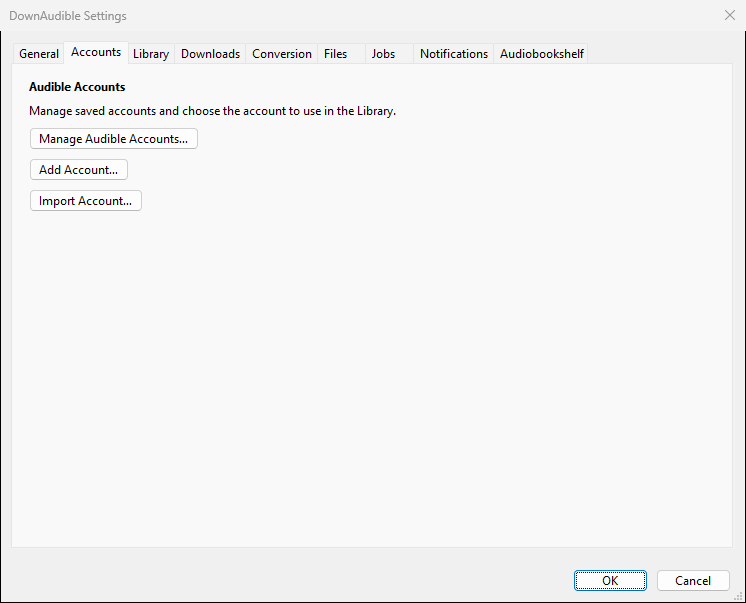
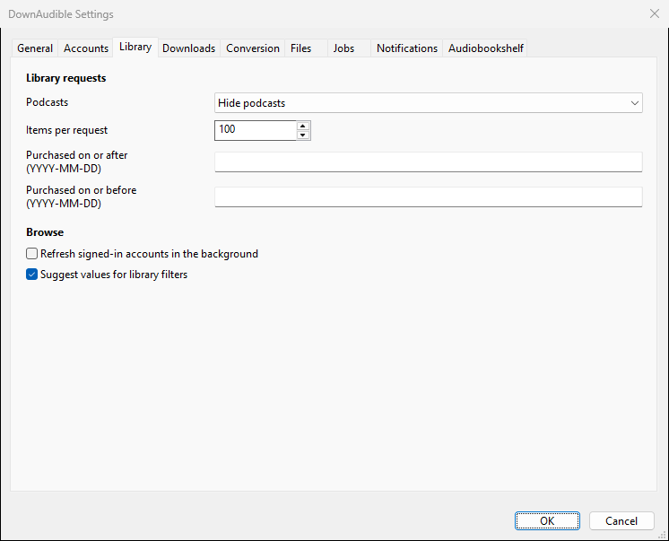
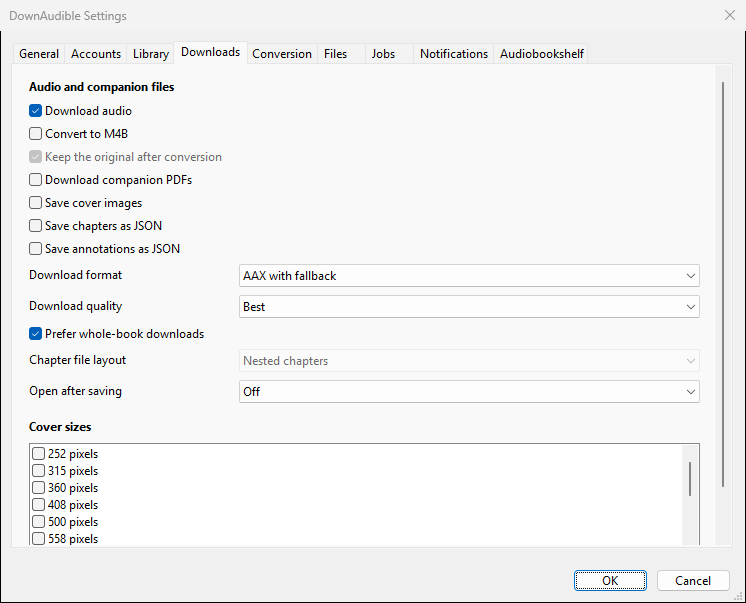
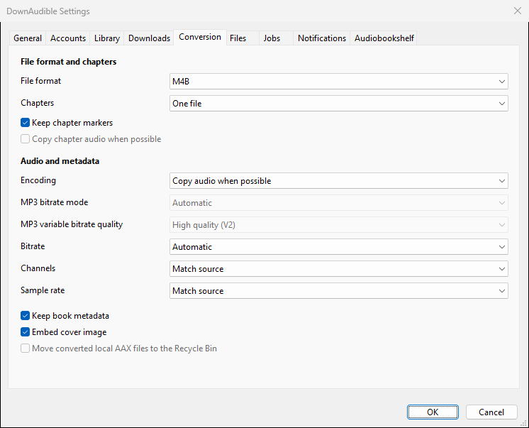
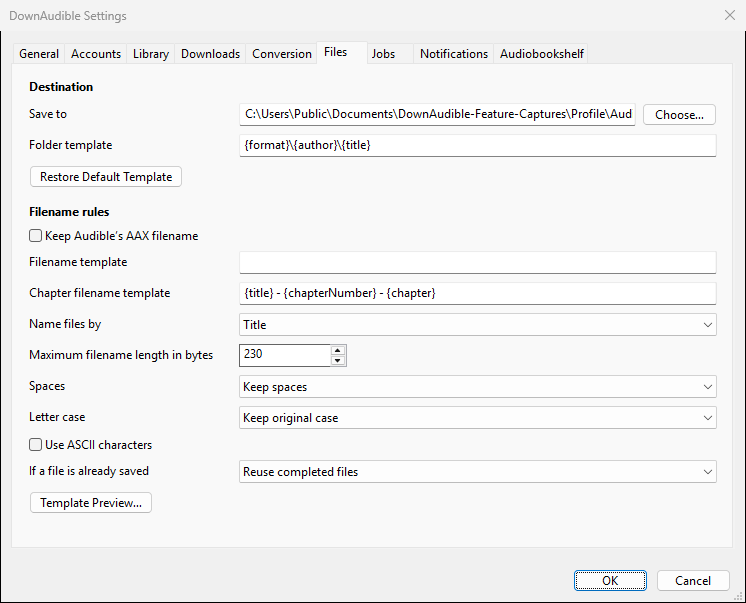

# Settings Reference

Choose **File > Settings…** or press **Ctrl+Comma**. **Help > Set Up DownAudible…** opens the setup assistant with the same settings pages. Choose **OK** to apply changes.

## General

**Check for updates automatically** checks for newer Windows releases. **Install updates automatically** downloads a verified update and installs it when you exit with the transfer queue idle. Installation through the app requires an installed copy configured with a trusted Windows publisher. **Check for Updates…** runs the check immediately. **Show Tooltips** displays short descriptions when you point to supported controls.

## Accounts

**Manage Audible Accounts…** opens the saved account list. **Add Account…** offers **Web Browser**, **Enter Credentials**, and **Android Browser (Advanced)**. **Import Account…** imports an Audible CLI profile, a saved auth file, or an OpenAudible credentials file. See [Accounts and Sign-In](help-02-accounts.md).

For optional Widevine downloads and Android registration, see [Widevine Stereo](help-13-widevine.md).

## Library

**Podcasts** can hide podcasts, show series, or load individual episodes. **Items per request** sets the request page size from 10 to 1,000. Enter purchase dates in **YYYY-MM-DD** form. The range includes both days in your local time. Leave either field blank to omit that limit. Choose an end date on or after the start date.

Choose **OK**, then **Refresh Library** or press **Ctrl+R** to load books with the new settings. **Suggest values for library filters** uses metadata in the current library.

**Refresh signed-in accounts in the background** checks for library changes every 30 minutes while DownAudible is open. It is off by default. Use **Audiobooks > Library Changes…** to review the last successful changes.

## Downloads

Use **Download audio**, **Convert to M4B** or the selected conversion format, **Keep the original after conversion**, and the companion file switches to choose what to save. **Download format**, **Download quality**, and **Prefer whole-book downloads** control what the helper requests. **Chapter file layout** applies to saved chapter JSON. **Cover sizes** controls separate artwork. **Open after saving** can open original or converted audio using the Windows app associated with its file format.

**AAX with fallback** is the default download format. It tries AAX and requests AAXC if needed. For profiles with [Widevine Stereo](help-13-widevine.md) enabled, DownAudible asks for that format first.

## Conversion

**File format** chooses M4B, M4A or MP3. **Chapters** chooses one file or a file per chapter. **Keep chapter markers** applies to a single output file. **Encoding** sets whether compatible audio can be reused. **Copy chapter audio when possible** applies to compatible sources and automatic audio parameters.

**MP3 bitrate mode** controls constant or variable bitrate. Select a **Bitrate**, **Channels**, or **Sample rate** when a player calls for specific settings. If the bitrate is too high for the sample rate, choose a lower bitrate or a higher sample rate before saving. **Keep book metadata** and **Embed cover image** include available tags and artwork. **Move converted local AAX files to the Recycle Bin** applies when the local MP3 export supports it.

## Files

**Save to** selects the archive folder. Separate folders in **Folder template** with a backslash (`\`). **Restore Default Template** restores `{format}\{author}\{title}`. Use **Template Preview…** to see an example. For tokens used by **Folder template**, **Filename template**, and **Chapter filename template**, see [Naming and Folders](help-06-files.md). **Name files by**, **Maximum filename length**, **Spaces**, **Letter case**, and **Use ASCII characters** adjust filenames.

**Keep Audible’s AAX filename** preserves it when valid. **If a file is already saved** controls whether the app reuses a completed result or creates another copy.

## Jobs

**Simultaneous downloads** and **Simultaneous conversions** set work limits. Enter 0 in **Bandwidth per download (kbps)** for unlimited bandwidth, or in **Request timeout (seconds)** to disable the timeout. **Continue after a job fails** controls whether the remaining jobs start. **Show detailed transfer progress** shows or hides progress details. **Log**, **Log file**, and **Use Default Location** control the transfer log.

**Daily download limit** is off by default. Set a limit for all titles or for titles Audible identifies as Plus, then choose a quantity in books, MB, or GB. The limit uses the last 24 hours and resumes waiting downloads as capacity returns. See [Downloads and Recovery](help-07-transfers.md#limits-feedback-and-logs).

## Notifications

**Open Notification Settings** opens Windows notification settings. **Send Test Notification** posts a sample. For each transfer event, choose a delivery mode and sound. **Queue Finished** supports a sound. To use your own sound for an event, select **Custom Sound**, then **Choose Audio…**. DownAudible accepts WAV, AIFF, M4A, MP3, AAC and FLAC and keeps a copy. Selecting a sound plays a preview.

[Downloads and Recovery](help-07-transfers.md)

## Audiobookshelf

Set a server, book library, and folder, then choose whether to upload new saved books automatically and include companion PDFs. See [Audiobookshelf](help-14-audiobookshelf.md) for connection, upload and recovery steps.

## Support DownAudible

If you like DownAudible and you’d like to support my work, you can [make a donation](https://www.paypal.com/donate/?hosted_button_id=WMLX4PLED9PRE). There’s no pressure or hard sell. DownAudible is and always will be free.
