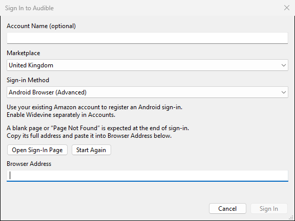
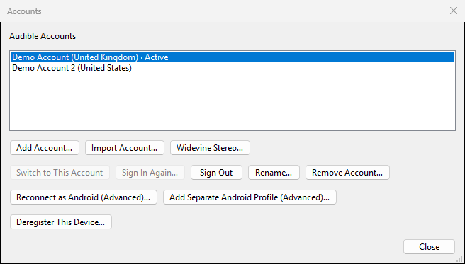
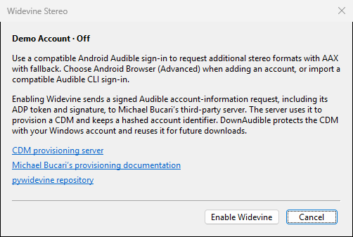
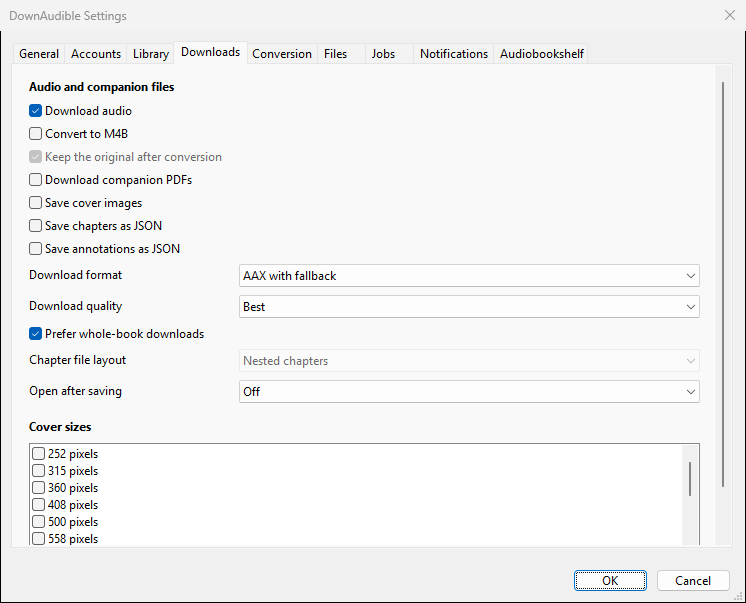

# Widevine Stereo

## When to use Widevine

Widevine is one way Audible delivers protected audio. Some titles have a different stereo version through Widevine, sometimes at a higher bitrate than the AAX or AAXC download. The available quality depends on the title, marketplace and your account’s download rights.

Widevine is off by default. Leave it off if your usual downloads meet your needs. To try the additional stereo source, connect a compatible Android Audible sign-in and enable Widevine for that profile.

## Prepare an Android sign-in

For a new profile, choose **Tools > Audible Accounts… > Add Account…**, select your Audible marketplace, and set **Sign-in Method** to **Android Browser (Advanced)**. Choose **Open Sign-In Page** and complete the sign-in in your computer’s browser with your existing Amazon account. Copy the full address of the final page into **Browser Address** and choose **Sign In**. The final page may be blank or say “Page Not Found”. Keep its address private. You can also [import a compatible Android sign-in from Audible CLI](help-02-accounts.md#import-an-account).

For an existing profile, finish any active transfer batch and select the profile in **Audible Accounts…**. If you are signed out, choose **Sign In Again…** first.

| Action | What it does |
| --- | --- |
| **Reconnect as Android (Advanced)…** | Updates the selected profile’s sign-in. Your file matches and download history stay with the profile. |
| **Add Separate Android Profile (Advanced)…** | Creates a separate DownAudible profile for the same Audible account and marketplace. It starts with its own sign-in and empty file matches and download history. You can still use the source profile. |

Both actions verify that you signed in to the same Audible account before saving. If the browser uses a different account, choose **Start Again** and sign in to the account used by the source profile.

## Enable Widevine and review what is shared

Select the profile in **Tools > Audible Accounts…** and choose **Widevine Stereo…**. Read the provider information, then choose **Enable Widevine** for that profile.

If a compatible content decryption module (CDM) is unavailable locally, DownAudible sends a signed Audible account-information request with its ADP token and signature to Michael Bucari’s provisioning server. The server uses it to issue a CDM and retains a hashed account identifier. DownAudible encrypts the CDM for your Windows account and reuses it for the same Audible account, including when you reconnect as Android or create a verified separate profile. Widevine stays off on those profiles until you enable it.

[CDM provisioning server](https://ollj0gz40d.execute-api.us-west-2.amazonaws.com/default/AudibleCdm) · [Provider documentation](https://github.com/mkb79/audible-cli/issues/155#issuecomment-2788239962) · [Data retained by the provider](https://github.com/mkb79/audible-cli/issues/155#issuecomment-2788472372) · [pywidevine repository](https://github.com/devine-dl/pywidevine)

## Request Widevine audio

In **Settings > Downloads** or **Download As…**, set **Download format** to **AAX with fallback**. With Widevine enabled, DownAudible requests it before trying AAX. When Audible reports that the format is unavailable, DownAudible tries the usual AAX and AAXC formats. Choose **Best**, **High**, or **Normal** for **Download quality** as usual.

To try Widevine for a book DownAudible already downloaded, go to **Settings > Files**, set **If a file is already saved** to **Save another copy**, and download the title again. If the book is linked to local audio, first choose **Remove File Match** in Library. The local audio stays on disk.

## Turn off Widevine

Select the profile, reopen **Widevine Stereo…**, and choose **Turn Off Widevine**. This keeps the sign-in and its cached CDM. Signing out or removing the profile clears its cached copy.

If the provider cannot issue a CDM, try **Enable Widevine** again later. If a title fails to download, check that Audible still allows your account to download it. If the title is available, you can turn Widevine off and retry with **AAX with fallback**.

[Accounts and Sign-In](help-02-accounts.md) · [Downloading Books](help-04-downloads.md)

## Support DownAudible

If you like DownAudible and you’d like to support my work, you can [make a donation](https://www.paypal.com/donate/?hosted_button_id=WMLX4PLED9PRE). There’s no pressure or hard sell. DownAudible is and always will be free.
