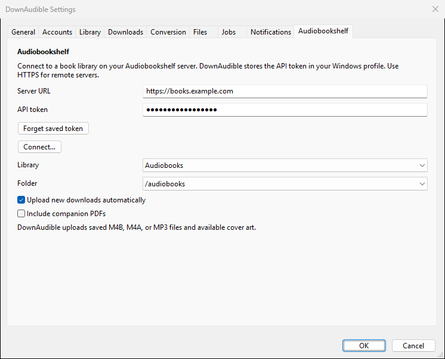
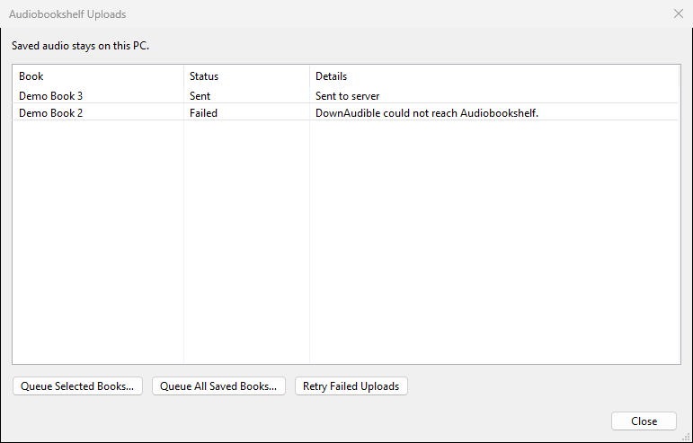

# Audiobookshelf

DownAudible can upload playable audiobooks to your Audiobookshelf server. You can send saved books yourself or turn on automatic uploads for new downloads. DownAudible keeps the local files.

## Connect to your server

1. Open **File > Settings… > Audiobookshelf**.
2. Enter the **Server URL** and an **API token** for a user who can access the destination library and upload files. Use HTTPS for a remote server.
3. Choose **Connect…**, select a book **Library** and **Folder**, and choose **OK** to save.

See the [Audiobookshelf API keys guide](https://audiobookshelf.org/docs/documentation/server-management/api-keys/) for help creating a key, or ask your server administrator for one. DownAudible protects the token in your Windows profile. To remove it from this PC, choose **Forget saved token** and save settings.

## Upload saved books

1. In **Library**, select the books to send, or leave the whole library available for a bulk upload.
2. Choose **Tools > Audiobookshelf Uploads…**.
3. Choose **Queue Selected Books…** or **Queue All Saved Books…** and confirm. DownAudible looks for complete playable audio in your archive and matched files.

DownAudible uploads M4B, M4A or MP3 audio and available saved cover art. Turn on **Include companion PDFs** in Settings to include saved PDFs.

## Upload new downloads automatically

After connecting to a library and folder, turn on **Upload new downloads automatically** in **Settings > Audiobookshelf**. When a download saves playable audio, DownAudible queues the upload. If the original requires conversion, turn on conversion in **Settings > Downloads** or **Download As…** and choose M4B, M4A or MP3.

## Check or retry uploads

Open **Tools > Audiobookshelf Uploads…** to check **Status** and **Details**. **Sent** means the server accepted the files. The book appears after Audiobookshelf scans the destination. **Already in library** means DownAudible found the book on the server and skipped the upload.

To retry, select failed rows and choose **Retry Failed Uploads**. With no rows selected, this retries all failed uploads for the current destination. Pending uploads stay tied to their original server, library and folder. Select that destination again in **Settings > Audiobookshelf** to resume them.

[Library and File Matching](help-03-library.md) · [Downloading Books](help-04-downloads.md) · [Downloads and Recovery](help-07-transfers.md)

## Support DownAudible

If you like DownAudible and you’d like to support my work, you can [make a donation](https://www.paypal.com/donate/?hosted_button_id=WMLX4PLED9PRE). There’s no pressure or hard sell. DownAudible is and always will be free.
