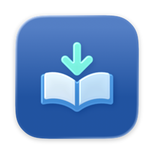

# DownAudible for Windows

After several requests, I decided to build a Windows version of DownAudible. It follows the Mac app’s workflows for backing up your Audible library and converting audiobooks. It aims for full parity with the MacOS version. I chose dedicated apps for each platform because platform-native apps and technologies mean the highest possible performance and more importantly the best accessibility, particularly for screenreader users. That, and I'd already written the MacOS version in Swift.

See the [Project README](../README.md#features) for the feature list, applicable to both platforms.

## Install or run from a ZIP

| Windows PC | Latest installer | Latest portable ZIP |
| --- | --- | --- |
| ARM64 | [Download ARM64 installer](https://github.com/ashleycox/DownAudible/releases/latest/download/DownAudible-Windows-ARM64-Installer.exe) | [Download ARM64 ZIP](https://github.com/ashleycox/DownAudible/releases/latest/download/DownAudible-Windows-ARM64-Portable.zip) |
| x64 (Intel or AMD) | [Download x64 installer](https://github.com/ashleycox/DownAudible/releases/latest/download/DownAudible-Windows-x64-Installer.exe) | [Download x64 ZIP](https://github.com/ashleycox/DownAudible/releases/latest/download/DownAudible-Windows-x64-Portable.zip) |

Choose **ARM64** for a Windows on Arm PC or VM, such as a pc running on a Qualcomm Snapdragon processor, or a virtual machine running on Apple SIlicon under [UTM](https://github.com/utmapp/UTM). Choose **x64** for a 64-bit Intel or AMD PC. Windows 11 on Arm can also run the x64 build through emulation, so if you are unsure which build you require please use the X64 build. Check **Settings > System > About > System type** to learn out which architecture your system uses.

Press **F1** or choose **Help > DownAudible Help** to open the illustrated manual offline. You can also read the [Windows manual](Manual/README.md) and [keyboard shortcuts](Manual/help-10-keyboard-shortcuts.md) here.

## Signing and updates

The Windows packages are currently unsigned. Windows SmartScreen may show a warning, and some security policies may block them. Providing you obtained DownAudible from the official source, that being its [Github Repository](https://github.com/ashleycox/downaudible), do not worry. DownAudible does not, and never will, contain maliscious code, and you are free to inspect the source to verify this.

DownAudible can check for updates automatically if enabled, or you can choose **Help > Check for Updates…**. When an update is available, choose **Open Release Page** to download and install it manually. In-app installation requires an installed copy configured with a trusted Authenticode publisher, so is unfortunately not available for the Windows release at present.

## Development

The Windows version uses wxPython for its desktop interface. It shares the Python Audible helper and the pinned FFmpeg and LAME sources with the Mac app. See the [build guide](BUILD.md) for instructions on building under Windows, and cross-building on an Apple silicon Mac, running tests and capturing the manual screenshots.

I welcome code contributions. For guidance, see [/CONTRIBUTING.md](../CONTRIBUTING.md)

## Support DownAudible

If you like DownAudible and you’d like to support my work, you can [make a donation](https://www.paypal.com/donate/?hosted_button_id=WMLX4PLED9PRE). There’s no pressure or hard sell. DownAudible is and always will be free.
